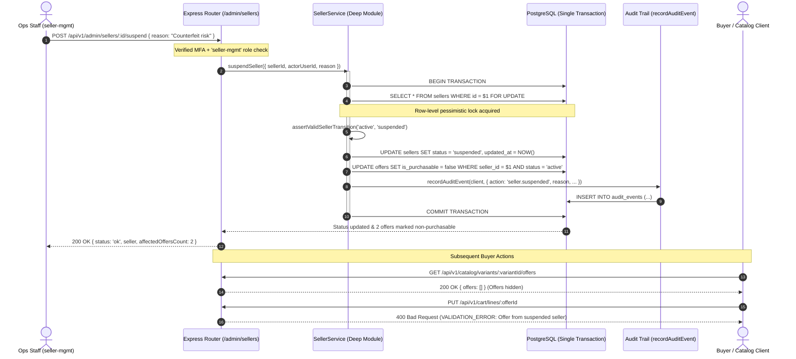

# Chapter 07: Seller Suspension & Reinstatement

## 1. The Goal & Big Picture

### What We Are Building

In this chapter, we implement **Seller Suspension & Reinstatement** alongside **Transactional Offer Deactivation**. In an Iranian physical-goods marketplace modelled after Digikala, third-party merchants operate under ongoing regulatory scrutiny, product authenticity rules, and operational SLAs. When a merchant exhibits critical non-compliance—such as distributing counterfeit products (_کالای غیر اصل یا قاچاق_), violating pricing or tax statutes (_گران‌فروشی و عدم صدور فاکتور_), or incurring severe buyer fulfillment defaults (_عدم تأمین و ارسال کالا_)—operational staff must possess the capability to halt merchant activities instantly.

Suspension cannot merely flip a status flag on a dashboard. To protect consumers and the platform from financial and legal liability:

1. **Immediate State Transition:** An operational user with the `seller-mgmt` role transitions an `active` seller to `suspended` via `POST /api/v1/admin/sellers/:id/suspend`.
2. **Mandatory Administrative Justification:** A suspension requires a non-empty `reason` field in the request payload. Arbitrary, undocumented merchant suspensions are rejected at the API seam.
3. **Atomic Offer Non-Purchasability:** In the **exact same database transaction** that updates the seller status, all active offers belonging to that seller are marked non-purchasable (`is_purchasable = false`). If either operation fails, the transaction rolls back completely.
4. **Public Catalog & Cart Suppression:** Suspended sellers' offers immediately disappear from public unauthenticated catalog listings (`GET /api/v1/catalog/variants/:variantId/offers`) and cannot be added to a buyer's shopping cart (`PUT /api/v1/cart/lines/:offerId`).
5. **Reinstatement Lifecycle:** When an authorized user resolves the merchant investigation or receives satisfactory proof of compliance, `POST /api/v1/admin/sellers/:id/reinstate` restores the merchant to `active` and atomically restores active offers to purchasable status (`is_purchasable = true`).
6. **Append-Only Audit Forensics:** Both suspension and reinstatement produce immutable entries in `audit_events`, capturing the operator ID, state diffs (`previousValue` and `newValue`), and mandatory operational justification.

```
+---------------------------------------------------------------------------------------------------------------+
|                                      Merchant Governance State Machine                                        |
+---------------------------------------------------------------------------------------------------------------+

                  +------------------+           +------------------+           +------------------+
                  |  pending-review  | --------> |   under-review   | --------> |     rejected     |
                  +------------------+           +------------------+           +------------------+
                                                           |
                                                           | (Initial Approval)
                                                           v
                                                 +------------------+
                        +----------------------> |      active      | <---------------------+
                        |                        +------------------+                       |
                        |                                  |                                |
                        | (POST /sellers/:id/reinstate)    | (POST /sellers/:id/suspend)    |
                        | Restores offers to purchasable   | Marks offers non-purchasable   |
                        |                                  v                                |
                        |                        +------------------+                       |
                        +----------------------- |    suspended     | ----------------------+
                                                 +------------------+
```

---

### Where It Fits

This slice bridges the **Seller Management** domain (introduced in Chapter 06) with the transactional boundaries of the **Catalog** and **Shopping Cart** systems. It ensures that merchant operational risk is contained at the database layer before consumer traffic interacts with seller offers:



---

### Prerequisites

This chapter builds directly upon:

- **Chapter 04 (Internal Role Middleware & RBAC):** Provides `requireRole('seller-mgmt')` and `createInternalAuthMiddleware` to guard administrative endpoints.
- **Chapter 05 (Audit Trail Shared Writer):** Provides `recordAuditEvent` and the statement-level immutable trigger on `audit_events`.
- **Chapter 06 (Seller Application & Review Lifecycle):** Establishes the `sellers` table, unique taxpayer ID constraint, and initial state machine (`pending-review` $\to$ `under-review` $\to$ `active` | `rejected`).

---

## 2. Architectural Deep Dive (The "Why")

### The Danger of Dual-Write Inconsistency & The Need for Database Atomicity

In distributed systems and microservices, an all-too-common pitfall is de-synchronizing entity lifecycles. Consider an architecture where suspending a merchant publishes an asynchronous message or makes two disconnected database queries:

```ts
// ❌ WRONG: Non-atomic dual writes
await db.query(`UPDATE sellers SET status = 'suspended' WHERE id = $1`, [sellerId]);
// What if node process crashes here? Or network times out?
await db.query(`UPDATE offers SET is_purchasable = false WHERE seller_id = $1`, [sellerId]);
```

If the secondary update fails, or if a message consumer is delayed by queue backlog, the merchant is labelled "suspended" in back-office dashboards, but their products remain purchasable on public customer storefronts. A fraudulent merchant could unload thousands of units of prohibited or counterfeit inventory during this latency window.

In our modular monolith design, we leverage PostgreSQL's native ACID transaction guarantees:

```ts
// ✅ CORRECT: Atomic transactional coupling in SellerService
return withTransaction(this.pool, async (client) => {
  // 1. Lock seller row
  const selectRes = await client.query('SELECT * FROM sellers WHERE id = $1 FOR UPDATE;', [sellerId]);

  // 2. Validate state machine
  assertValidSellerTransition(currentRow.status, 'suspended');

  // 3. Mutate seller status
  await client.query(`UPDATE sellers SET status = 'suspended', updated_at = NOW() WHERE id = $1`, [sellerId]);

  // 4. Atomically deactivate all active offers
  const offersRes = await client.query(
    `UPDATE offers SET is_purchasable = false, updated_at = NOW() WHERE seller_id = $1 AND status = 'active'`,
    [sellerId]
  );

  // 5. Write forensic audit entry
  await recordAuditEvent(client, { action: 'seller.suspended', ... });

  return { seller, affectedOffersCount: offersRes.rowCount };
});
```

Because all five steps occur within `withTransaction(this.pool, ...)`, either **every single step succeeds** or **the entire sequence rolls back**. There is zero possibility of an orphaned suspended seller with purchasable offers.

---

### Concurrency and Pessimistic Row Locking (`FOR UPDATE`)

When handling high-risk interventions, race conditions between administrative staff or automated risk systems must be completely prevented:

- Operational Staff A detects a copyright violation and clicks **Suspend**.
- Operational Staff B reviews an inventory dispute ticket and attempts a status update at the exact same second.

Without concurrency control, both transactions might read `status = 'active'`, compute status changes concurrently, and write interleaved, contradictory audit trails.

By executing `SELECT * FROM sellers WHERE id = $1 FOR UPDATE;`, PostgreSQL places an exclusive row-level lock on the merchant record. Any concurrent transaction attempting to read or mutate that specific seller must wait until the running transaction either commits or aborts. The state read by the business logic is guaranteed to be current and immutable for the duration of the transition.

---

### Protecting Offer Lifecycle: The Critical Distinction Between Deactivated and Suspended Offers

A naive implementation might write:

```sql
-- ❌ DANGEROUS REINSTATEMENT QUERY:
UPDATE offers SET is_purchasable = true WHERE seller_id = $1;
```

Why is this catastrophic in production?
In a live marketplace, a merchant may have 100 offers:

- 80 offers are active and in stock.
- 20 offers were previously deactivated by catalog managers because of copyright notices, out-of-stock flags, or discontinued stock (`status = 'deactivated'`, `is_purchasable = false`).

If an administrative user suspends the seller and subsequently reinstates them, a blanket update would accidentally turn all 20 discontinued offers back into purchasable items! Buyers would purchase items the seller cannot fulfill.

Our design avoids this trap by maintaining two orthogonal fields:

1. `status VARCHAR(50)`: The lifecycle state of the offer (`'active'`, `'deactivated'`, `'pending-inventory'`, `'held-for-review'`).
2. `is_purchasable BOOLEAN`: Whether the offer can currently be purchased.

When suspending:

```sql
UPDATE offers
SET is_purchasable = false, updated_at = NOW()
WHERE seller_id = $1 AND status = 'active';
```

When reinstating:

```sql
UPDATE offers
SET is_purchasable = true, updated_at = NOW()
WHERE seller_id = $1 AND status = 'active';
```

Only offers whose lifecycle status is `'active'` are affected. Offers that were manually deactivated or held for review remain untouched and non-purchasable.

---

### Mandatory Justification at the API Boundary

Arbitrary punitive actions without recorded justification violate corporate governance and Iranian consumer/commercial dispute standards. If a seller files a legal challenge or operational inquiry with the dispute resolution committee (_هیات حل اختلاف مارکت‌پلیس_), the audit trail must explain _why_ the merchant was barred.

We enforce this rule at the HTTP router boundary:

```ts
const { reason } = req.body ?? {};
if (typeof reason !== 'string' || !reason.trim()) {
  throw new ValidationError('علت تعلیق فروشنده الزامی است.', [
    { field: 'reason', message: 'علت تعلیق الزامی است.' },
  ]);
}
```

If an operator submits an empty string, whitespace, or omits the `reason` key, the API fails fast with HTTP 400 `VALIDATION_ERROR` before any database locks or queries are executed.

---

### Lessons from Code Review

During the development and testing cycle of this ticket, three key architectural nuances were codified:

1. **Test Hygiene on Immutable Tables:**
   In `beforeEach` test blocks, attempting `DELETE FROM audit_events` triggers PostgreSQL's statement-level trigger and crashes the test suite (`audit_events is append-only: DELETE operations are prohibited`). Tests must reset state by clearing parent entities (`sellers`, `offers`, `user_accounts`), never by attempting to truncate the append-only ledger.

2. **Down Migration Completeness:**
   Integration test suites like `tests/integration/audit-trail.test.ts` verify database health by executing a `down` migration with `count: 1` followed by an `up` migration. The down script in `migrations/1794911942200_seller-suspension-reinstatement.js` must safely drop `offers` and restore the check constraint to its 4-status state, ensuring idempotency.

3. **Error Status Code Standardization:**
   While some REST styles use HTTP 422 for unprocessable entity transitions, this repository standardizes on HTTP 400 with a structured machine-readable error code `INVALID_STATE_TRANSITION`. Maintaining this consistency prevents frontend client breakage across administrative dashboards.

---

## 3. File Map (Build Order)

Here is the checklist of files added or modified in this slice, ordered in logical build sequence:

- [ ] `migrations/1794911942200_seller-suspension-reinstatement.js` — Migration updating the seller status check constraint to include `'suspended'` and creating the relational `offers` table.
- [ ] `src/modules/seller/domain/status-machine.ts` — Updates domain status machine rules to support `suspended`, allowing transitions between `active` and `suspended`.
- [ ] `src/modules/seller/types.ts` — Type definitions for suspension/reinstatement parameters, results, offers, and public catalog offers.
- [ ] `src/modules/seller/service.ts` — Core transactional business logic for `suspendSeller`, `reinstateSeller`, `createOffer`, `getPublicOffersForVariant`, and `assertOfferPurchasableForCart`.
- [ ] `src/modules/seller/routes.ts` — Admin route handlers for `POST /api/v1/admin/sellers/:id/suspend` and `POST /api/v1/admin/sellers/:id/reinstate`.
- [ ] `src/app.ts` — Mounts public catalog query endpoint (`GET /api/v1/catalog/variants/:variantId/offers`) and cart item validation (`PUT /api/v1/cart/lines/:offerId`).
- [ ] `tests/unit/seller-suspension.test.ts` — Unit test suite verifying domain state machine transition guards.
- [ ] `tests/unit/seller-lifecycle.test.ts` — Updates lifecycle unit assertions to recognize `'suspended'` as a valid domain status.
- [ ] `tests/integration/seller-suspension.test.ts` — Integration tests validating service-level atomicity, offer mutability, and audit log entries.
- [ ] `tests/integration/seller-suspension-api.test.ts` — Supertest HTTP integration suite verifying RBAC guards, status codes, and the end-to-end suspension lifecycle.

---

## 4. Step-by-Step Implementation

### Step 1: Database Migration for Seller Status & Offers Table

#### Context & Purpose

We must update the check constraint `chk_sellers_status` on the `sellers` table to allow `'suspended'`. Additionally, we create the initial `offers` table referencing `sellers(id)` with indexes optimized for seller offer lookups and purchasability filtering.

#### Verified Code: `migrations/1794911942200_seller-suspension-reinstatement.js`

```javascript
/**
 * @type {import('node-pg-migrate').ColumnDefinitions | undefined}
 */
export const shorthands = undefined;

/**
 * @param pgm {import('node-pg-migrate').MigrationBuilder}
 * @returns {Promise<void> | void}
 */
export const up = (pgm) => {
  pgm.sql(`
    -- Update sellers status check constraint to include 'suspended'
    ALTER TABLE sellers DROP CONSTRAINT IF EXISTS chk_sellers_status;
    ALTER TABLE sellers ADD CONSTRAINT chk_sellers_status CHECK (status IN ('pending-review', 'under-review', 'active', 'rejected', 'suspended'));

    -- Create third-party seller offers table
    CREATE TABLE IF NOT EXISTS offers (
      id UUID PRIMARY KEY DEFAULT gen_random_uuid(),
      seller_id UUID NOT NULL REFERENCES sellers(id) ON DELETE CASCADE,
      variant_id UUID NOT NULL,
      price BIGINT NOT NULL DEFAULT 0,
      status VARCHAR(50) NOT NULL DEFAULT 'active',
      is_purchasable BOOLEAN NOT NULL DEFAULT true,
      created_at TIMESTAMPTZ NOT NULL DEFAULT NOW(),
      updated_at TIMESTAMPTZ NOT NULL DEFAULT NOW(),
      CONSTRAINT chk_offers_status CHECK (status IN ('active', 'deactivated', 'pending-inventory', 'held-for-review'))
    );

    CREATE INDEX IF NOT EXISTS idx_offers_seller_id ON offers(seller_id);
    CREATE INDEX IF NOT EXISTS idx_offers_variant_id ON offers(variant_id);
    CREATE INDEX IF NOT EXISTS idx_offers_status_purchasable ON offers(status, is_purchasable);
  `);
};

/**
 * @param pgm {import('node-pg-migrate').MigrationBuilder}
 * @returns {Promise<void> | void}
 */
export const down = (pgm) => {
  pgm.sql(`
    DROP TABLE IF EXISTS offers;

    ALTER TABLE sellers DROP CONSTRAINT IF EXISTS chk_sellers_status;
    ALTER TABLE sellers ADD CONSTRAINT chk_sellers_status CHECK (status IN ('pending-review', 'under-review', 'active', 'rejected'));
  `);
};
```

#### Code Walkthrough

- `ALTER TABLE sellers DROP CONSTRAINT ...`: Replaces the 4-status check constraint with a 5-status constraint allowing `'suspended'`.
- `seller_id UUID NOT NULL REFERENCES sellers(id) ON DELETE CASCADE`: Enforces foreign key referential integrity at the database level.
- `price BIGINT NOT NULL DEFAULT 0`: Stores monetary values as integers (Rials) to eliminate floating-point precision hazards.
- `idx_offers_status_purchasable`: Composite index on `(status, is_purchasable)` ensures catalog filtering queries run in $\mathcal{O}(\log N)$ time.
- `down(pgm)`: Restores original constraints and drops the table, allowing seamless rollback during automated testing.

---

### Step 2: Domain State Machine Updates

#### Context & Purpose

`src/modules/seller/domain/status-machine.ts` is the pure, deterministic heart of merchant status transitions. We update it to declare `'suspended'` and define the permitted transition edges: `active` $\to$ `suspended` and `suspended` $\to$ `active`.

#### Verified Code: `src/modules/seller/domain/status-machine.ts`

```typescript
import { InvalidStateTransitionError } from '../../../errors.js';

export const SELLER_STATUSES = [
  'pending-review',
  'under-review',
  'active',
  'rejected',
  'suspended',
] as const;

export type SellerStatus = (typeof SELLER_STATUSES)[number];

export function isValidSellerStatus(status: unknown): status is SellerStatus {
  return typeof status === 'string' && (SELLER_STATUSES as readonly string[]).includes(status);
}

export const ALLOWED_STATUS_TRANSITIONS: Record<SellerStatus, readonly SellerStatus[]> = {
  'pending-review': ['under-review'],
  'under-review': ['active', 'rejected'],
  active: ['suspended'],
  suspended: ['active'],
  rejected: [],
};

export function canTransitionSellerStatus(current: SellerStatus, next: SellerStatus): boolean {
  if (current === next) {
    return false;
  }
  const allowed = ALLOWED_STATUS_TRANSITIONS[current];
  return allowed ? allowed.includes(next) : false;
}

export function assertValidSellerTransition(current: SellerStatus, next: SellerStatus): void {
  if (!canTransitionSellerStatus(current, next)) {
    throw new InvalidStateTransitionError(
      `تغییر وضعیت فروشنده از '${current}' به '${next}' مجاز نمی‌باشد. مسیر مجاز: pending-review -> under-review -> active <-> suspended (یا rejected از under-review)`,
    );
  }
}
```

#### Code Walkthrough

- `ALLOWED_STATUS_TRANSITIONS['active'] = ['suspended']`: An active seller can be moved to suspended.
- `ALLOWED_STATUS_TRANSITIONS['suspended'] = ['active']`: A suspended seller can be reinstated directly to active.
- `canTransitionSellerStatus`: Fast constant-time lookup. Rejects self-transitions (`current === next`) as no-ops.
- `assertValidSellerTransition`: Throws `InvalidStateTransitionError` with a clear Persian domain error message when an invalid edge is attempted.

---

### Step 3: Domain Types

#### Context & Purpose

`src/modules/seller/types.ts` defines the contracts for suspension parameters, result wrappers, offer data structures, and public catalog projections.

#### Verified Code: `src/modules/seller/types.ts`

```typescript
import type { SellerStatus } from './domain/status-machine.js';

export interface SellerContact {
  phone?: string;
  email?: string;
  address?: string;
  postalCode?: string;
  [key: string]: unknown;
}

export interface Seller {
  id: string;
  name: string;
  taxpayerId: string;
  contact: SellerContact;
  status: SellerStatus;
  createdAt: Date;
  updatedAt: Date;
}

export interface SellerRow {
  id: string;
  name: string;
  taxpayer_id: string;
  contact: SellerContact;
  status: SellerStatus;
  created_at: Date;
  updated_at: Date;
}

export interface CreateSellerParams {
  name: string;
  taxpayerId: string;
  contact: SellerContact;
}

export interface TransitionSellerStatusParams {
  sellerId: string;
  newStatus: SellerStatus;
  actorUserId: string;
  reason?: string | null | undefined;
}

export interface SuspendSellerParams {
  sellerId: string;
  actorUserId: string;
  reason: string;
}

export interface SuspendSellerResult {
  seller: Seller;
  affectedOffersCount: number;
}

export interface ReinstateSellerParams {
  sellerId: string;
  actorUserId: string;
  reason?: string | null | undefined;
}

export interface ReinstateSellerResult {
  seller: Seller;
  affectedOffersCount: number;
}

export interface Offer {
  id: string;
  sellerId: string;
  variantId: string;
  price: number;
  status: 'active' | 'deactivated' | 'pending-inventory' | 'held-for-review';
  isPurchasable: boolean;
  createdAt: Date;
  updatedAt: Date;
}

export interface PublicCatalogOffer {
  id: string;
  variantId: string;
  price: number;
  seller: {
    id: string;
    name: string;
  };
}

export interface CreateOfferParams {
  sellerId: string;
  variantId: string;
  price: number;
  status?: 'active' | 'deactivated' | 'pending-inventory' | 'held-for-review';
  isPurchasable?: boolean;
}

export interface ListSellersFilter {
  status?: SellerStatus | undefined;
}
```

#### Code Walkthrough

- `SuspendSellerParams`: Encapsulates `sellerId`, `actorUserId`, and a mandatory non-empty `reason`.
- `SuspendSellerResult`: Returns both the updated `Seller` entity and `affectedOffersCount`, giving operational callers immediate feedback on the blast radius of the suspension.
- `PublicCatalogOffer`: Minimal projection for consumer storefronts, avoiding exposure of internal timestamps, margins, or raw contact details.

---

### Step 4: SellerService Deep Module Enhancements

#### Context & Purpose

`src/modules/seller/service.ts` encapsulates the core business operations. It coordinates row locking, state machine enforcement, relational bulk updates, and append-only audit event logging.

#### Verified Code: `src/modules/seller/service.ts`

```typescript
import type { Pool } from 'pg';
import { withTransaction } from '../../db/index.js';
import { ConflictError, NotFoundError, ValidationError } from '../../errors.js';
import { recordAuditEvent } from '../audit/index.js';
import { assertValidSellerTransition, isValidSellerStatus } from './domain/status-machine.js';
import type {
  CreateOfferParams,
  CreateSellerParams,
  ListSellersFilter,
  Offer,
  PublicCatalogOffer,
  ReinstateSellerParams,
  ReinstateSellerResult,
  Seller,
  SellerRow,
  SuspendSellerParams,
  SuspendSellerResult,
  TransitionSellerStatusParams,
} from './types.js';

const UUID_REGEX = /^[0-9a-f]{8}-[0-9a-f]{4}-[0-9a-f]{4}-[0-9a-f]{4}-[0-9a-f]{12}$/i;

function assertValidUuid(id: string, fieldName: string = 'id'): void {
  if (!UUID_REGEX.test(id)) {
    throw new ValidationError('شناسه فروشنده نامعتبر است.', [
      { field: fieldName, message: 'شناسه فروشنده باید یک UUID معتبر باشد.' },
    ]);
  }
}

function mapSellerRow(row: SellerRow): Seller {
  return {
    id: row.id,
    name: row.name,
    taxpayerId: row.taxpayer_id,
    contact: row.contact,
    status: row.status,
    createdAt: new Date(row.created_at),
    updatedAt: new Date(row.updated_at),
  };
}

export class SellerService {
  constructor(private readonly pool: Pool) {}

  async createSeller(params: CreateSellerParams): Promise<Seller> {
    const name = params.name?.trim();
    if (!name) {
      throw new ValidationError('نام فروشنده الزامی است.', [
        { field: 'name', message: 'نام فروشنده الزامی است.' },
      ]);
    }

    const taxpayerId = params.taxpayerId?.trim();
    if (!taxpayerId) {
      throw new ValidationError('کد مالیاتی / شناسه ملی فروشنده الزامی است.', [
        { field: 'taxpayerId', message: 'کد مالیاتی / شناسه ملی فروشنده الزامی است.' },
      ]);
    }

    const contact = params.contact;
    if (
      !contact ||
      typeof contact !== 'object' ||
      Array.isArray(contact) ||
      Object.keys(contact).length === 0
    ) {
      throw new ValidationError('اطلاعات تماس فروشنده الزامی است.', [
        { field: 'contact', message: 'اطلاعات تماس فروشنده الزامی است.' },
      ]);
    }

    const query = `
      INSERT INTO sellers (name, taxpayer_id, contact, status)
      VALUES ($1, $2, $3, 'pending-review')
      RETURNING *;
    `;

    try {
      const result = await this.pool.query<SellerRow>(query, [
        name,
        taxpayerId,
        JSON.stringify(contact),
      ]);
      const row = result.rows[0];
      if (!row) {
        throw new Error('Failed to create seller: No row returned from database');
      }
      return mapSellerRow(row);
    } catch (err: unknown) {
      if (
        typeof err === 'object' &&
        err !== null &&
        'code' in err &&
        (err as { code: string }).code === '23505'
      ) {
        throw new ConflictError('فروشنده‌ای با این کد مالیاتی قبلاً ثبت شده است.');
      }
      throw err;
    }
  }

  async getSellerById(id: string): Promise<Seller | null> {
    assertValidUuid(id, 'id');

    const query = `
      SELECT *
      FROM sellers
      WHERE id = $1
      LIMIT 1;
    `;

    const result = await this.pool.query<SellerRow>(query, [id]);
    const row = result.rows[0];
    if (!row) {
      return null;
    }
    return mapSellerRow(row);
  }

  async transitionSellerStatus(params: TransitionSellerStatusParams): Promise<Seller> {
    const { sellerId, newStatus, actorUserId, reason } = params;

    assertValidUuid(sellerId, 'id');

    if (!isValidSellerStatus(newStatus)) {
      throw new ValidationError(`وضعیت جدید '${newStatus}' نامعتبر است.`, [
        { field: 'status', message: `وضعیت باید یکی از مقادیر مجاز باشد.` },
      ]);
    }

    return withTransaction(this.pool, async (client) => {
      const selectQuery = `
        SELECT *
        FROM sellers
        WHERE id = $1
        FOR UPDATE;
      `;
      const selectRes = await client.query<SellerRow>(selectQuery, [sellerId]);
      const currentRow = selectRes.rows[0];

      if (!currentRow) {
        throw new NotFoundError('فروشنده‌ای با شناسه مورد نظر یافت نشد.');
      }

      assertValidSellerTransition(currentRow.status, newStatus);

      const updateQuery = `
        UPDATE sellers
        SET status = $1, updated_at = NOW()
        WHERE id = $2
        RETURNING *;
      `;
      const updateRes = await client.query<SellerRow>(updateQuery, [newStatus, sellerId]);
      const updatedRow = updateRes.rows[0];

      if (!updatedRow) {
        throw new Error('Failed to update seller status: No row returned');
      }

      await recordAuditEvent(client, {
        actorType: 'user',
        actorId: actorUserId,
        action: 'seller.status_transition',
        entityType: 'seller',
        entityId: sellerId,
        previousValue: { status: currentRow.status },
        newValue: { status: newStatus },
        reason: reason ?? null,
      });

      return mapSellerRow(updatedRow);
    });
  }

  /**
   * Suspends an active seller in cases of serious risk.
   * Atomically marks all active offers non-purchasable and records an audit event in one transaction.
   */
  async suspendSeller(params: SuspendSellerParams): Promise<SuspendSellerResult> {
    const { sellerId, actorUserId, reason } = params;

    assertValidUuid(sellerId, 'id');

    const trimmedReason = reason?.trim();
    if (!trimmedReason) {
      throw new ValidationError('علت تعلیق فروشنده الزامی است.', [
        { field: 'reason', message: 'علت تعلیق الزامی است.' },
      ]);
    }

    if (!actorUserId?.trim()) {
      throw new ValidationError('شناسه کاربر اقدام‌کننده الزامی است.', [
        { field: 'actorUserId', message: 'شناسه کاربر الزامی است.' },
      ]);
    }

    return withTransaction(this.pool, async (client) => {
      // 1. Lock seller row for update
      const selectRes = await client.query<SellerRow>(
        'SELECT * FROM sellers WHERE id = $1 FOR UPDATE;',
        [sellerId],
      );
      const currentRow = selectRes.rows[0];
      if (!currentRow) {
        throw new NotFoundError('فروشنده‌ای با شناسه مورد نظر یافت نشد.');
      }

      // 2. Validate state transition: only active sellers can be suspended
      assertValidSellerTransition(currentRow.status, 'suspended');

      // 3. Update seller status to 'suspended'
      const updateRes = await client.query<SellerRow>(
        `UPDATE sellers
         SET status = 'suspended', updated_at = NOW()
         WHERE id = $1
         RETURNING *;`,
        [sellerId],
      );
      const updatedRow = updateRes.rows[0];
      if (!updatedRow) {
        throw new Error('Failed to update seller status: No row returned');
      }

      // 4. Atomically mark all active offers belonging to this seller as non-purchasable
      const offersRes = await client.query(
        `UPDATE offers
         SET is_purchasable = false, updated_at = NOW()
         WHERE seller_id = $1 AND status = 'active';`,
        [sellerId],
      );
      const affectedOffersCount = offersRes.rowCount ?? 0;

      // 5. Record immutable audit event
      await recordAuditEvent(client, {
        actorType: 'user',
        actorId: actorUserId,
        action: 'seller.suspended',
        entityType: 'seller',
        entityId: sellerId,
        previousValue: { status: currentRow.status },
        newValue: { status: 'suspended' },
        reason: trimmedReason,
      });

      return {
        seller: mapSellerRow(updatedRow),
        affectedOffersCount,
      };
    });
  }

  /**
   * Reinstates a suspended seller back to active status.
   * Atomically restores active offers to purchasable and records an audit event in one transaction.
   */
  async reinstateSeller(params: ReinstateSellerParams): Promise<ReinstateSellerResult> {
    const { sellerId, actorUserId, reason } = params;

    assertValidUuid(sellerId, 'id');

    if (!actorUserId?.trim()) {
      throw new ValidationError('شناسه کاربر اقدام‌کننده الزامی است.', [
        { field: 'actorUserId', message: 'شناسه کاربر الزامی است.' },
      ]);
    }

    const trimmedReason = reason?.trim() || 'رفع تعلیق و بازگشت به وضعیت فعال';

    return withTransaction(this.pool, async (client) => {
      // 1. Lock seller row for update
      const selectRes = await client.query<SellerRow>(
        'SELECT * FROM sellers WHERE id = $1 FOR UPDATE;',
        [sellerId],
      );
      const currentRow = selectRes.rows[0];
      if (!currentRow) {
        throw new NotFoundError('فروشنده‌ای با شناسه مورد نظر یافت نشد.');
      }

      // 2. Validate state transition: only suspended sellers can be reinstated to active
      assertValidSellerTransition(currentRow.status, 'active');

      // 3. Update seller status to 'active'
      const updateRes = await client.query<SellerRow>(
        `UPDATE sellers
         SET status = 'active', updated_at = NOW()
         WHERE id = $1
         RETURNING *;`,
        [sellerId],
      );
      const updatedRow = updateRes.rows[0];
      if (!updatedRow) {
        throw new Error('Failed to update seller status: No row returned');
      }

      // 4. Atomically restore all active offers belonging to this seller to purchasable
      const offersRes = await client.query(
        `UPDATE offers
         SET is_purchasable = true, updated_at = NOW()
         WHERE seller_id = $1 AND status = 'active';`,
        [sellerId],
      );
      const affectedOffersCount = offersRes.rowCount ?? 0;

      // 5. Record immutable audit event
      await recordAuditEvent(client, {
        actorType: 'user',
        actorId: actorUserId,
        action: 'seller.reinstated',
        entityType: 'seller',
        entityId: sellerId,
        previousValue: { status: currentRow.status },
        newValue: { status: 'active' },
        reason: trimmedReason,
      });

      return {
        seller: mapSellerRow(updatedRow),
        affectedOffersCount,
      };
    });
  }

  /**
   * Helper to create an offer for testing and matching flows.
   */
  async createOffer(params: CreateOfferParams): Promise<Offer> {
    const { sellerId, variantId, price, status = 'active', isPurchasable = true } = params;
    assertValidUuid(sellerId, 'sellerId');
    assertValidUuid(variantId, 'variantId');

    const res = await this.pool.query<{
      id: string;
      seller_id: string;
      variant_id: string;
      price: string;
      status: 'active' | 'deactivated' | 'pending-inventory' | 'held-for-review';
      is_purchasable: boolean;
      created_at: Date;
      updated_at: Date;
    }>(
      `INSERT INTO offers (seller_id, variant_id, price, status, is_purchasable)
       VALUES ($1, $2, $3, $4, $5)
       RETURNING *;`,
      [sellerId, variantId, price, status, isPurchasable],
    );
    const row = res.rows[0]!;
    return {
      id: row.id,
      sellerId: row.seller_id,
      variantId: row.variant_id,
      price: Number(row.price),
      status: row.status,
      isPurchasable: row.is_purchasable,
      createdAt: new Date(row.created_at),
      updatedAt: new Date(row.updated_at),
    };
  }

  /**
   * Public catalog query: retrieves all active, purchasable offers for a variant.
   * Filters out offers belonging to non-active / suspended sellers and non-purchasable offers.
   */
  async getPublicOffersForVariant(variantId: string): Promise<PublicCatalogOffer[]> {
    assertValidUuid(variantId, 'variantId');

    const query = `
      SELECT o.id, o.variant_id, o.price, s.id AS seller_id, s.name AS seller_name
      FROM offers o
      JOIN sellers s ON s.id = o.seller_id
      WHERE o.variant_id = $1
        AND o.is_purchasable = true
        AND o.status = 'active'
        AND s.status = 'active'
      ORDER BY o.price ASC;
    `;

    const result = await this.pool.query<{
      id: string;
      variant_id: string;
      price: string;
      seller_id: string;
      seller_name: string;
    }>(query, [variantId]);

    return result.rows.map((r) => ({
      id: r.id,
      variantId: r.variant_id,
      price: Number(r.price),
      seller: {
        id: r.seller_id,
        name: r.seller_name,
      },
    }));
  }

  /**
   * Asserts an offer is valid and purchasable for adding to a cart.
   * Throws ValidationError if the offer belongs to a suspended seller or is marked non-purchasable.
   */
  async assertOfferPurchasableForCart(offerId: string): Promise<Offer> {
    assertValidUuid(offerId, 'offerId');

    const query = `
      SELECT o.id, o.seller_id, o.variant_id, o.price, o.status, o.is_purchasable, o.created_at, o.updated_at,
             s.status AS seller_status
      FROM offers o
      JOIN sellers s ON s.id = o.seller_id
      WHERE o.id = $1;
    `;

    const result = await this.pool.query<{
      id: string;
      seller_id: string;
      variant_id: string;
      price: string;
      status: 'active' | 'deactivated' | 'pending-inventory' | 'held-for-review';
      is_purchasable: boolean;
      created_at: Date;
      updated_at: Date;
      seller_status: string;
    }>(query, [offerId]);

    const row = result.rows[0];
    if (!row) {
      throw new NotFoundError('پیشنهاد مورد نظر یافت نشد.');
    }

    if (row.seller_status !== 'active' || !row.is_purchasable || row.status !== 'active') {
      throw new ValidationError(
        'این پیشنهاد به دلیل تعلیق فروشنده یا عدم دسترسی، قابل افزودن به سبد خرید نمی‌باشد.',
        [
          {
            field: 'offerId',
            message: 'پیشنهادهای فروشنده تعلیق‌شده امکان افزودن به سبد خرید ندارند.',
          },
        ],
      );
    }

    return {
      id: row.id,
      sellerId: row.seller_id,
      variantId: row.variant_id,
      price: Number(row.price),
      status: row.status,
      isPurchasable: row.is_purchasable,
      createdAt: new Date(row.created_at),
      updatedAt: new Date(row.updated_at),
    };
  }

  async listSellers(filter?: ListSellersFilter): Promise<Seller[]> {
    const conditions: string[] = [];
    const values: unknown[] = [];

    if (filter?.status) {
      if (!isValidSellerStatus(filter.status)) {
        throw new ValidationError(`وضعیت فیلتر '${filter.status}' نامعتبر است.`, [
          { field: 'status', message: 'وضعیت باید یکی از مقادیر مجاز باشد.' },
        ]);
      }
      values.push(filter.status);
      conditions.push(`status = $${values.length}`);
    }

    const whereClause = conditions.length > 0 ? `WHERE ${conditions.join(' AND ')}` : '';
    const query = `
      SELECT *
      FROM sellers
      ${whereClause}
      ORDER BY created_at DESC;
    `;

    const result = await this.pool.query<SellerRow>(query, values);
    return result.rows.map(mapSellerRow);
  }
}
```

#### Code Walkthrough

- `withTransaction`: Creates a transaction boundary using a single connection client from the pool. Automatically executes `COMMIT` on return or `ROLLBACK` on error.
- `SELECT ... FOR UPDATE`: Locks the seller row against concurrent modification by other administrative sessions.
- `UPDATE offers SET is_purchasable = false ... WHERE seller_id = $1 AND status = 'active'`: Safely deactivates only active offers, preserving manually deactivated ones.
- `recordAuditEvent(client, ...)`: Reuses the transactional client to append an audit entry with `action: 'seller.suspended'` or `'seller.reinstated'`.
- `getPublicOffersForVariant`: Filters with `s.status = 'active' AND o.is_purchasable = true AND o.status = 'active'`, ensuring suspended sellers' items drop out of queries automatically.
- `assertOfferPurchasableForCart`: Checks the live status of the seller and offer, failing fast with a Persian domain validation error if the seller is suspended.

---

### Step 5: Express Administrative Router

#### Context & Purpose

`src/modules/seller/routes.ts` mounts the administrative HTTP endpoints `POST /:id/suspend` and `POST /:id/reinstate` behind the `seller-mgmt` RBAC check.

#### Verified Code: `src/modules/seller/routes.ts`

```typescript
import { Router, type Request, type Response, type RequestHandler } from 'express';
import type { SellerService } from './service.js';
import { requireRole } from '../../middleware/auth.js';
import { NotFoundError, UnauthorizedError, ValidationError } from '../../errors.js';
import type { InternalSessionUser } from '../identity/service.js';
import type { SellerStatus } from './domain/status-machine.js';

function parseSellerId(req: Request): string {
  const rawId = req.params['id'];
  const id = Array.isArray(rawId) ? rawId[0] : rawId;
  if (!id) {
    throw new ValidationError('شناسه فروشنده الزامی است.', [
      { field: 'id', message: 'شناسه فروشنده الزامی است.' },
    ]);
  }
  return id;
}

export function createSellerAdminRouter(
  sellerService: SellerService,
  requireInternalAuth: RequestHandler,
): Router {
  const router = Router();

  // Protect all seller management routes with internal auth and 'seller-mgmt' role
  router.use(requireInternalAuth, requireRole('seller-mgmt'));

  // POST /api/v1/admin/sellers
  router.post('/', async (req: Request, res: Response, next) => {
    try {
      const { name, taxpayerId, contact } = req.body ?? {};
      const seller = await sellerService.createSeller({
        name,
        taxpayerId,
        contact,
      });

      res.status(201).json({
        status: 'ok',
        seller,
      });
    } catch (err) {
      next(err);
    }
  });

  // GET /api/v1/admin/sellers
  router.get('/', async (req: Request, res: Response, next) => {
    try {
      const rawStatus = req.query['status'];
      const statusParam =
        typeof rawStatus === 'string' ? (rawStatus.trim() as SellerStatus) : undefined;

      const sellers = await sellerService.listSellers(
        statusParam ? { status: statusParam } : undefined,
      );

      res.status(200).json({
        status: 'ok',
        group: 'seller-mgmt',
        sellers,
      });
    } catch (err) {
      next(err);
    }
  });

  // GET /api/v1/admin/sellers/:id
  router.get('/:id', async (req: Request, res: Response, next) => {
    try {
      const id = parseSellerId(req);

      const seller = await sellerService.getSellerById(id);
      if (!seller) {
        throw new NotFoundError('فروشنده‌ای با شناسه مورد نظر یافت نشد.');
      }

      res.status(200).json({
        status: 'ok',
        seller,
      });
    } catch (err) {
      next(err);
    }
  });

  // PATCH /api/v1/admin/sellers/:id/status
  router.patch('/:id/status', async (req: Request, res: Response, next) => {
    try {
      const id = parseSellerId(req);

      const { status: newStatus, reason } = req.body ?? {};
      if (!newStatus) {
        throw new ValidationError('فیلد status الزامی است.', [
          { field: 'status', message: 'فیلد status الزامی است.' },
        ]);
      }

      const internalUser = req.internalUser ?? (req.user as InternalSessionUser | undefined);
      if (!internalUser) {
        throw new UnauthorizedError('توکن احراز هویت ارسال نشده است.');
      }

      const updatedSeller = await sellerService.transitionSellerStatus({
        sellerId: id,
        newStatus,
        actorUserId: internalUser.id,
        reason: typeof reason === 'string' ? reason.trim() : null,
      });

      res.status(200).json({
        status: 'ok',
        seller: updatedSeller,
      });
    } catch (err) {
      next(err);
    }
  });

  // POST /api/v1/admin/sellers/:id/suspend
  router.post('/:id/suspend', async (req: Request, res: Response, next) => {
    try {
      const id = parseSellerId(req);

      const { reason } = req.body ?? {};
      if (typeof reason !== 'string' || !reason.trim()) {
        throw new ValidationError('علت تعلیق فروشنده الزامی است.', [
          { field: 'reason', message: 'علت تعلیق الزامی است.' },
        ]);
      }

      const internalUser = req.internalUser ?? (req.user as InternalSessionUser | undefined);
      if (!internalUser) {
        throw new UnauthorizedError('توکن احراز هویت ارسال نشده است.');
      }

      const result = await sellerService.suspendSeller({
        sellerId: id,
        actorUserId: internalUser.id,
        reason: reason.trim(),
      });

      res.status(200).json({
        status: 'ok',
        seller: result.seller,
        affectedOffersCount: result.affectedOffersCount,
      });
    } catch (err) {
      next(err);
    }
  });

  // POST /api/v1/admin/sellers/:id/reinstate
  router.post('/:id/reinstate', async (req: Request, res: Response, next) => {
    try {
      const id = parseSellerId(req);

      const { reason } = req.body ?? {};

      const internalUser = req.internalUser ?? (req.user as InternalSessionUser | undefined);
      if (!internalUser) {
        throw new UnauthorizedError('توکن احراز هویت ارسال نشده است.');
      }

      const result = await sellerService.reinstateSeller({
        sellerId: id,
        actorUserId: internalUser.id,
        reason: typeof reason === 'string' ? reason.trim() : undefined,
      });

      res.status(200).json({
        status: 'ok',
        seller: result.seller,
        affectedOffersCount: result.affectedOffersCount,
      });
    } catch (err) {
      next(err);
    }
  });

  return router;
}
```

#### Code Walkthrough

- `router.use(requireInternalAuth, requireRole('seller-mgmt'))`: Enforces session validity and role permissions across all seller routes.
- Mandatory Reason Validation: `POST /:id/suspend` checks `typeof reason !== 'string' || !reason.trim()`, returning a structured 400 error if missing.
- Context User Forwarding: Passes `internalUser.id` directly to `SellerService`, guaranteeing correct forensic attribution in the audit trail.

---

### Step 6: Application Composition Root

#### Context & Purpose

`src/app.ts` assembles the entire application. We mount the public catalog endpoint (`/api/v1/catalog`) and cart route (`/api/v1/cart`) to expose observable behavior to buyers.

#### Verified Code: `src/app.ts` (Relevant Section)

```typescript
// Public catalog router (unauthenticated)
const catalogRouter = express.Router();
catalogRouter.get('/variants/:variantId/offers', async (req, res, next) => {
  try {
    const rawVariantId = req.params['variantId'];
    const variantId = Array.isArray(rawVariantId) ? rawVariantId[0] : rawVariantId;
    if (!variantId) {
      throw new ValidationError('شناسه گونه کالا الزامی است.', [
        { field: 'variantId', message: 'شناسه گونه کالا الزامی است.' },
      ]);
    }
    const offers = await sellerService.getPublicOffersForVariant(variantId);
    res.status(200).json({
      status: 'ok',
      variantId,
      offers,
    });
  } catch (err) {
    next(err);
  }
});
app.use('/api/v1/catalog', catalogRouter);

// Shopping cart router (buyer auth protected)
const cartRouter = express.Router();
cartRouter.put('/lines/:offerId', requireBuyerAuth, async (req, res, next) => {
  try {
    const rawOfferId = req.params['offerId'];
    const offerId = Array.isArray(rawOfferId) ? rawOfferId[0] : rawOfferId;
    if (!offerId) {
      throw new ValidationError('شناسه پیشنهاد الزامی است.', [
        { field: 'offerId', message: 'شناسه پیشنهاد الزامی است.' },
      ]);
    }
    const offer = await sellerService.assertOfferPurchasableForCart(offerId);
    res.status(200).json({
      status: 'ok',
      line: {
        offerId: offer.id,
        sellerId: offer.sellerId,
        variantId: offer.variantId,
        price: offer.price,
      },
    });
  } catch (err) {
    next(err);
  }
});
app.use('/api/v1/cart', cartRouter);
```

#### Code Walkthrough

- `GET /api/v1/catalog/variants/:variantId/offers`: Open, unauthenticated endpoint querying purchasable offers.
- `PUT /api/v1/cart/lines/:offerId`: Guarded by `requireBuyerAuth`. Delegates offer verification to `sellerService.assertOfferPurchasableForCart(offerId)`.

---

## 5. Verification & Testing (TDD Walkthrough)

### Seam & Test Strategy

We verify this feature across two primary public seams:

1. **Unit Seam (`tests/unit/seller-suspension.test.ts`):** Tests the pure domain state machine functions without database or network I/O. Verifies allowed and disallowed transition paths to and from `'suspended'`.
2. **Integration & API Seams (`tests/integration/seller-suspension.test.ts` & `tests/integration/seller-suspension-api.test.ts`):**
   - **Service Integration:** Validates PostgreSQL transaction atomicity, row-level locking, bulk offer updates, and immutable audit logs.
   - **HTTP API Integration:** Uses `supertest` to verify authentication headers, RBAC rejection, input validation, and the full end-to-end lifecycle (catalog visibility and cart protection).

---

### Verified Test Code: Unit State Machine

#### File: `tests/unit/seller-suspension.test.ts`

```typescript
import { describe, expect, it } from 'vitest';
import {
  SELLER_STATUSES,
  assertValidSellerTransition,
  canTransitionSellerStatus,
  isValidSellerStatus,
} from '../../src/modules/seller/domain/status-machine.js';
import { InvalidStateTransitionError } from '../../src/errors.js';

describe('Seller Suspension & Reinstatement State Machine (Unit)', () => {
  describe('Status definitions with suspended state', () => {
    it('includes suspended in SELLER_STATUSES', () => {
      expect(SELLER_STATUSES).toContain('suspended');
    });

    it('recognizes suspended as valid seller status', () => {
      expect(isValidSellerStatus('suspended')).toBe(true);
    });
  });

  describe('Suspension transitions', () => {
    it('allows transition from active to suspended', () => {
      expect(canTransitionSellerStatus('active', 'suspended')).toBe(true);
      expect(() => assertValidSellerTransition('active', 'suspended')).not.toThrow();
    });

    it('forbids suspending from pending-review', () => {
      expect(canTransitionSellerStatus('pending-review', 'suspended')).toBe(false);
      expect(() => assertValidSellerTransition('pending-review', 'suspended')).toThrow(
        InvalidStateTransitionError,
      );
    });

    it('forbids suspending from under-review', () => {
      expect(canTransitionSellerStatus('under-review', 'suspended')).toBe(false);
      expect(() => assertValidSellerTransition('under-review', 'suspended')).toThrow(
        InvalidStateTransitionError,
      );
    });

    it('forbids suspending an already rejected seller', () => {
      expect(canTransitionSellerStatus('rejected', 'suspended')).toBe(false);
      expect(() => assertValidSellerTransition('rejected', 'suspended')).toThrow(
        InvalidStateTransitionError,
      );
    });

    it('forbids suspending an already suspended seller (no-op)', () => {
      expect(canTransitionSellerStatus('suspended', 'suspended')).toBe(false);
      expect(() => assertValidSellerTransition('suspended', 'suspended')).toThrow(
        InvalidStateTransitionError,
      );
    });
  });

  describe('Reinstatement transitions', () => {
    it('allows transition from suspended to active', () => {
      expect(canTransitionSellerStatus('suspended', 'active')).toBe(true);
      expect(() => assertValidSellerTransition('suspended', 'active')).not.toThrow();
    });

    it('forbids reinstating to pending-review', () => {
      expect(canTransitionSellerStatus('suspended', 'pending-review')).toBe(false);
      expect(() => assertValidSellerTransition('suspended', 'pending-review')).toThrow(
        InvalidStateTransitionError,
      );
    });

    it('forbids reinstating to under-review', () => {
      expect(canTransitionSellerStatus('suspended', 'under-review')).toBe(false);
      expect(() => assertValidSellerTransition('suspended', 'under-review')).toThrow(
        InvalidStateTransitionError,
      );
    });

    it('forbids reinstating to rejected', () => {
      expect(canTransitionSellerStatus('suspended', 'rejected')).toBe(false);
      expect(() => assertValidSellerTransition('suspended', 'rejected')).toThrow(
        InvalidStateTransitionError,
      );
    });
  });
});
```

---

### Verified Test Code: HTTP API End-to-End Lifecycle

#### File: `tests/integration/seller-suspension-api.test.ts`

```typescript
import { afterAll, beforeAll, beforeEach, describe, expect, it } from 'vitest';
import request from 'supertest';
import type { Pool } from 'pg';
import type { Express } from 'express';
import jwt from 'jsonwebtoken';
import { createDbPool } from '../../src/db/index.js';
import { loadConfig } from '../../src/config/index.js';
import { createApp } from '../../src/app.js';
import { InMemorySmsSender } from '../../src/modules/identity/ports/sms-sender.js';
import { findAuditEventsByEntity } from '../../src/modules/audit/index.js';
import type { OperationalRole } from '../../src/modules/identity/domain/roles.js';

describe('Seller Suspension & Reinstatement API (Integration)', () => {
  let pool: Pool;
  let app: Express;
  let smsSender: InMemorySmsSender;
  const JWT_SECRET = 'test-seller-suspension-secret-key-123456';

  beforeAll(async () => {
    const config = loadConfig({}, { loadDotenv: false });
    pool = createDbPool({ connectionString: config.testDatabaseUrl });
    smsSender = new InMemorySmsSender();
    const appContext = createApp({
      pool,
      config: {
        ...config,
        jwtSecret: JWT_SECRET,
        otpTtlSeconds: 120,
        otpRateLimitMaxAttempts: 5,
        otpRateLimitWindowSeconds: 60,
      },
      smsSender,
    });
    app = appContext.app;
  });

  afterAll(async () => {
    await pool.end();
  });

  beforeEach(async () => {
    await pool.query('DELETE FROM offers');
    await pool.query('DELETE FROM sellers');
    await pool.query('DELETE FROM internal_sessions');
    await pool.query('DELETE FROM user_invites');
    await pool.query('DELETE FROM otp_requests');
    await pool.query('DELETE FROM user_accounts');
    smsSender.clear();
  });

  async function createVerifiedUser(
    email: string,
    phone: string,
    roles: OperationalRole[],
  ): Promise<{ sessionToken: string; userId: string }> {
    const userRes = await pool.query<{ id: string }>(
      `
      INSERT INTO user_accounts (email, phone, roles, status)
      VALUES ($1, $2, $3, 'active')
      RETURNING id;
      `,
      [email, phone, roles],
    );
    const userId = userRes.rows[0]!.id;

    const tokenRes = await pool.query<{ session_token: string }>(
      `
      INSERT INTO internal_sessions (user_id, session_token, mfa_verified, expires_at)
      VALUES ($1, md5(random()::text), TRUE, NOW() + INTERVAL '1 hour')
      RETURNING session_token;
      `,
      [userId],
    );

    return {
      sessionToken: tokenRes.rows[0]!.session_token,
      userId,
    };
  }

  function createBuyerToken(
    buyerId: string = '00000000-0000-0000-0000-000000000999',
    phone: string = '+989129998877',
  ) {
    return jwt.sign({ sub: buyerId, phone, role: 'buyer' }, JWT_SECRET, { expiresIn: '1h' });
  }

  async function createActiveSeller(
    sellerStaffToken: string,
    params: { name?: string; taxpayerId?: string } = {},
  ): Promise<string> {
    const createRes = await request(app)
      .post('/api/v1/admin/sellers')
      .set('Authorization', `Bearer ${sellerStaffToken}`)
      .send({
        name: params.name ?? 'فروشگاه تست تعلیق',
        taxpayerId: params.taxpayerId ?? '10108877665',
        contact: { phone: '09121112233', email: 'test@suspension.ir' },
      });

    const sellerId = createRes.body.seller.id;

    await request(app)
      .patch(`/api/v1/admin/sellers/${sellerId}/status`)
      .set('Authorization', `Bearer ${sellerStaffToken}`)
      .send({ status: 'under-review', reason: 'بررسی مدارک' });

    await request(app)
      .patch(`/api/v1/admin/sellers/${sellerId}/status`)
      .set('Authorization', `Bearer ${sellerStaffToken}`)
      .send({ status: 'active', reason: 'تأیید اولیه' });

    return sellerId;
  }

  describe('RBAC & Validation for Suspension & Reinstatement endpoints', () => {
    it('requires authentication for suspend and reinstate endpoints', async () => {
      const dummyId = '00000000-0000-0000-0000-000000000123';

      const suspendRes = await request(app)
        .post(`/api/v1/admin/sellers/${dummyId}/suspend`)
        .send({ reason: 'تست' });
      expect(suspendRes.status).toBe(401);

      const reinstateRes = await request(app)
        .post(`/api/v1/admin/sellers/${dummyId}/reinstate`)
        .send({ reason: 'تست' });
      expect(reinstateRes.status).toBe(401);
    });

    it('rejects operational users without seller-mgmt role with 403', async () => {
      const catalogUser = await createVerifiedUser('catalog.user@marketplace.ir', '+989121110011', [
        'catalog',
      ]);
      const dummyId = '00000000-0000-0000-0000-000000000123';

      const suspendRes = await request(app)
        .post(`/api/v1/admin/sellers/${dummyId}/suspend`)
        .set('Authorization', `Bearer ${catalogUser.sessionToken}`)
        .send({ reason: 'کالای تقلبی' });
      expect(suspendRes.status).toBe(403);
      expect(suspendRes.body.code).toBe('FORBIDDEN');

      const reinstateRes = await request(app)
        .post(`/api/v1/admin/sellers/${dummyId}/reinstate`)
        .set('Authorization', `Bearer ${catalogUser.sessionToken}`)
        .send({ reason: 'رفع سوءتفاهم' });
      expect(reinstateRes.status).toBe(403);
      expect(reinstateRes.body.code).toBe('FORBIDDEN');
    });

    it('requires mandatory non-empty reason for suspend endpoint', async () => {
      const sellerStaff = await createVerifiedUser('staff@marketplace.ir', '+989121110022', [
        'seller-mgmt',
      ]);
      const sellerId = await createActiveSeller(sellerStaff.sessionToken);

      // Missing reason
      const res1 = await request(app)
        .post(`/api/v1/admin/sellers/${sellerId}/suspend`)
        .set('Authorization', `Bearer ${sellerStaff.sessionToken}`)
        .send({});
      expect(res1.status).toBe(400);
      expect(res1.body.code).toBe('VALIDATION_ERROR');

      // Empty string reason
      const res2 = await request(app)
        .post(`/api/v1/admin/sellers/${sellerId}/suspend`)
        .set('Authorization', `Bearer ${sellerStaff.sessionToken}`)
        .send({ reason: '   ' });
      expect(res2.status).toBe(400);
      expect(res2.body.code).toBe('VALIDATION_ERROR');
    });

    it('returns 404 for non-existent seller id', async () => {
      const sellerStaff = await createVerifiedUser('staff@marketplace.ir', '+989121110022', [
        'seller-mgmt',
      ]);
      const nonExistentId = '99999999-9999-9999-9999-999999999999';

      const res = await request(app)
        .post(`/api/v1/admin/sellers/${nonExistentId}/suspend`)
        .set('Authorization', `Bearer ${sellerStaff.sessionToken}`)
        .send({ reason: 'تست' });
      expect(res.status).toBe(404);
      expect(res.body.code).toBe('NOT_FOUND');
    });

    it('rejects suspending a seller that is not in active state (400 INVALID_STATE_TRANSITION)', async () => {
      const sellerStaff = await createVerifiedUser('staff@marketplace.ir', '+989121110022', [
        'seller-mgmt',
      ]);
      const createRes = await request(app)
        .post('/api/v1/admin/sellers')
        .set('Authorization', `Bearer ${sellerStaff.sessionToken}`)
        .send({
          name: 'فروشنده در انتظار',
          taxpayerId: '10103332211',
          contact: { phone: '09129998877' },
        });
      expect(createRes.status).toBe(201);
      const pendingSellerId = createRes.body.seller.id;

      const res = await request(app)
        .post(`/api/v1/admin/sellers/${pendingSellerId}/suspend`)
        .set('Authorization', `Bearer ${sellerStaff.sessionToken}`)
        .send({ reason: 'تعلیق زودهنگام' });
      expect(res.status).toBe(400);
      expect(res.body.code).toBe('INVALID_STATE_TRANSITION');
    });
  });

  describe('End-to-End Suspension and Reinstatement Lifecycle', () => {
    it('executes full cycle: active seller with offers -> suspend (offers disappear & cart rejected) -> reinstate (offers reappear & cart accepted) with audit events', async () => {
      const sellerStaff = await createVerifiedUser('staff@marketplace.ir', '+989121110022', [
        'seller-mgmt',
      ]);
      const sellerId = await createActiveSeller(sellerStaff.sessionToken, {
        name: 'فروشگاه دیجی‌پارس',
        taxpayerId: '10107766554',
      });

      const variantId = '11111111-2222-3333-4444-555555555555';
      const offerRes = await pool.query<{ id: string }>(
        `INSERT INTO offers (seller_id, variant_id, price, status, is_purchasable)
         VALUES ($1, $2, 450000, 'active', true)
         RETURNING id;`,
        [sellerId, variantId],
      );
      const offerId = offerRes.rows[0]!.id;

      const buyerToken = createBuyerToken();

      // 1. Initial State: Catalog returns active offer; Buyer can add to cart
      const catalogBeforeSuspend = await request(app).get(
        `/api/v1/catalog/variants/${variantId}/offers`,
      );
      expect(catalogBeforeSuspend.status).toBe(200);
      expect(catalogBeforeSuspend.body.offers).toHaveLength(1);
      expect(catalogBeforeSuspend.body.offers[0].id).toBe(offerId);
      expect(catalogBeforeSuspend.body.offers[0].price).toBe(450000);
      expect(catalogBeforeSuspend.body.offers[0].seller.name).toBe('فروشگاه دیجی‌پارس');

      const cartBeforeSuspend = await request(app)
        .put(`/api/v1/cart/lines/${offerId}`)
        .set('Authorization', `Bearer ${buyerToken}`);
      expect(cartBeforeSuspend.status).toBe(200);
      expect(cartBeforeSuspend.body.status).toBe('ok');

      // 2. Suspend Seller
      const suspendRes = await request(app)
        .post(`/api/v1/admin/sellers/${sellerId}/suspend`)
        .set('Authorization', `Bearer ${sellerStaff.sessionToken}`)
        .send({
          reason: 'گزارش تخلف شدید در ارسال کالای مغایر با کاتالوگ',
        });

      expect(suspendRes.status).toBe(200);
      expect(suspendRes.body.status).toBe('ok');
      expect(suspendRes.body.seller.status).toBe('suspended');
      expect(suspendRes.body.affectedOffersCount).toBe(1);

      // Verify offer in database is is_purchasable = false
      const dbOfferSuspended = await pool.query<{ is_purchasable: boolean }>(
        'SELECT is_purchasable FROM offers WHERE id = $1',
        [offerId],
      );
      expect(dbOfferSuspended.rows[0]?.is_purchasable).toBe(false);

      // Verify Public Catalog: offers disappear!
      const catalogAfterSuspend = await request(app).get(
        `/api/v1/catalog/variants/${variantId}/offers`,
      );
      expect(catalogAfterSuspend.status).toBe(200);
      expect(catalogAfterSuspend.body.offers).toHaveLength(0);

      // Verify Cart: cannot add suspended seller offer
      const cartAfterSuspend = await request(app)
        .put(`/api/v1/cart/lines/${offerId}`)
        .set('Authorization', `Bearer ${buyerToken}`);
      expect(cartAfterSuspend.status).toBe(400);
      expect(cartAfterSuspend.body.code).toBe('VALIDATION_ERROR');

      // 3. Reinstate Seller
      const reinstateRes = await request(app)
        .post(`/api/v1/admin/sellers/${sellerId}/reinstate`)
        .set('Authorization', `Bearer ${sellerStaff.sessionToken}`)
        .send({
          reason: 'تعهد کتبی مدیرعامل فروشگاه و ارائه فاکتور رسمی اصالت',
        });

      expect(reinstateRes.status).toBe(200);
      expect(reinstateRes.body.status).toBe('ok');
      expect(reinstateRes.body.seller.status).toBe('active');
      expect(reinstateRes.body.affectedOffersCount).toBe(1);

      // Verify offer in database is is_purchasable = true again
      const dbOfferReinstated = await pool.query<{ is_purchasable: boolean }>(
        'SELECT is_purchasable FROM offers WHERE id = $1',
        [offerId],
      );
      expect(dbOfferReinstated.rows[0]?.is_purchasable).toBe(true);

      // Verify Public Catalog: offers reappear!
      const catalogAfterReinstate = await request(app).get(
        `/api/v1/catalog/variants/${variantId}/offers`,
      );
      expect(catalogAfterReinstate.status).toBe(200);
      expect(catalogAfterReinstate.body.offers).toHaveLength(1);
      expect(catalogAfterReinstate.body.offers[0].id).toBe(offerId);

      // Verify Cart: can add to cart again
      const cartAfterReinstate = await request(app)
        .put(`/api/v1/cart/lines/${offerId}`)
        .set('Authorization', `Bearer ${buyerToken}`);
      expect(cartAfterReinstate.status).toBe(200);
      expect(cartAfterReinstate.body.status).toBe('ok');

      // 4. Verify Audit Events
      const auditEvents = await findAuditEventsByEntity(pool, 'seller', sellerId);
      const suspendEvent = auditEvents.find((e) => e.action === 'seller.suspended');
      expect(suspendEvent).toBeDefined();
      expect(suspendEvent?.actorId).toBe(sellerStaff.userId);
      expect(suspendEvent?.previousValue).toEqual({ status: 'active' });
      expect(suspendEvent?.newValue).toEqual({ status: 'suspended' });
      expect(suspendEvent?.reason).toBe('گزارش تخلف شدید در ارسال کالای مغایر با کاتالوگ');

      const reinstateEvent = auditEvents.find((e) => e.action === 'seller.reinstated');
      expect(reinstateEvent).toBeDefined();
      expect(reinstateEvent?.actorId).toBe(sellerStaff.userId);
      expect(reinstateEvent?.previousValue).toEqual({ status: 'suspended' });
      expect(reinstateEvent?.newValue).toEqual({ status: 'active' });
      expect(reinstateEvent?.reason).toBe('تعهد کتبی مدیرعامل فروشگاه و ارائه فاکتور رسمی اصالت');
    });
  });
});
```

---

### How to Verify Locally

Execute the following commands in terminal:

```bash
# 1. Run database migration
npm run migrate:up

# 2. Run unit tests for state machine
npx vitest run tests/unit/seller-suspension.test.ts

# 3. Run integration tests for SellerService suspension
npx vitest run tests/integration/seller-suspension.test.ts

# 4. Run HTTP API integration tests
npx vitest run tests/integration/seller-suspension-api.test.ts

# 5. Run full test suite and type check
npm run typecheck
npm run test
```

---

### Acceptance Checklist

- [x] `POST /api/v1/admin/sellers/:id/suspend` (seller-mgmt role) moves seller to `suspended` state instantly; requires a mandatory reason field
- [x] All active offers belonging to a suspended seller are marked non-purchasable in the same database transaction
- [x] `POST /api/v1/admin/sellers/:id/reinstate` returns seller to `active`; offers restored to purchasable
- [x] Suspension and reinstatement each produce an audit event with reason
- [x] A suspended seller's offers do not appear in public catalog queries and cannot be added to a cart
- [x] Integration tests: suspend → offers disappear from public catalog → reinstate → offers reappear; audit entries present for both actions
