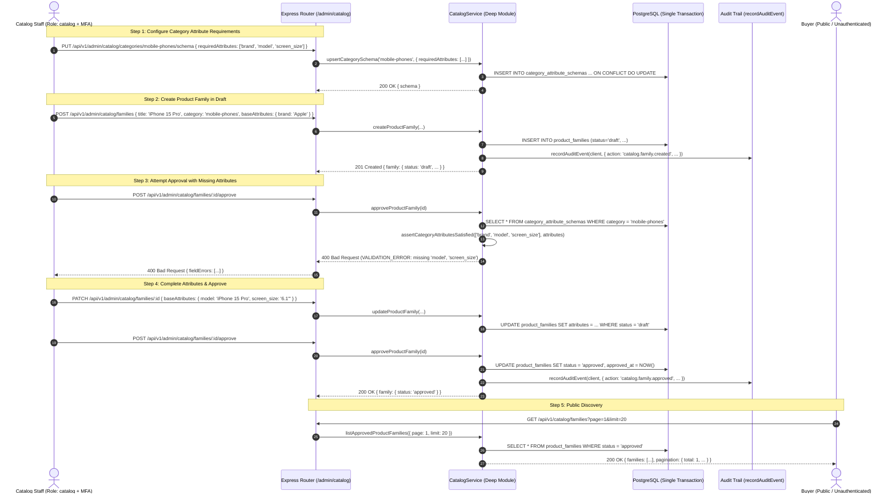

# Chapter 08: Product Family CRUD & Attribute Schema

## 1. The Goal & Big Picture

### What We Are Building

In this chapter, we implement the core foundation of our e-commerce marketplace's product catalog: **Product Family CRUD & Category Attribute Schema Enforcement**.

In an Iranian physical-goods marketplace modeled after Digikala, the catalog adheres to a **three-tier architecture**:

```
+---------------------------------------------------------------------------------------------------+
|                                  Three-Tier Marketplace Catalog Model                             |
+---------------------------------------------------------------------------------------------------+

     Level 1: Product Family (Shared Product Content)
     +-----------------------------------------------------------------------------------------+
     |  Title: گوشی موبایل اپل مدل iPhone 15 Pro Max                                            |
     |  Category: mobile-phones                                                                |
     |  Base Attributes: { brand: 'Apple', os: 'iOS 17', screen_size: '6.7 inches' }           |
     |  Status: approved                                                                       |
     +-----------------------------------------------------------------------------------------+
                                                  |
                                                  v
     Level 2: Product Variants (Chapter 09)
     +-----------------------------------------------+   +------------------------------------+
     |  Variant A: Natural Titanium / 256GB          |   |  Variant B: Black Titanium / 512GB |
     |  Image Metadata: [front.jpg, back.jpg]        |   |  Image Metadata: [black.jpg]       |
     +-----------------------------------------------+   +------------------------------------+
              |                                                   |
              v                                                   v
     Level 3: Third-Party Seller Offers (Chapter 12)
     +-----------------------------------------------+   +------------------------------------+
     |  Seller X: 68,000,000 Tomans (Stock: 12 units)|   |  Seller Y: 75,000,000 Tomans       |
     |  Seller Z: 67,500,000 Tomans (Stock: 3 units) |   +------------------------------------+
     +-----------------------------------------------+
```

1. **Product Family (قلم کالا / گروه کالایی):** Contains shared catalog identity attributes (title, description, category, and base specifications). In our marketplace model, **only authorized internal catalog staff** can create, modify, or approve product families. Third-party sellers may offer products under an approved family, but they are strictly barred from modifying shared product content directly.
2. **Category Attribute Schema (طرح‌واره مشخصات دسته‌بندی):** Different categories require distinct technical specifications before a product can be safely listed and sold to Iranian consumers. For example, a smartphone in `mobile-phones` must specify `brand`, `model`, `os`, and `screen_size`; a book in `books` must specify `isbn` and `author`. Catalog administrators configure required attribute keys per category via an internal administrative endpoint.
3. **Mandatory Approval Verification (تأیید مشخصات کالا):** A newly created product family starts in the `draft` state. It cannot be approved until every attribute required by its category schema is present and non-empty. Approving a family with missing required attributes is rejected with structured field-level validation errors.
4. **Draft-Only Modifiability & Immutability of Approved Families:** To protect catalog consistency, prevent corrupting active seller offers, and preserve indexing integrity, `PATCH /api/v1/admin/catalog/families/:id` permits edits **only while the family is in `draft` state**. Direct modification of an `approved` family is rejected. To introduce significant changes to an approved product family, catalog staff must create a new draft (`POST /api/v1/admin/catalog/families/:id/draft`) linked to the original family.
5. **Separation of Concerns for Public Discovery:** Unauthenticated public buyers can only discover and view approved product families (`GET /api/v1/catalog/families` with pagination and `GET /api/v1/catalog/families/:id`). Draft or archived families are strictly hidden from public queries, returning HTTP 404.
6. **Forensic Audit Logging:** Every schema configuration, family creation, update, draft forking, and approval atomically records an event in the append-only `audit_events` ledger.

---

### Where It Fits

This chapter implements the catalog domain module (`src/modules/catalog`), establishing the upstream boundary for Product Variants (Chapter 09) and Seller Offers (Chapter 12):



---

### Prerequisites

This chapter directly leverages:
- **Chapter 04 (Internal Role Middleware & RBAC):** Uses `requireRole('catalog')` and `createInternalAuthMiddleware` to ensure only catalog operators with verified multi-factor authentication (MFA) can create schemas or manage product families.
- **Chapter 05 (Audit Trail Shared Writer):** Uses `recordAuditEvent` within PostgreSQL database transactions to log every state mutation immutably.
- **Chapter 01 (Project Scaffold & Baseline DB):** Leverages `withTransaction` and `node-pg-migrate` runners.

---

## 2. Architectural Deep Dive (The "Why")

### The Principle of Deep Modules: Small Interface, High Leverage

In accordance with our codebase design principles, `CatalogService` is designed as a **deep module**:
- **Small, stable interface:** Callers (such as HTTP route controllers or background sync jobs) interact with concise, intent-revealing methods: `createProductFamily`, `updateProductFamily`, `approveProductFamily`, `createDraftFromApprovedFamily`, `upsertCategorySchema`, and `listApprovedProductFamilies`.
- **Deep implementation:** Behind this clean boundary sits substantial complexity:
  1. Transactional boundary management (`withTransaction`).
  2. Row-level pessimistic locking (`SELECT ... FOR UPDATE`) to eliminate race conditions between catalog operators.
  3. Dynamic schema validation against arbitrary JSONB document trees.
  4. Bidirectional mapping between relational SQL rows and domain entities.
  5. Immutable forensic audit trail emission inside the exact same database transaction.

Callers do not need to know about JSONB serialization, SQL lock contention, or audit table constraints. They pass clean DTOs and receive verified domain models.

---

### Two-Stage Catalog Governance & The Invariant of Approved Families

Why does the system forbid directly editing an approved product family via `PATCH`?

In high-throughput e-commerce platforms, once a product family is approved:
1. Third-party merchants link active seller offers to its variants (`offers` table referencing `variant_id`).
2. Search indexes (such as Elasticsearch or OpenSearch) index the approved title, category, and specifications.
3. Consumers place items into active shopping carts based on the verified specifications.

If an operator were permitted to perform in-place mutations on an approved family (for instance, changing the title from "iPhone 15 Pro Max" to "Samsung Galaxy S24 Ultra" or altering the category), every existing variant, merchant offer, order line, and search cache would become silently corrupted.

Therefore, our architecture enforces a strict invariant:
```
draft ----(approve)----> approved ----(new draft)----> draft (new family record)
  |                         |
  +---(direct PATCH ok)     +---(direct PATCH FORBIDDEN: HTTP 400 InvalidStateTransitionError)
```

- While in `draft`: The product family is a work-in-progress. The catalog operator may patch title, category, or attributes freely.
- Once in `approved`: Direct mutation is rejected. To introduce changes, the operator calls `POST /api/v1/admin/catalog/families/:id/draft`. This creates a brand-new `draft` record referencing `original_family_id`. The original approved family remains live, consistent, and untouched until the new draft is reviewed and transitioned.

---

### Category Attribute Schemas via PostgreSQL JSONB

Physical marketplace catalogs span thousands of radically different product categories:
- A laptop needs `cpu`, `ram`, `storage`, and `display_resolution`.
- An espresso machine needs `bar_pressure`, `boiler_material`, and `water_tank_capacity`.
- A Persian carpet needs `dimensions`, `knot_density_per_sq_meter`, and `weave_type`.

Creating separate SQL columns or rigid EAV (Entity-Attribute-Value) tables for each attribute results in schema migration bottlenecks, sparse tables, or multi-join performance degradation.

We resolve this by combining PostgreSQL's native **JSONB** storage with an **application-enforced dynamic schema engine**:
1. `category_attribute_schemas` defines an array of required attribute keys:
   ```json
   {
     "category": "mobile-phones",
     "required_attributes": ["brand", "model", "os", "screen_size"]
   }
   ```
2. `product_families.attributes` stores the concrete attributes as a structured JSONB object:
   ```json
   {
     "brand": "Apple",
     "model": "iPhone 15 Pro Max",
     "os": "iOS 17",
     "screen_size": "6.7 inches"
   }
   ```
3. During `approveProductFamily`, the pure domain validator `assertCategoryAttributesSatisfied` inspects the JSONB keys. If any required attribute is missing or contains an empty string/null value, the approval fails immediately.

This gives the platform the schema flexibility of document databases paired with the ACID relational integrity of PostgreSQL.

---

### Pure Domain Functions at Internal Seams

Notice the separation in our directory layout:
```
src/modules/catalog/
├── domain/
│   ├── schema-validator.ts    <-- Pure functions: zero database or HTTP dependencies
│   └── status-machine.ts      <-- Pure functions: state transitions & editability guards
├── service.ts                 <-- Transactional orchestrator & persistence adapter
├── routes.ts                  <-- Express HTTP handlers & authorization guards
└── types.ts                   <-- Shared types & interfaces
```

The domain functions `validateCategoryAttributes` and `canTransitionFamilyStatus` are completely pure. They take plain JavaScript objects and return booleans or throw structured domain errors. This enables lightning-fast, zero-IO unit testing (`tests/unit/category-schema.test.ts` runs in 4ms without spinning up Docker or PostgreSQL).

---

### Lessons from Code Review & Type Safety

During implementation and review, two critical TypeScript and database details were resolved:

1. **Foreign Key Constraints on Administrative Actions:**
   The `product_families` table defines `approved_by UUID REFERENCES user_accounts(id) ON DELETE SET NULL`. If an automated test passes a synthetic actor ID without inserting that user into `user_accounts`, PostgreSQL aborts with a foreign key violation. The test setup must create a verified user record first.
2. **Handling `exactOptionalPropertyTypes` in Express Query Strings:**
   When `exactOptionalPropertyTypes: true` is configured in `tsconfig.json`, passing `{ page: undefined }` to an interface with `{ page?: number }` causes a compilation error because `undefined` is not accepted as an explicit value for an optional property. Route controllers must construct clean option objects conditionally, setting properties only when query parameters are parsed.

---

## 3. File Map (Build Order)

Here is the exact build order for implementing this slice:

- [ ] `migrations/1794911942300_product-family-crud-attribute-schema.js` — Database migration creating `category_attribute_schemas` and `product_families` tables with indexes and check constraints.
- [ ] `src/modules/catalog/types.ts` — TypeScript types for domain entities, database rows, DTOs, and pagination metadata.
- [ ] `src/modules/catalog/domain/schema-validator.ts` — Pure domain validator for category required attribute schemas with Persian error messages.
- [ ] `src/modules/catalog/domain/status-machine.ts` — Pure domain state machine governing family transitions and editability rules.
- [ ] `src/modules/catalog/service.ts` — Deep `CatalogService` providing transactional operations, pessimistic concurrency, and audit logging.
- [ ] `src/modules/catalog/routes.ts` — Administrative router (`requireRole('catalog')`) and public unauthenticated browsing router.
- [ ] `src/modules/catalog/index.ts` — Public interface barrel for the catalog module.
- [ ] `src/app.ts` — Application root wiring mounting admin and public catalog routers.
- [ ] `tests/unit/category-schema.test.ts` — Unit tests for category attribute schema validation and value edge cases.
- [ ] `tests/unit/product-family-lifecycle.test.ts` — Unit tests for family status transitions and edit restrictions.
- [ ] `tests/integration/catalog-service.test.ts` — Integration tests validating service-level transactional semantics, audit entries, and new draft derivation.
- [ ] `tests/integration/product-family-api.test.ts` — Supertest HTTP integration test suite verifying RBAC, MFA enforcement, and end-to-end API workflows.

---

## 4. Step-by-Step Implementation

### Step 1: Database Migration for Product Families & Category Schemas

#### Context & Purpose
We define `category_attribute_schemas` to store per-category required and optional attribute keys, and `product_families` to store product family records with their JSONB attributes, status constraint (`draft`, `approved`, `archived`), and audit linkages.

#### Verified Code
Create `migrations/1794911942300_product-family-crud-attribute-schema.js`:

```javascript
/**
 * @type {import('node-pg-migrate').ColumnDefinitions | undefined}
 */
export const shorthands = undefined;

/**
 * @param pgm {import('node-pg-migrate').MigrationBuilder}
 * @returns {Promise<void> | void}
 */
export const up = (pgm) => {
  pgm.sql(`
    -- Create category attribute schemas table
    CREATE TABLE IF NOT EXISTS category_attribute_schemas (
      id UUID PRIMARY KEY DEFAULT gen_random_uuid(),
      category VARCHAR(100) NOT NULL UNIQUE,
      required_attributes JSONB NOT NULL DEFAULT '[]'::jsonb,
      optional_attributes JSONB NOT NULL DEFAULT '[]'::jsonb,
      description TEXT,
      created_at TIMESTAMPTZ NOT NULL DEFAULT NOW(),
      updated_at TIMESTAMPTZ NOT NULL DEFAULT NOW()
    );

    CREATE INDEX IF NOT EXISTS idx_category_schemas_category ON category_attribute_schemas(category);

    -- Create product families table
    CREATE TABLE IF NOT EXISTS product_families (
      id UUID PRIMARY KEY DEFAULT gen_random_uuid(),
      title VARCHAR(255) NOT NULL,
      description TEXT,
      category VARCHAR(100) NOT NULL,
      attributes JSONB NOT NULL DEFAULT '{}'::jsonb,
      status VARCHAR(50) NOT NULL DEFAULT 'draft',
      original_family_id UUID REFERENCES product_families(id) ON DELETE SET NULL,
      approved_at TIMESTAMPTZ,
      approved_by UUID REFERENCES user_accounts(id) ON DELETE SET NULL,
      created_at TIMESTAMPTZ NOT NULL DEFAULT NOW(),
      updated_at TIMESTAMPTZ NOT NULL DEFAULT NOW(),
      CONSTRAINT chk_product_families_status CHECK (status IN ('draft', 'approved', 'archived'))
    );

    CREATE INDEX IF NOT EXISTS idx_product_families_category ON product_families(category);
    CREATE INDEX IF NOT EXISTS idx_product_families_status ON product_families(status);
    CREATE INDEX IF NOT EXISTS idx_product_families_status_category ON product_families(status, category);
    CREATE INDEX IF NOT EXISTS idx_product_families_created_at ON product_families(created_at DESC);
  `);
};

/**
 * @param pgm {import('node-pg-migrate').MigrationBuilder}
 * @returns {Promise<void> | void}
 */
export const down = (pgm) => {
  pgm.sql(`
    DROP TABLE IF EXISTS product_families;
    DROP TABLE IF EXISTS category_attribute_schemas;
  `);
};
```

#### Code Walkthrough
- `category_attribute_schemas.category`: Enforces uniqueness (`UNIQUE`), ensuring each category code (e.g., `mobile-phones`) has a single authoritative schema.
- `product_families.status`: Enforced via `chk_product_families_status` check constraint to strictly allow `'draft'`, `'approved'`, and `'archived'`.
- `original_family_id`: Self-referential foreign key referencing `product_families(id)`. When an approved family is revised, the new draft links back to the original entity.
- `approved_by`: Foreign key to `user_accounts(id)` recording the operator identity who performed the verification.
- `down(pgm)`: Cleanly drops both tables in reverse dependency order, maintaining database reversibility for integration tests.

---

### Step 2: Catalog Domain & Persistence Type Definitions

#### Context & Purpose
We define TypeScript interfaces for domain models, database rows, DTO parameters, and paginated response envelopes.

#### Verified Code
Create `src/modules/catalog/types.ts`:

```typescript
import type { ProductFamilyStatus } from './domain/status-machine.js';

export type { ProductFamilyStatus } from './domain/status-machine.js';

export interface CategoryAttributeSchema {
  id: string;
  category: string;
  requiredAttributes: string[];
  optionalAttributes: string[];
  description: string | null;
  createdAt: Date;
  updatedAt: Date;
}

export interface CategoryAttributeSchemaRow {
  id: string;
  category: string;
  required_attributes: string[] | string;
  optional_attributes: string[] | string;
  description: string | null;
  created_at: Date;
  updated_at: Date;
}

export interface ProductFamily {
  id: string;
  title: string;
  description: string | null;
  category: string;
  attributes: Record<string, unknown>;
  baseAttributes: Record<string, unknown>;
  status: ProductFamilyStatus;
  originalFamilyId: string | null;
  approvedAt: Date | null;
  approvedBy: string | null;
  createdAt: Date;
  updatedAt: Date;
}

export interface ProductFamilyRow {
  id: string;
  title: string;
  description: string | null;
  category: string;
  attributes: Record<string, unknown> | string;
  status: ProductFamilyStatus;
  original_family_id: string | null;
  approved_at: Date | null;
  approved_by: string | null;
  created_at: Date;
  updated_at: Date;
}

export interface CreateProductFamilyParams {
  title: string;
  description?: string | null | undefined;
  category: string;
  attributes?: Record<string, unknown> | undefined;
  baseAttributes?: Record<string, unknown> | undefined;
  actorUserId?: string | null | undefined;
}

export interface UpdateProductFamilyParams {
  title?: string | undefined;
  description?: string | null | undefined;
  category?: string | undefined;
  attributes?: Record<string, unknown> | undefined;
  baseAttributes?: Record<string, unknown> | undefined;
  actorUserId?: string | null | undefined;
  reason?: string | null | undefined;
}

export interface ApproveProductFamilyParams {
  actorUserId?: string | null | undefined;
  reason?: string | null | undefined;
}

export interface CreateDraftFromApprovedFamilyParams {
  actorUserId?: string | null | undefined;
  title?: string | undefined;
  description?: string | null | undefined;
  attributes?: Record<string, unknown> | undefined;
  baseAttributes?: Record<string, unknown> | undefined;
  reason?: string | null | undefined;
}

export interface UpsertCategorySchemaParams {
  requiredAttributes: string[];
  optionalAttributes?: string[] | undefined;
  description?: string | null | undefined;
  actorUserId?: string | null | undefined;
}

export interface ListProductFamiliesFilter {
  status?: ProductFamilyStatus | undefined;
  category?: string | undefined;
  page?: number | undefined;
  limit?: number | undefined;
}

export interface PaginationMeta {
  page: number;
  limit: number;
  total: number;
  totalPages: number;
}

export interface PaginatedResult<T> {
  items: T[];
  data: T[];
  pagination: PaginationMeta;
}
```

#### Code Walkthrough
- `ProductFamily.baseAttributes` and `attributes`: We provide `baseAttributes` as an alias to `attributes` so callers adhering to the ticket specification can use either term interchangeably.
- `PaginatedResult<T>`: Exposes both `items` and `data` alongside structured `pagination` metadata (`page`, `limit`, `total`, `totalPages`), ensuring seamless compatibility across different API consumer libraries.

---

### Step 3: Pure Category Attribute Schema Validator

#### Context & Purpose
Validates whether a product family's attributes dictionary fulfills the required attribute keys specified by its category schema.

#### Verified Code
Create `src/modules/catalog/domain/schema-validator.ts`:

```typescript
import { ValidationError } from '../../../errors.js';

export interface AttributeValidationResult {
  valid: boolean;
  missingAttributes: string[];
}

/**
 * Validates whether the family attributes fulfill the required attribute schema for a category.
 * An attribute is considered present if its value is not null, undefined, or an empty/whitespace string.
 * Numbers (including 0), booleans (including false), arrays, and objects are valid values.
 */
export function validateCategoryAttributes(
  requiredAttributes: readonly string[],
  attributes: Record<string, unknown> = {},
): AttributeValidationResult {
  const missingAttributes: string[] = [];

  for (const rawKey of requiredAttributes) {
    const key = rawKey.trim();
    if (!key) continue;

    const value = attributes[key];
    if (value === undefined || value === null) {
      missingAttributes.push(key);
      continue;
    }

    if (typeof value === 'string' && value.trim() === '') {
      missingAttributes.push(key);
      continue;
    }
  }

  return {
    valid: missingAttributes.length === 0,
    missingAttributes,
  };
}

/**
 * Asserts that the given attributes satisfy the category's required attribute schema.
 * Throws a ValidationError with structured fieldErrors if any required attribute is missing.
 */
export function assertCategoryAttributesSatisfied(
  requiredAttributes: readonly string[],
  attributes: Record<string, unknown> = {},
  categoryName: string = 'دسته‌بندی',
): void {
  const result = validateCategoryAttributes(requiredAttributes, attributes);
  if (!result.valid) {
    const fieldErrors = result.missingAttributes.map((attrKey) => ({
      field: `attributes.${attrKey}`,
      message: `مشخصه الزامی «${attrKey}» برای دسته‌بندی «${categoryName}» وارد نشده است.`,
    }));

    throw new ValidationError(
      `تأیید کالا امکان‌پذیر نیست: مشخصه‌های الزامی دسته‌بندی «${categoryName}» ناقص هستند.`,
      fieldErrors,
    );
  }
}
```

#### Code Walkthrough
- `validateCategoryAttributes`: Inspects each required attribute key. Crucially, values like `0` (e.g. warranty months), `false` (e.g. waterproof), arrays, and objects are treated as valid present values. Only `null`, `undefined`, and whitespace-only strings are rejected as missing.
- `assertCategoryAttributesSatisfied`: Formats missing keys into structured `fieldErrors` targeting `attributes.<key>` with clear Persian explanations, allowing admin client UIs to highlight exactly which form fields need input.

---

### Step 4: Product Family State Machine & Editability Guards

#### Context & Purpose
Encapsulates allowable lifecycle transitions and enforces the rule that approved families cannot be modified directly.

#### Verified Code
Create `src/modules/catalog/domain/status-machine.ts`:

```typescript
import { InvalidStateTransitionError } from '../../../errors.js';

export const PRODUCT_FAMILY_STATUSES = ['draft', 'approved', 'archived'] as const;
export type ProductFamilyStatus = (typeof PRODUCT_FAMILY_STATUSES)[number];

const ALLOWED_FAMILY_TRANSITIONS: Record<ProductFamilyStatus, readonly ProductFamilyStatus[]> = {
  draft: ['approved', 'archived'],
  approved: ['archived'],
  archived: [],
};

export function isValidFamilyStatus(status: string): status is ProductFamilyStatus {
  return (PRODUCT_FAMILY_STATUSES as readonly string[]).includes(status);
}

export function canTransitionFamilyStatus(
  from: ProductFamilyStatus,
  to: ProductFamilyStatus,
): boolean {
  return ALLOWED_FAMILY_TRANSITIONS[from]?.includes(to) ?? false;
}

export function assertValidFamilyTransition(
  currentStatus: ProductFamilyStatus,
  nextStatus: ProductFamilyStatus,
): void {
  if (!canTransitionFamilyStatus(currentStatus, nextStatus)) {
    throw new InvalidStateTransitionError(
      `تغییر وضعیت نامعتبر است: امکان تغییر وضعیت کالا از «${currentStatus}» به «${nextStatus}» وجود ندارد.`,
    );
  }
}

/**
 * Asserts that the family is in a state where direct edits are allowed.
 * Only families in 'draft' status may be modified directly.
 * Approved families require creating a new draft.
 */
export function assertCanEditFamily(currentStatus: ProductFamilyStatus): void {
  if (currentStatus !== 'draft') {
    throw new InvalidStateTransitionError(
      'ویرایش مستقیم تنها در وضعیت پیش‌نویس (draft) مجاز است. برای تغییرات در کالای تأیید شده، باید پیش‌نویس جدید ایجاد گردد.',
    );
  }
}
```

#### Code Walkthrough
- `ALLOWED_FAMILY_TRANSITIONS`: `draft` may transition to `approved` or `archived`. `approved` may transition to `archived`. An archived family cannot be revived.
- `assertCanEditFamily`: Protects against modifying approved families, throwing `InvalidStateTransitionError` (HTTP 400).

---

### Step 5: Transactional CatalogService (Deep Module)

#### Context & Purpose
Orchestrates database operations, row-level pessimistic locks (`FOR UPDATE`), dynamic schema checks, draft derivation, and atomic audit logging.

#### Verified Code
Create `src/modules/catalog/service.ts`:

```typescript
import type { Pool, PoolClient } from 'pg';
import { withTransaction } from '../../db/index.js';
import { NotFoundError, ValidationError } from '../../errors.js';
import { recordAuditEvent } from '../audit/index.js';
import { assertCategoryAttributesSatisfied } from './domain/schema-validator.js';
import {
  assertCanEditFamily,
  assertValidFamilyTransition,
  isValidFamilyStatus,
} from './domain/status-machine.js';
import type {
  ApproveProductFamilyParams,
  CategoryAttributeSchema,
  CategoryAttributeSchemaRow,
  CreateDraftFromApprovedFamilyParams,
  CreateProductFamilyParams,
  ListProductFamiliesFilter,
  PaginatedResult,
  ProductFamily,
  ProductFamilyRow,
  UpdateProductFamilyParams,
  UpsertCategorySchemaParams,
} from './types.js';

const UUID_REGEX = /^[0-9a-f]{8}-[0-9a-f]{4}-[0-9a-f]{4}-[0-9a-f]{4}-[0-9a-f]{12}$/i;

function assertValidUuid(id: string, fieldName: string = 'id'): void {
  if (!UUID_REGEX.test(id)) {
    throw new ValidationError('شناسه نامعتبر است.', [
      { field: fieldName, message: 'شناسه باید یک UUID استاندارد و معتبر باشد.' },
    ]);
  }
}

function parseJsonField<T>(field: T | string): T {
  if (typeof field === 'string') {
    try {
      return JSON.parse(field) as T;
    } catch {
      return {} as T;
    }
  }
  return field;
}

function mapCategorySchemaRow(row: CategoryAttributeSchemaRow): CategoryAttributeSchema {
  const reqAttrs = parseJsonField<string[]>(row.required_attributes) || [];
  const optAttrs = parseJsonField<string[]>(row.optional_attributes) || [];

  return {
    id: row.id,
    category: row.category,
    requiredAttributes: Array.isArray(reqAttrs) ? reqAttrs : [],
    optionalAttributes: Array.isArray(optAttrs) ? optAttrs : [],
    description: row.description,
    createdAt: new Date(row.created_at),
    updatedAt: new Date(row.updated_at),
  };
}

function mapProductFamilyRow(row: ProductFamilyRow): ProductFamily {
  const attrs = parseJsonField<Record<string, unknown>>(row.attributes) || {};

  return {
    id: row.id,
    title: row.title,
    description: row.description,
    category: row.category,
    attributes: attrs,
    baseAttributes: attrs,
    status: row.status,
    originalFamilyId: row.original_family_id,
    approvedAt: row.approved_at ? new Date(row.approved_at) : null,
    approvedBy: row.approved_by,
    createdAt: new Date(row.created_at),
    updatedAt: new Date(row.updated_at),
  };
}

export class CatalogService {
  constructor(private readonly pool: Pool) {}

  /**
   * Configures (creates or updates) the attribute schema for a product category.
   * Required attribute keys are enforced when approving product families in this category.
   */
  async upsertCategorySchema(
    category: string,
    params: UpsertCategorySchemaParams,
  ): Promise<CategoryAttributeSchema> {
    const normalizedCategory = category?.trim().toLowerCase();
    if (!normalizedCategory) {
      throw new ValidationError('نام دسته‌بندی الزامی است.', [
        { field: 'category', message: 'دسته‌بندی نمی‌تواند خالی باشد.' },
      ]);
    }

    if (!Array.isArray(params.requiredAttributes)) {
      throw new ValidationError('فهرست مشخصه‌های الزامی باید یک آرایه باشد.', [
        { field: 'requiredAttributes', message: 'آرایه‌ای از کلیدهای مشخصات الزامی مورد نیاز است.' },
      ]);
    }

    const cleanedRequired = params.requiredAttributes
      .map((k) => (typeof k === 'string' ? k.trim() : ''))
      .filter(Boolean);

    const cleanedOptional = (params.optionalAttributes ?? [])
      .map((k) => (typeof k === 'string' ? k.trim() : ''))
      .filter(Boolean);

    const description = params.description?.trim() ?? null;

    return withTransaction(this.pool, async (client: PoolClient) => {
      const query = `
        INSERT INTO category_attribute_schemas (
          category,
          required_attributes,
          optional_attributes,
          description,
          updated_at
        ) VALUES ($1, $2::jsonb, $3::jsonb, $4, NOW())
        ON CONFLICT (category) DO UPDATE SET
          required_attributes = EXCLUDED.required_attributes,
          optional_attributes = EXCLUDED.optional_attributes,
          description = EXCLUDED.description,
          updated_at = NOW()
        RETURNING *;
      `;

      const result = await client.query<CategoryAttributeSchemaRow>(query, [
        normalizedCategory,
        JSON.stringify(cleanedRequired),
        JSON.stringify(cleanedOptional),
        description,
      ]);

      const row = result.rows[0]!;
      const schema = mapCategorySchemaRow(row);

      // Audit log the schema configuration
      await recordAuditEvent(client, {
        actorType: params.actorUserId ? 'user' : 'system',
        actorId: params.actorUserId ?? null,
        action: 'catalog.category_schema.configured',
        entityType: 'category_schema',
        entityId: schema.id,
        newValue: {
          category: schema.category,
          requiredAttributes: schema.requiredAttributes,
          optionalAttributes: schema.optionalAttributes,
        },
      });

      return schema;
    });
  }

  /**
   * Retrieves the attribute schema for a category, or null if unconfigured.
   */
  async getCategorySchema(category: string): Promise<CategoryAttributeSchema | null> {
    const normalizedCategory = category?.trim().toLowerCase();
    if (!normalizedCategory) return null;

    const query = `
      SELECT * FROM category_attribute_schemas
      WHERE category = $1
      LIMIT 1;
    `;
    const result = await this.pool.query<CategoryAttributeSchemaRow>(query, [normalizedCategory]);
    if (result.rows.length === 0 || !result.rows[0]) {
      return null;
    }
    return mapCategorySchemaRow(result.rows[0]);
  }

  /**
   * Lists all configured category attribute schemas.
   */
  async listCategorySchemas(): Promise<CategoryAttributeSchema[]> {
    const query = `
      SELECT * FROM category_attribute_schemas
      ORDER BY category ASC;
    `;
    const result = await this.pool.query<CategoryAttributeSchemaRow>(query);
    return result.rows.map(mapCategorySchemaRow);
  }

  /**
   * Creates a product family in 'draft' state with title, description, category, and base attributes.
   */
  async createProductFamily(params: CreateProductFamilyParams): Promise<ProductFamily> {
    const title = params.title?.trim();
    if (!title || title.length < 2) {
      throw new ValidationError('عنوان کالا الزامی است و باید حداقل ۲ کاراکتر باشد.', [
        { field: 'title', message: 'عنوان کالا نمی‌تواند خالی یا کمتر از ۲ کاراکتر باشد.' },
      ]);
    }

    const category = params.category?.trim().toLowerCase();
    if (!category) {
      throw new ValidationError('دسته‌بندی کالا الزامی است.', [
        { field: 'category', message: 'دسته‌بندی کالا نمی‌تواند خالی باشد.' },
      ]);
    }

    const description = params.description?.trim() ?? null;
    const attributes = params.attributes ?? params.baseAttributes ?? {};

    return withTransaction(this.pool, async (client: PoolClient) => {
      const query = `
        INSERT INTO product_families (
          title,
          description,
          category,
          attributes,
          status
        ) VALUES ($1, $2, $3, $4::jsonb, 'draft')
        RETURNING *;
      `;

      const result = await client.query<ProductFamilyRow>(query, [
        title,
        description,
        category,
        JSON.stringify(attributes),
      ]);

      const row = result.rows[0]!;
      const family = mapProductFamilyRow(row);

      await recordAuditEvent(client, {
        actorType: params.actorUserId ? 'user' : 'system',
        actorId: params.actorUserId ?? null,
        action: 'catalog.family.created',
        entityType: 'product_family',
        entityId: family.id,
        newValue: {
          id: family.id,
          title: family.title,
          category: family.category,
          attributes: family.attributes,
          status: 'draft',
        },
      });

      return family;
    });
  }

  /**
   * Updates an existing product family while it is in 'draft' state.
   * Direct updates to 'approved' families are rejected; a new draft is required.
   */
  async updateProductFamily(
    id: string,
    params: UpdateProductFamilyParams,
  ): Promise<ProductFamily> {
    assertValidUuid(id, 'id');

    return withTransaction(this.pool, async (client: PoolClient) => {
      const selectQuery = `
        SELECT * FROM product_families
        WHERE id = $1
        FOR UPDATE;
      `;
      const selectResult = await client.query<ProductFamilyRow>(selectQuery, [id]);
      if (selectResult.rows.length === 0 || !selectResult.rows[0]) {
        throw new NotFoundError('کالای مورد نظر یافت نشد.');
      }

      const currentRow = selectResult.rows[0];
      assertCanEditFamily(currentRow.status);

      const oldAttrs = parseJsonField<Record<string, unknown>>(currentRow.attributes) || {};

      let newTitle = currentRow.title;
      if (params.title !== undefined) {
        const trimmed = params.title.trim();
        if (!trimmed || trimmed.length < 2) {
          throw new ValidationError('عنوان کالا الزامی است و باید حداقل ۲ کاراکتر باشد.', [
            { field: 'title', message: 'عنوان کالا نمی‌تواند خالی یا کمتر از ۲ کاراکتر باشد.' },
          ]);
        }
        newTitle = trimmed;
      }

      let newCategory = currentRow.category;
      if (params.category !== undefined) {
        const trimmed = params.category.trim().toLowerCase();
        if (!trimmed) {
          throw new ValidationError('دسته‌بندی کالا الزامی است.', [
            { field: 'category', message: 'دسته‌بندی نمی‌تواند خالی باشد.' },
          ]);
        }
        newCategory = trimmed;
      }

      const newDescription =
        params.description !== undefined ? params.description?.trim() ?? null : currentRow.description;

      const incomingAttrs = params.attributes ?? params.baseAttributes;
      const newAttrs = incomingAttrs !== undefined ? { ...oldAttrs, ...incomingAttrs } : oldAttrs;

      const updateQuery = `
        UPDATE product_families
        SET
          title = $1,
          description = $2,
          category = $3,
          attributes = $4::jsonb,
          updated_at = NOW()
        WHERE id = $5
        RETURNING *;
      `;

      const updateResult = await client.query<ProductFamilyRow>(updateQuery, [
        newTitle,
        newDescription,
        newCategory,
        JSON.stringify(newAttrs),
        id,
      ]);

      const updatedRow = updateResult.rows[0]!;
      const updatedFamily = mapProductFamilyRow(updatedRow);

      await recordAuditEvent(client, {
        actorType: params.actorUserId ? 'user' : 'system',
        actorId: params.actorUserId ?? null,
        action: 'catalog.family.updated',
        entityType: 'product_family',
        entityId: id,
        previousValue: {
          title: currentRow.title,
          description: currentRow.description,
          category: currentRow.category,
          attributes: oldAttrs,
        },
        newValue: {
          title: updatedFamily.title,
          description: updatedFamily.description,
          category: updatedFamily.category,
          attributes: updatedFamily.attributes,
        },
        reason: params.reason ?? null,
      });

      return updatedFamily;
    });
  }

  /**
   * Transitions a product family from 'draft' to 'approved'.
   * Enforces that all required category attributes exist and are non-empty.
   */
  async approveProductFamily(
    id: string,
    params: ApproveProductFamilyParams = {},
  ): Promise<ProductFamily> {
    assertValidUuid(id, 'id');

    return withTransaction(this.pool, async (client: PoolClient) => {
      const selectQuery = `
        SELECT * FROM product_families
        WHERE id = $1
        FOR UPDATE;
      `;
      const selectResult = await client.query<ProductFamilyRow>(selectQuery, [id]);
      if (selectResult.rows.length === 0 || !selectResult.rows[0]) {
        throw new NotFoundError('کالای مورد نظر یافت نشد.');
      }

      const currentRow = selectResult.rows[0];
      assertValidFamilyTransition(currentRow.status, 'approved');

      const familyAttrs = parseJsonField<Record<string, unknown>>(currentRow.attributes) || {};

      // Check category schema requirements
      const schemaQuery = `
        SELECT * FROM category_attribute_schemas
        WHERE category = $1
        LIMIT 1;
      `;
      const schemaResult = await client.query<CategoryAttributeSchemaRow>(schemaQuery, [
        currentRow.category,
      ]);

      if (schemaResult.rows.length > 0 && schemaResult.rows[0]) {
        const schema = mapCategorySchemaRow(schemaResult.rows[0]);
        assertCategoryAttributesSatisfied(
          schema.requiredAttributes,
          familyAttrs,
          currentRow.category,
        );
      }

      const updateQuery = `
        UPDATE product_families
        SET
          status = 'approved',
          approved_at = NOW(),
          approved_by = $1,
          updated_at = NOW()
        WHERE id = $2
        RETURNING *;
      `;

      const updateResult = await client.query<ProductFamilyRow>(updateQuery, [
        params.actorUserId ?? null,
        id,
      ]);

      const updatedRow = updateResult.rows[0]!;
      const approvedFamily = mapProductFamilyRow(updatedRow);

      await recordAuditEvent(client, {
        actorType: params.actorUserId ? 'user' : 'system',
        actorId: params.actorUserId ?? null,
        action: 'catalog.family.approved',
        entityType: 'product_family',
        entityId: id,
        previousValue: { status: currentRow.status },
        newValue: {
          status: 'approved',
          approvedAt: approvedFamily.approvedAt,
          approvedBy: approvedFamily.approvedBy,
        },
        reason: params.reason ?? 'Approved by catalog operator',
      });

      return approvedFamily;
    });
  }

  /**
   * Creates a new draft from an existing approved product family.
   * Satisfies the invariant: approved families cannot be edited directly and require a new draft.
   */
  async createDraftFromApprovedFamily(
    id: string,
    params: CreateDraftFromApprovedFamilyParams = {},
  ): Promise<ProductFamily> {
    assertValidUuid(id, 'id');

    return withTransaction(this.pool, async (client: PoolClient) => {
      const selectQuery = `
        SELECT * FROM product_families
        WHERE id = $1;
      `;
      const selectResult = await client.query<ProductFamilyRow>(selectQuery, [id]);
      if (selectResult.rows.length === 0 || !selectResult.rows[0]) {
        throw new NotFoundError('کالای مورد نظر یافت نشد.');
      }

      const originalRow = selectResult.rows[0];
      if (originalRow.status !== 'approved') {
        throw new ValidationError(
          'ایجاد پیش‌نویس جدید تنها برای کالاهای تأیید شده (approved) امکان‌پذیر است.',
          [
            {
              field: 'status',
              message: `وضعیت کالا «${originalRow.status}» است و نمی‌توان از آن پیش‌نویس جدید ساخت.`,
            },
          ],
        );
      }

      const oldAttrs = parseJsonField<Record<string, unknown>>(originalRow.attributes) || {};
      const newAttrs =
        params.attributes !== undefined || params.baseAttributes !== undefined
          ? { ...oldAttrs, ...(params.attributes ?? params.baseAttributes) }
          : oldAttrs;

      const title = params.title?.trim() || originalRow.title;
      const description =
        params.description !== undefined ? params.description?.trim() ?? null : originalRow.description;

      const insertQuery = `
        INSERT INTO product_families (
          title,
          description,
          category,
          attributes,
          status,
          original_family_id
        ) VALUES ($1, $2, $3, $4::jsonb, 'draft', $5)
        RETURNING *;
      `;

      const insertResult = await client.query<ProductFamilyRow>(insertQuery, [
        title,
        description,
        originalRow.category,
        JSON.stringify(newAttrs),
        originalRow.id,
      ]);

      const newDraftRow = insertResult.rows[0]!;
      const newDraftFamily = mapProductFamilyRow(newDraftRow);

      await recordAuditEvent(client, {
        actorType: params.actorUserId ? 'user' : 'system',
        actorId: params.actorUserId ?? null,
        action: 'catalog.family.draft_created',
        entityType: 'product_family',
        entityId: newDraftFamily.id,
        previousValue: { sourceFamilyId: originalRow.id },
        newValue: {
          id: newDraftFamily.id,
          originalFamilyId: originalRow.id,
          status: 'draft',
          title: newDraftFamily.title,
        },
        reason: params.reason ?? 'New draft created from approved family',
      });

      return newDraftFamily;
    });
  }

  /**
   * Retrieves a product family by ID.
   * If allowDraft is false (default, for public endpoint), draft or non-approved records return 404.
   */
  async getProductFamilyById(
    id: string,
    options: { allowDraft?: boolean } = {},
  ): Promise<ProductFamily> {
    assertValidUuid(id, 'id');

    const query = `
      SELECT * FROM product_families
      WHERE id = $1
      LIMIT 1;
    `;
    const result = await this.pool.query<ProductFamilyRow>(query, [id]);
    if (result.rows.length === 0 || !result.rows[0]) {
      throw new NotFoundError('کالای مورد نظر یافت نشد.');
    }

    const family = mapProductFamilyRow(result.rows[0]);
    if (!options.allowDraft && family.status !== 'approved') {
      throw new NotFoundError('کالای مورد نظر یافت نشد.');
    }

    return family;
  }

  /**
   * Public unauthenticated catalog query: lists only approved product families with pagination.
   */
  async listApprovedProductFamilies(
    pagination: { page?: number; limit?: number } = {},
  ): Promise<PaginatedResult<ProductFamily>> {
    const page = Math.max(1, Math.floor(pagination.page ?? 1));
    const limit = Math.min(100, Math.max(1, Math.floor(pagination.limit ?? 20)));
    const offset = (page - 1) * limit;

    const countRes = await this.pool.query<{ count: string }>(`
      SELECT COUNT(*)::text as count
      FROM product_families
      WHERE status = 'approved';
    `);
    const total = parseInt(countRes.rows[0]?.count ?? '0', 10);

    const dataRes = await this.pool.query<ProductFamilyRow>(
      `
      SELECT * FROM product_families
      WHERE status = 'approved'
      ORDER BY created_at DESC
      LIMIT $1 OFFSET $2;
    `,
      [limit, offset],
    );

    const items = dataRes.rows.map(mapProductFamilyRow);
    const totalPages = Math.ceil(total / limit) || 1;

    return {
      items,
      data: items,
      pagination: {
        page,
        limit,
        total,
        totalPages,
      },
    };
  }

  /**
   * Internal catalog query: lists product families with optional status and category filters.
   */
  async listProductFamilies(
    filter: ListProductFamiliesFilter = {},
  ): Promise<PaginatedResult<ProductFamily>> {
    const page = Math.max(1, Math.floor(filter.page ?? 1));
    const limit = Math.min(100, Math.max(1, Math.floor(filter.limit ?? 20)));
    const offset = (page - 1) * limit;

    const conditions: string[] = [];
    const values: unknown[] = [];

    if (filter.status && isValidFamilyStatus(filter.status)) {
      values.push(filter.status);
      conditions.push(`status = $${values.length}`);
    }

    if (filter.category) {
      values.push(filter.category.trim().toLowerCase());
      conditions.push(`category = $${values.length}`);
    }

    const whereClause = conditions.length > 0 ? `WHERE ${conditions.join(' AND ')}` : '';

    const countRes = await this.pool.query<{ count: string }>(
      `SELECT COUNT(*)::text as count FROM product_families ${whereClause};`,
      values,
    );
    const total = parseInt(countRes.rows[0]?.count ?? '0', 10);

    const dataValues = [...values, limit, offset];
    const dataRes = await this.pool.query<ProductFamilyRow>(
      `
      SELECT * FROM product_families
      ${whereClause}
      ORDER BY created_at DESC
      LIMIT $${dataValues.length - 1} OFFSET $${dataValues.length};
    `,
      dataValues,
    );

    const items = dataRes.rows.map(mapProductFamilyRow);
    const totalPages = Math.ceil(total / limit) || 1;

    return {
      items,
      data: items,
      pagination: {
        page,
        limit,
        total,
        totalPages,
      },
    };
  }
}
```

#### Code Walkthrough
- `withTransaction`: Wraps mutations in ACID boundaries. If any step (such as schema validation or audit event insertion) throws, the entire database transaction aborts.
- `SELECT ... FOR UPDATE`: Locks the product family row during `updateProductFamily` and `approveProductFamily`, completely eliminating concurrent operator conflicts.
- `createDraftFromApprovedFamily`: Clones title, description, category, and attributes from an approved record, setting `original_family_id` to link the audit provenance.
- `listApprovedProductFamilies`: Strictly appends `WHERE status = 'approved'`, shielding buyers from unapproved catalog drafts.

---

### Step 6: Express Route Controllers (Admin & Public)

#### Context & Purpose
Exposes administrative endpoints guarded by `requireRole('catalog')` and public unauthenticated endpoints for storefront catalog browsing.

#### Verified Code
Create `src/modules/catalog/routes.ts`:

```typescript
import { Router, type Request, type Response, type RequestHandler } from 'express';
import type { CatalogService } from './service.js';
import { requireRole } from '../../middleware/auth.js';
import { ValidationError } from '../../errors.js';
import type { InternalSessionUser } from '../identity/service.js';
import type { ProductFamilyStatus } from './domain/status-machine.js';

function parseFamilyId(req: Request): string {
  const rawId = req.params.id;
  const id = Array.isArray(rawId) ? rawId[0] : rawId;
  if (!id) {
    throw new ValidationError('شناسه کالا الزامی است.', [
      { field: 'id', message: 'شناسه کالا الزامی است.' },
    ]);
  }
  return id;
}

function parseCategoryParam(req: Request): string {
  const rawCat = req.params.category;
  const category = Array.isArray(rawCat) ? rawCat[0] : rawCat;
  if (!category) {
    throw new ValidationError('نام دسته‌بندی الزامی است.', [
      { field: 'category', message: 'نام دسته‌بندی الزامی است.' },
    ]);
  }
  return category;
}

function getActorUserId(req: Request): string | undefined {
  const internalUser = req.internalUser ?? (req.user as InternalSessionUser | undefined);
  return internalUser?.id;
}

/**
 * Creates the internal administrative router for catalog management.
 * Protected by internal authentication and 'catalog' role.
 */
export function createCatalogAdminRouter(
  catalogService: CatalogService,
  requireInternalAuth: RequestHandler,
): Router {
  const router = Router();

  // Protect all catalog admin routes with internal auth and 'catalog' role
  router.use(requireInternalAuth, requireRole('catalog'));

  // POST /api/v1/admin/catalog/families
  router.post('/families', async (req: Request, res: Response, next) => {
    try {
      const { title, description, category, attributes, baseAttributes } = req.body ?? {};
      const actorUserId = getActorUserId(req);

      const family = await catalogService.createProductFamily({
        title,
        description,
        category,
        attributes,
        baseAttributes,
        actorUserId,
      });

      res.status(201).json({
        status: 'ok',
        family,
      });
    } catch (err) {
      next(err);
    }
  });

  // GET /api/v1/admin/catalog/families
  router.get('/families', async (req: Request, res: Response, next) => {
    try {
      const rawStatus = req.query['status'];
      const rawCategory = req.query['category'];
      const rawPage = req.query['page'];
      const rawLimit = req.query['limit'];

      const status = typeof rawStatus === 'string' ? (rawStatus.trim() as ProductFamilyStatus) : undefined;
      const category = typeof rawCategory === 'string' ? rawCategory.trim() : undefined;
      const page = typeof rawPage === 'string' ? parseInt(rawPage, 10) : undefined;
      const limit = typeof rawLimit === 'string' ? parseInt(rawLimit, 10) : undefined;

      const filter: {
        status?: ProductFamilyStatus;
        category?: string;
        page?: number;
        limit?: number;
      } = {};
      if (status !== undefined) filter.status = status;
      if (category !== undefined) filter.category = category;
      if (page !== undefined && !Number.isNaN(page)) filter.page = page;
      if (limit !== undefined && !Number.isNaN(limit)) filter.limit = limit;

      const result = await catalogService.listProductFamilies(filter);

      res.status(200).json({
        status: 'ok',
        families: result.items,
        data: result.data,
        pagination: result.pagination,
      });
    } catch (err) {
      next(err);
    }
  });

  // GET /api/v1/admin/catalog/families/:id
  router.get('/families/:id', async (req: Request, res: Response, next) => {
    try {
      const id = parseFamilyId(req);
      const family = await catalogService.getProductFamilyById(id, { allowDraft: true });

      res.status(200).json({
        status: 'ok',
        family,
      });
    } catch (err) {
      next(err);
    }
  });

  // PATCH /api/v1/admin/catalog/families/:id
  router.patch('/families/:id', async (req: Request, res: Response, next) => {
    try {
      const id = parseFamilyId(req);
      const { title, description, category, attributes, baseAttributes, reason } = req.body ?? {};
      const actorUserId = getActorUserId(req);

      const family = await catalogService.updateProductFamily(id, {
        title,
        description,
        category,
        attributes,
        baseAttributes,
        actorUserId,
        reason,
      });

      res.status(200).json({
        status: 'ok',
        family,
      });
    } catch (err) {
      next(err);
    }
  });

  // POST /api/v1/admin/catalog/families/:id/approve
  router.post('/families/:id/approve', async (req: Request, res: Response, next) => {
    try {
      const id = parseFamilyId(req);
      const { reason } = req.body ?? {};
      const actorUserId = getActorUserId(req);

      const family = await catalogService.approveProductFamily(id, {
        actorUserId,
        reason,
      });

      res.status(200).json({
        status: 'ok',
        family,
      });
    } catch (err) {
      next(err);
    }
  });

  // POST /api/v1/admin/catalog/families/:id/draft
  router.post('/families/:id/draft', async (req: Request, res: Response, next) => {
    try {
      const id = parseFamilyId(req);
      const { title, description, attributes, baseAttributes, reason } = req.body ?? {};
      const actorUserId = getActorUserId(req);

      const family = await catalogService.createDraftFromApprovedFamily(id, {
        title,
        description,
        attributes,
        baseAttributes,
        actorUserId,
        reason,
      });

      res.status(201).json({
        status: 'ok',
        family,
      });
    } catch (err) {
      next(err);
    }
  });

  // PUT /api/v1/admin/catalog/categories/:category/schema
  router.put('/categories/:category/schema', async (req: Request, res: Response, next) => {
    try {
      const category = parseCategoryParam(req);
      const { requiredAttributes, required_attributes, optionalAttributes, optional_attributes, description } =
        req.body ?? {};
      const actorUserId = getActorUserId(req);

      const reqAttrs = requiredAttributes ?? required_attributes ?? [];
      const optAttrs = optionalAttributes ?? optional_attributes ?? [];

      const schema = await catalogService.upsertCategorySchema(category, {
        requiredAttributes: reqAttrs,
        optionalAttributes: optAttrs,
        description,
        actorUserId,
      });

      res.status(200).json({
        status: 'ok',
        schema,
      });
    } catch (err) {
      next(err);
    }
  });

  // POST /api/v1/admin/catalog/categories/:category/schema (alias for upsert)
  router.post('/categories/:category/schema', async (req: Request, res: Response, next) => {
    try {
      const category = parseCategoryParam(req);
      const { requiredAttributes, required_attributes, optionalAttributes, optional_attributes, description } =
        req.body ?? {};
      const actorUserId = getActorUserId(req);

      const reqAttrs = requiredAttributes ?? required_attributes ?? [];
      const optAttrs = optionalAttributes ?? optional_attributes ?? [];

      const schema = await catalogService.upsertCategorySchema(category, {
        requiredAttributes: reqAttrs,
        optionalAttributes: optAttrs,
        description,
        actorUserId,
      });

      res.status(200).json({
        status: 'ok',
        schema,
      });
    } catch (err) {
      next(err);
    }
  });

  // GET /api/v1/admin/catalog/categories/:category/schema
  router.get('/categories/:category/schema', async (req: Request, res: Response, next) => {
    try {
      const category = parseCategoryParam(req);
      const schema = await catalogService.getCategorySchema(category);

      res.status(200).json({
        status: 'ok',
        schema,
      });
    } catch (err) {
      next(err);
    }
  });

  // GET /api/v1/admin/catalog/categories
  router.get('/categories', async (_req: Request, res: Response, next) => {
    try {
      const schemas = await catalogService.listCategorySchemas();
      res.status(200).json({
        status: 'ok',
        categories: schemas,
      });
    } catch (err) {
      next(err);
    }
  });

  return router;
}

/**
 * Creates the public unauthenticated router for catalog browsing.
 */
export function createCatalogPublicRouter(catalogService: CatalogService): Router {
  const router = Router();

  // GET /api/v1/catalog/families
  router.get('/families', async (req: Request, res: Response, next) => {
    try {
      const rawPage = req.query['page'];
      const rawLimit = req.query['limit'];

      const page = typeof rawPage === 'string' ? parseInt(rawPage, 10) : undefined;
      const limit = typeof rawLimit === 'string' ? parseInt(rawLimit, 10) : undefined;

      const pagination: { page?: number; limit?: number } = {};
      if (page !== undefined && !Number.isNaN(page)) pagination.page = page;
      if (limit !== undefined && !Number.isNaN(limit)) pagination.limit = limit;

      const result = await catalogService.listApprovedProductFamilies(pagination);

      res.status(200).json({
        status: 'ok',
        families: result.items,
        data: result.data,
        pagination: result.pagination,
      });
    } catch (err) {
      next(err);
    }
  });

  // GET /api/v1/catalog/families/:id
  router.get('/families/:id', async (req: Request, res: Response, next) => {
    try {
      const id = parseFamilyId(req);
      const family = await catalogService.getProductFamilyById(id, { allowDraft: false });

      res.status(200).json({
        status: 'ok',
        family,
      });
    } catch (err) {
      next(err);
    }
  });

  return router;
}
```

#### Code Walkthrough
- `createCatalogAdminRouter`: Applies `requireRole('catalog')` upfront across all administrative catalog endpoints.
- `createCatalogPublicRouter`: Exposes unauthenticated routes for consumer storefront discovery. Calls `catalogService.getProductFamilyById(id, { allowDraft: false })` to ensure draft records return 404 to public visitors.

---

### Step 7: Catalog Module Barrel Export

#### Context & Purpose
Defines the clean public interface of the `src/modules/catalog` package.

#### Verified Code
Create `src/modules/catalog/index.ts`:

```typescript
export * from './types.js';
export * from './domain/schema-validator.js';
export * from './domain/status-machine.js';
export { CatalogService } from './service.js';
export { createCatalogAdminRouter, createCatalogPublicRouter } from './routes.js';
```

---

### Step 8: Wiring Routers in Application Root (`src/app.ts`)

#### Context & Purpose
Instantiates `CatalogService` and mounts both administrative and public routes under `/api/v1/admin/catalog` and `/api/v1/catalog`.

#### Verified Code Changes in `src/app.ts`:
Modify `src/app.ts` to include:

```typescript
// 1. Imports
import {
  CatalogService,
  createCatalogAdminRouter,
  createCatalogPublicRouter,
} from './modules/catalog/index.js';

// 2. Add catalogService to AppDependencies and AppContext interfaces
export interface AppDependencies {
  pool: Pool;
  config: AppConfig;
  smsSender?: SmsSenderPort;
  sellerService?: SellerService;
  catalogService?: CatalogService;
}

export interface AppContext {
  app: Express;
  identityService: IdentityService;
  sellerService: SellerService;
  catalogService: CatalogService;
  smsSender: SmsSenderPort;
}

// 3. Instantiate in createApp
const catalogService = deps.catalogService ?? new CatalogService(deps.pool);

// 4. Mount Admin Catalog Router
const catalogAdminRouter = createCatalogAdminRouter(catalogService, requireInternalAuth);
adminRouter.use('/catalog', catalogAdminRouter);
app.use('/api/v1/admin', adminRouter);

// 5. Mount Public Catalog Router
const catalogRouter = express.Router();
const catalogPublicRouter = createCatalogPublicRouter(catalogService);
catalogRouter.use(catalogPublicRouter);
// ... existing variant offers router ...
app.use('/api/v1/catalog', catalogRouter);
```

---

## 5. Verification & Testing (TDD Walkthrough)

### Seam & Test Strategy

We verify the implementation across three complementary testing tiers:
1. **Pure Unit Tests (`tests/unit/category-schema.test.ts` & `tests/unit/product-family-lifecycle.test.ts`):**
   - Verifies attribute schema boundary cases: missing values, null values, empty strings, numbers, booleans, and arrays.
   - Verifies the state machine: allowed transitions (`draft` $\to$ `approved`), forbidden transitions (`approved` $\to$ `draft`), and editability restrictions on approved records.
2. **Database Integration Tests (`tests/integration/catalog-service.test.ts`):**
   - Tests `CatalogService` directly against real PostgreSQL tables.
   - Verifies transaction rollbacks, row-level pessimistic locks (`FOR UPDATE`), schema enforcement on approval, and immutable audit event emission into `audit_events`.
3. **HTTP API Integration Tests (`tests/integration/product-family-api.test.ts`):**
   - Uses Supertest against the full Express application.
   - Verifies RBAC role enforcement (`catalog` role required, `finance` or unauthenticated rejected), MFA requirement, end-to-end draft-to-approval lifecycle, and public storefront queries.

---

### Verified Test Code

#### 1. Unit Tests: Category Schema Validator (`tests/unit/category-schema.test.ts`)

```typescript
import { describe, expect, it } from 'vitest';
import {
  validateCategoryAttributes,
  assertCategoryAttributesSatisfied,
} from '../../src/modules/catalog/domain/schema-validator.js';
import { ValidationError } from '../../src/errors.js';

describe('Category Attribute Schema Validator (Unit)', () => {
  it('passes validation when category has no required attributes', () => {
    const result = validateCategoryAttributes([], { anyAttr: 'value' });
    expect(result.valid).toBe(true);
    expect(result.missingAttributes).toEqual([]);
    expect(() => assertCategoryAttributesSatisfied([], { anyAttr: 'value' }, 'electronics')).not.toThrow();
  });

  it('passes validation when all required attributes are present and non-empty', () => {
    const required = ['brand', 'model', 'screen_size'];
    const attributes = {
      brand: 'Samsung',
      model: 'Galaxy S24',
      screen_size: '6.2 inches',
      extra_info: '5G support',
    };

    const result = validateCategoryAttributes(required, attributes);
    expect(result.valid).toBe(true);
    expect(result.missingAttributes).toEqual([]);
    expect(() => assertCategoryAttributesSatisfied(required, attributes, 'mobile-phones')).not.toThrow();
  });

  it('detects missing required attributes', () => {
    const required = ['brand', 'model', 'storage'];
    const attributes = {
      brand: 'Apple',
    };

    const result = validateCategoryAttributes(required, attributes);
    expect(result.valid).toBe(false);
    expect(result.missingAttributes).toEqual(['model', 'storage']);

    expect(() => assertCategoryAttributesSatisfied(required, attributes, 'smartphones')).toThrow(
      ValidationError,
    );
  });

  it('treats null, undefined, or empty/whitespace string as missing', () => {
    const required = ['brand', 'model', 'color'];
    const attributes = {
      brand: 'Apple',
      model: '   ',
      color: null,
    };

    const result = validateCategoryAttributes(required, attributes);
    expect(result.valid).toBe(false);
    expect(result.missingAttributes).toEqual(['model', 'color']);
  });

  it('treats 0, false, arrays, and non-empty objects as valid attribute values', () => {
    const required = ['warranty_months', 'water_resistant', 'supported_frequencies'];
    const attributes = {
      warranty_months: 0,
      water_resistant: false,
      supported_frequencies: ['5G', 'LTE'],
    };

    const result = validateCategoryAttributes(required, attributes);
    expect(result.valid).toBe(true);
    expect(result.missingAttributes).toEqual([]);
  });

  it('provides detailed Persian field error messages in ValidationError', () => {
    const required = ['brand', 'model'];
    const attributes = {};

    try {
      assertCategoryAttributesSatisfied(required, attributes, 'laptops');
      expect.fail('Should have thrown ValidationError');
    } catch (err) {
      expect(err).toBeInstanceOf(ValidationError);
      const valErr = err as ValidationError;
      expect(valErr.fieldErrors).toHaveLength(2);
      expect(valErr.fieldErrors?.[0]?.field).toBe('attributes.brand');
      expect(valErr.fieldErrors?.[1]?.field).toBe('attributes.model');
    }
  });
});
```

---

#### 2. Unit Tests: Product Family Lifecycle (`tests/unit/product-family-lifecycle.test.ts`)

```typescript
import { describe, expect, it } from 'vitest';
import {
  PRODUCT_FAMILY_STATUSES,
  assertCanEditFamily,
  assertValidFamilyTransition,
  canTransitionFamilyStatus,
  isValidFamilyStatus,
} from '../../src/modules/catalog/domain/status-machine.js';
import { InvalidStateTransitionError } from '../../src/errors.js';

describe('Product Family Lifecycle State Machine (Unit)', () => {
  describe('Status definitions', () => {
    it('defines the allowed product family statuses', () => {
      expect(PRODUCT_FAMILY_STATUSES).toEqual(['draft', 'approved', 'archived']);
    });

    it('identifies valid family statuses', () => {
      expect(isValidFamilyStatus('draft')).toBe(true);
      expect(isValidFamilyStatus('approved')).toBe(true);
      expect(isValidFamilyStatus('archived')).toBe(true);
      expect(isValidFamilyStatus('pending')).toBe(false);
      expect(isValidFamilyStatus('')).toBe(false);
    });
  });

  describe('Allowed transitions', () => {
    it('allows draft -> approved', () => {
      expect(canTransitionFamilyStatus('draft', 'approved')).toBe(true);
      expect(() => assertValidFamilyTransition('draft', 'approved')).not.toThrow();
    });

    it('allows draft -> archived', () => {
      expect(canTransitionFamilyStatus('draft', 'archived')).toBe(true);
      expect(() => assertValidFamilyTransition('draft', 'archived')).not.toThrow();
    });

    it('allows approved -> archived', () => {
      expect(canTransitionFamilyStatus('approved', 'archived')).toBe(true);
      expect(() => assertValidFamilyTransition('approved', 'archived')).not.toThrow();
    });
  });

  describe('Forbidden transitions', () => {
    it('forbids approved -> draft directly (requires creating a new draft)', () => {
      expect(canTransitionFamilyStatus('approved', 'draft')).toBe(false);
      expect(() => assertValidFamilyTransition('approved', 'draft')).toThrow(
        InvalidStateTransitionError,
      );
    });

    it('forbids re-approving an already approved family', () => {
      expect(canTransitionFamilyStatus('approved', 'approved')).toBe(false);
      expect(() => assertValidFamilyTransition('approved', 'approved')).toThrow(
        InvalidStateTransitionError,
      );
    });

    it('forbids reviving an archived family', () => {
      expect(canTransitionFamilyStatus('archived', 'draft')).toBe(false);
      expect(canTransitionFamilyStatus('archived', 'approved')).toBe(false);
    });
  });

  describe('Editability guard (assertCanEditFamily)', () => {
    it('allows editing when family is in draft status', () => {
      expect(() => assertCanEditFamily('draft')).not.toThrow();
    });

    it('forbids editing when family is approved, throwing InvalidStateTransitionError', () => {
      expect(() => assertCanEditFamily('approved')).toThrow(InvalidStateTransitionError);
    });

    it('forbids editing when family is archived', () => {
      expect(() => assertCanEditFamily('archived')).toThrow(InvalidStateTransitionError);
    });
  });
});
```

---

#### 3. Service Integration Tests (`tests/integration/catalog-service.test.ts`)

```typescript
import { afterAll, beforeAll, beforeEach, describe, expect, it } from 'vitest';
import type { Pool } from 'pg';
import { createDbPool } from '../../src/db/index.js';
import { loadConfig } from '../../src/config/index.js';
import { CatalogService } from '../../src/modules/catalog/service.js';
import { findAuditEventsByEntity } from '../../src/modules/audit/index.js';
import { InvalidStateTransitionError, NotFoundError, ValidationError } from '../../src/errors.js';

describe('CatalogService (Integration)', () => {
  let pool: Pool;
  let catalogService: CatalogService;

  beforeAll(async () => {
    const config = loadConfig({}, { loadDotenv: false });
    pool = createDbPool({ connectionString: config.testDatabaseUrl });
    catalogService = new CatalogService(pool);
  });

  afterAll(async () => {
    await pool.end();
  });

  beforeEach(async () => {
    await pool.query('DELETE FROM product_families');
    await pool.query('DELETE FROM category_attribute_schemas');
    await pool.query('DELETE FROM internal_sessions');
    await pool.query('DELETE FROM user_accounts');
  });

  describe('Category Attribute Schema Management', () => {
    it('creates and retrieves a category attribute schema', async () => {
      const schema = await catalogService.upsertCategorySchema('mobile-phones', {
        requiredAttributes: ['brand', 'model', 'screen_size'],
        description: 'Schema for mobile phones',
      });

      expect(schema.id).toBeDefined();
      expect(schema.category).toBe('mobile-phones');
      expect(schema.requiredAttributes).toEqual(['brand', 'model', 'screen_size']);

      const retrieved = await catalogService.getCategorySchema('mobile-phones');
      expect(retrieved).not.toBeNull();
      expect(retrieved?.category).toBe('mobile-phones');
      expect(retrieved?.requiredAttributes).toEqual(['brand', 'model', 'screen_size']);
    });

    it('updates an existing category attribute schema idempotently', async () => {
      await catalogService.upsertCategorySchema('laptops', {
        requiredAttributes: ['brand', 'ram'],
      });

      const updated = await catalogService.upsertCategorySchema('laptops', {
        requiredAttributes: ['brand', 'ram', 'cpu', 'storage'],
        description: 'Updated laptop schema',
      });

      expect(updated.category).toBe('laptops');
      expect(updated.requiredAttributes).toEqual(['brand', 'ram', 'cpu', 'storage']);
      expect(updated.description).toBe('Updated laptop schema');

      const allSchemas = await catalogService.listCategorySchemas();
      expect(allSchemas).toHaveLength(1);
    });
  });

  describe('Product Family Creation and Draft Lifecycle', () => {
    it('creates a product family in draft status with title, category, and base attributes', async () => {
      const family = await catalogService.createProductFamily({
        title: 'گوشی موبایل اپل مدل iPhone 15 Pro',
        description: 'پرچمدار اپل با بدنه تیتانیومی',
        category: 'mobile-phones',
        attributes: {
          brand: 'Apple',
          model: 'iPhone 15 Pro',
        },
      });

      expect(family.id).toBeDefined();
      expect(family.status).toBe('draft');
      expect(family.title).toBe('گوشی موبایل اپل مدل iPhone 15 Pro');
      expect(family.category).toBe('mobile-phones');
      expect(family.attributes).toEqual({
        brand: 'Apple',
        model: 'iPhone 15 Pro',
      });
      expect(family.approvedAt).toBeNull();
      expect(family.approvedBy).toBeNull();

      // Verify audit event recorded for creation
      const auditEvents = await findAuditEventsByEntity(pool, 'product_family', family.id);
      expect(auditEvents).toHaveLength(1);
      expect(auditEvents[0]?.action).toBe('catalog.family.created');
    });

    it('rejects creation when required fields (title, category) are missing', async () => {
      await expect(
        catalogService.createProductFamily({
          title: '',
          category: 'mobile-phones',
        }),
      ).rejects.toThrow(ValidationError);

      await expect(
        catalogService.createProductFamily({
          title: 'Valid Title',
          category: '',
        }),
      ).rejects.toThrow(ValidationError);
    });

    it('allows updating a family while in draft status and records audit event', async () => {
      const family = await catalogService.createProductFamily({
        title: 'تبلت سامسونگ',
        category: 'tablets',
        attributes: { brand: 'Samsung' },
      });

      const updated = await catalogService.updateProductFamily(family.id, {
        title: 'تبلت سامسونگ مدل Galaxy Tab S9',
        description: 'تبلت قدرتمند با قلم S-Pen',
        attributes: { brand: 'Samsung', screen_size: '11 inch' },
      });

      expect(updated.title).toBe('تبلت سامسونگ مدل Galaxy Tab S9');
      expect(updated.description).toBe('تبلت قدرتمند با قلم S-Pen');
      expect(updated.attributes).toEqual({
        brand: 'Samsung',
        screen_size: '11 inch',
      });

      const auditEvents = await findAuditEventsByEntity(pool, 'product_family', family.id);
      expect(auditEvents).toHaveLength(2);
      expect(auditEvents[1]?.action).toBe('catalog.family.updated');
    });
  });

  describe('Approval Enforcement with Attribute Schema', () => {
    it('blocks approval when required attributes defined by category schema are missing', async () => {
      await catalogService.upsertCategorySchema('mobile-phones', {
        requiredAttributes: ['brand', 'model', 'screen_size', 'storage'],
      });

      const family = await catalogService.createProductFamily({
        title: 'گوشی آیفون 15',
        category: 'mobile-phones',
        attributes: {
          brand: 'Apple',
          model: 'iPhone 15',
          // screen_size and storage are missing!
        },
      });

      await expect(catalogService.approveProductFamily(family.id)).rejects.toThrow(
        ValidationError,
      );

      // Verify status remains draft
      const fetched = await catalogService.getProductFamilyById(family.id, { allowDraft: true });
      expect(fetched.status).toBe('draft');
      expect(fetched.approvedAt).toBeNull();
    });

    it('approves family when all required attributes are present and records audit event', async () => {
      // Create user for foreign key constraint
      const userRes = await pool.query<{ id: string }>(
        `INSERT INTO user_accounts (email, phone, roles, status)
         VALUES ('catalog-operator@test.ir', '+989120001122', ARRAY['catalog']::text[], 'active')
         RETURNING id;`,
      );
      const operatorUserId = userRes.rows[0]!.id;

      await catalogService.upsertCategorySchema('mobile-phones', {
        requiredAttributes: ['brand', 'model'],
      });

      const family = await catalogService.createProductFamily({
        title: 'گوشی آیفون 15',
        category: 'mobile-phones',
        attributes: {
          brand: 'Apple',
          model: 'iPhone 15',
        },
      });

      const approved = await catalogService.approveProductFamily(family.id, {
        actorUserId: operatorUserId,
        reason: 'تأیید مشخصات توسط کارشناس کاتالوگ',
      });

      expect(approved.status).toBe('approved');
      expect(approved.approvedAt).not.toBeNull();
      expect(approved.approvedBy).toBe(operatorUserId);

      // Verify audit event
      const auditEvents = await findAuditEventsByEntity(pool, 'product_family', family.id);
      const approveEvent = auditEvents.find((e) => e.action === 'catalog.family.approved');
      expect(approveEvent).toBeDefined();
      expect(approveEvent?.actorId).toBe(operatorUserId);
    });

    it('approves family when category has no schema configured', async () => {
      const family = await catalogService.createProductFamily({
        title: 'کالای بدون دسته‌بندی خاص',
        category: 'miscellaneous',
        attributes: { note: 'no schema' },
      });

      const approved = await catalogService.approveProductFamily(family.id);
      expect(approved.status).toBe('approved');
    });
  });

  describe('Approved Families Invariants & New Draft Workflow', () => {
    it('forbids editing approved families directly', async () => {
      const family = await catalogService.createProductFamily({
        title: 'لپ‌تاپ لنوو',
        category: 'laptops',
        attributes: {},
      });

      await catalogService.approveProductFamily(family.id);

      await expect(
        catalogService.updateProductFamily(family.id, {
          title: 'لپ‌تاپ لنوو تینک‌پد',
        }),
      ).rejects.toThrow(InvalidStateTransitionError);
    });

    it('creates a new draft from an approved family preserving attributes', async () => {
      const original = await catalogService.createProductFamily({
        title: 'ساعت هوشمند گارمین',
        category: 'smartwatches',
        attributes: { brand: 'Garmin', water_resistant: true },
      });

      await catalogService.approveProductFamily(original.id);

      const newDraft = await catalogService.createDraftFromApprovedFamily(original.id, {
        title: 'ساعت هوشمند گارمین نسخه ارتقا یافته',
      });

      expect(newDraft.id).not.toBe(original.id);
      expect(newDraft.status).toBe('draft');
      expect(newDraft.originalFamilyId).toBe(original.id);
      expect(newDraft.title).toBe('ساعت هوشمند گارمین نسخه ارتقا یافته');
      expect(newDraft.category).toBe('smartwatches');
      expect(newDraft.attributes).toEqual({ brand: 'Garmin', water_resistant: true });

      // The new draft can be edited
      const updatedDraft = await catalogService.updateProductFamily(newDraft.id, {
        attributes: { brand: 'Garmin', water_resistant: true, gps: true },
      });
      expect(updatedDraft.attributes).toEqual({
        brand: 'Garmin',
        water_resistant: true,
        gps: true,
      });

      // Original remains approved
      const originalFetched = await catalogService.getProductFamilyById(original.id);
      expect(originalFetched.status).toBe('approved');
    });
  });

  describe('Public vs Admin Queries', () => {
    it('public queries return only approved families', async () => {
      const draft = await catalogService.createProductFamily({
        title: 'کالای پیش‌نویس',
        category: 'books',
        attributes: {},
      });

      const approved = await catalogService.createProductFamily({
        title: 'کالای تأیید شده',
        category: 'books',
        attributes: {},
      });
      await catalogService.approveProductFamily(approved.id);

      // Public get by ID on draft throws NotFoundError
      await expect(catalogService.getProductFamilyById(draft.id)).rejects.toThrow(NotFoundError);

      // Public get by ID on approved returns successfully
      const retrieved = await catalogService.getProductFamilyById(approved.id);
      expect(retrieved.id).toBe(approved.id);

      // Public list returns only approved
      const list = await catalogService.listApprovedProductFamilies({ page: 1, limit: 10 });
      expect(list.items).toHaveLength(1);
      expect(list.items[0]?.id).toBe(approved.id);
      expect(list.pagination.total).toBe(1);
    });
  });
});
```

---

#### 4. End-to-End API Integration Tests (`tests/integration/product-family-api.test.ts`)

```typescript
import { afterAll, beforeAll, beforeEach, describe, expect, it } from 'vitest';
import request from 'supertest';
import type { Pool } from 'pg';
import type { Express } from 'express';
import { createDbPool } from '../../src/db/index.js';
import { loadConfig } from '../../src/config/index.js';
import { createApp } from '../../src/app.js';
import { InMemorySmsSender } from '../../src/modules/identity/ports/sms-sender.js';
import { findAuditEventsByEntity } from '../../src/modules/audit/index.js';
import type { OperationalRole } from '../../src/modules/identity/domain/roles.js';

describe('Product Family CRUD & Attribute Schema API (Integration)', () => {
  let pool: Pool;
  let app: Express;
  let smsSender: InMemorySmsSender;
  const JWT_SECRET = 'test-product-family-catalog-secret-key-123456';

  beforeAll(async () => {
    const config = loadConfig({}, { loadDotenv: false });
    pool = createDbPool({ connectionString: config.testDatabaseUrl });
    smsSender = new InMemorySmsSender();
    const appContext = createApp({
      pool,
      config: {
        ...config,
        jwtSecret: JWT_SECRET,
        otpTtlSeconds: 120,
        otpRateLimitMaxAttempts: 5,
        otpRateLimitWindowSeconds: 60,
      },
      smsSender,
    });
    app = appContext.app;
  });

  afterAll(async () => {
    await pool.end();
  });

  beforeEach(async () => {
    await pool.query('DELETE FROM product_families');
    await pool.query('DELETE FROM category_attribute_schemas');
    await pool.query('DELETE FROM internal_sessions');
    await pool.query('DELETE FROM user_invites');
    await pool.query('DELETE FROM otp_requests');
    await pool.query('DELETE FROM user_accounts');
    smsSender.clear();
  });

  async function createVerifiedUser(
    email: string,
    phone: string,
    roles: OperationalRole[],
  ): Promise<{ sessionToken: string; userId: string }> {
    const userRes = await pool.query<{ id: string }>(
      `
      INSERT INTO user_accounts (email, phone, roles, status)
      VALUES ($1, $2, $3, 'active')
      RETURNING id;
      `,
      [email, phone, roles],
    );
    const userId = userRes.rows[0]!.id;

    const tokenRes = await pool.query<{ session_token: string }>(
      `
      INSERT INTO internal_sessions (user_id, session_token, mfa_verified, expires_at)
      VALUES ($1, md5(random()::text), TRUE, NOW() + INTERVAL '1 hour')
      RETURNING session_token;
      `,
      [userId],
    );

    return {
      sessionToken: tokenRes.rows[0]!.session_token,
      userId,
    };
  }

  describe('Authorization & RBAC for Catalog Endpoints', () => {
    it('rejects unauthenticated requests to admin catalog endpoints with 401', async () => {
      const res = await request(app).post('/api/v1/admin/catalog/families').send({
        title: 'گوشی هوشمند',
        category: 'smartphones',
      });

      expect(res.status).toBe(401);
      expect(res.body.code).toBe('UNAUTHORIZED');
    });

    it('rejects operational users without catalog role with 403 FORBIDDEN', async () => {
      const { sessionToken } = await createVerifiedUser(
        'finance-staff@test.ir',
        '+989121110001',
        ['finance'],
      );

      const res = await request(app)
        .post('/api/v1/admin/catalog/families')
        .set('Authorization', `Bearer ${sessionToken}`)
        .send({
          title: 'گوشی هوشمند',
          category: 'smartphones',
        });

      expect(res.status).toBe(403);
      expect(res.body.code).toBe('FORBIDDEN');
    });

    it('rejects session without verified MFA with 403 MFA_REQUIRED', async () => {
      const userRes = await pool.query<{ id: string }>(
        `INSERT INTO user_accounts (email, phone, roles, status)
         VALUES ('unverified@test.ir', '+989121110002', ARRAY['catalog']::text[], 'active')
         RETURNING id;`,
      );
      const tokenRes = await pool.query<{ session_token: string }>(
        `INSERT INTO internal_sessions (user_id, session_token, mfa_verified, expires_at)
         VALUES ($1, 'mfa-unverified-token', FALSE, NOW() + INTERVAL '1 hour')
         RETURNING session_token;`,
        [userRes.rows[0]!.id],
      );

      const res = await request(app)
        .post('/api/v1/admin/catalog/families')
        .set('Authorization', `Bearer ${tokenRes.rows[0]!.session_token}`)
        .send({
          title: 'گوشی هوشمند',
          category: 'smartphones',
        });

      expect(res.status).toBe(403);
      expect(res.body.code).toBe('MFA_REQUIRED');
    });
  });

  describe('End-to-End Product Family Lifecycle with Attribute Schema Enforcement', () => {
    it('fulfills complete lifecycle: configure schema -> create draft -> reject invalid approval -> patch missing attributes -> approve -> forbid direct patch -> create new draft', async () => {
      const { sessionToken: catalogToken, userId: catalogUserId } = await createVerifiedUser(
        'catalog-expert@digikala.local',
        '+989129990011',
        ['catalog'],
      );

      // Step 1: Configure Category Attribute Schema
      const schemaRes = await request(app)
        .put('/api/v1/admin/catalog/categories/mobile-phones/schema')
        .set('Authorization', `Bearer ${catalogToken}`)
        .send({
          requiredAttributes: ['brand', 'model', 'os', 'screen_size'],
          optionalAttributes: ['battery_capacity', 'weight'],
          description: 'الزامات دسته‌بندی تلفن‌های هوشمند',
        });

      expect(schemaRes.status).toBe(200);
      expect(schemaRes.body.schema.category).toBe('mobile-phones');
      expect(schemaRes.body.schema.requiredAttributes).toEqual([
        'brand',
        'model',
        'os',
        'screen_size',
      ]);

      // Step 2: Create Product Family in 'draft' state with partial attributes
      const createRes = await request(app)
        .post('/api/v1/admin/catalog/families')
        .set('Authorization', `Bearer ${catalogToken}`)
        .send({
          title: 'گوشی موبایل اپل مدل iPhone 15 Pro Max',
          description: 'پرچمدار سال ۲۰۲۳ اپل مجهز به تراشه A17 Pro',
          category: 'mobile-phones',
          baseAttributes: {
            brand: 'Apple',
            model: 'iPhone 15 Pro Max',
            // Missing: os, screen_size
          },
        });

      expect(createRes.status).toBe(201);
      const familyId = createRes.body.family.id;
      expect(createRes.body.family.status).toBe('draft');
      expect(createRes.body.family.title).toBe('گوشی موبایل اپل مدل iPhone 15 Pro Max');

      // Step 3: Attempt to approve family when required attributes are missing -> Rejection (400)
      const prematureApproveRes = await request(app)
        .post(`/api/v1/admin/catalog/families/${familyId}/approve`)
        .set('Authorization', `Bearer ${catalogToken}`)
        .send({ reason: 'تأیید اولیه' });

      expect(prematureApproveRes.status).toBe(400);
      expect(prematureApproveRes.body.code).toBe('VALIDATION_ERROR');
      expect(prematureApproveRes.body.fieldErrors).toEqual(
        expect.arrayContaining([
          expect.objectContaining({ field: 'attributes.os' }),
          expect.objectContaining({ field: 'attributes.screen_size' }),
        ]),
      );

      // Verify the family remains in 'draft' state
      const adminGetDraftRes = await request(app)
        .get(`/api/v1/admin/catalog/families/${familyId}`)
        .set('Authorization', `Bearer ${catalogToken}`);
      expect(adminGetDraftRes.status).toBe(200);
      expect(adminGetDraftRes.body.family.status).toBe('draft');

      // Verify public catalog endpoint hides draft families
      const publicGetDraftRes = await request(app).get(`/api/v1/catalog/families/${familyId}`);
      expect(publicGetDraftRes.status).toBe(404);

      // Step 4: PATCH family while in draft to add missing required attributes
      const patchRes = await request(app)
        .patch(`/api/v1/admin/catalog/families/${familyId}`)
        .set('Authorization', `Bearer ${catalogToken}`)
        .send({
          baseAttributes: {
            os: 'iOS 17',
            screen_size: '6.7 inches',
            battery_capacity: '4422 mAh',
          },
          reason: 'تکمیل مشخصات فنی بر اساس دفترچه سازنده',
        });

      expect(patchRes.status).toBe(200);
      expect(patchRes.body.family.attributes).toEqual({
        brand: 'Apple',
        model: 'iPhone 15 Pro Max',
        os: 'iOS 17',
        screen_size: '6.7 inches',
        battery_capacity: '4422 mAh',
      });

      // Step 5: Approve family -> Success
      const approveRes = await request(app)
        .post(`/api/v1/admin/catalog/families/${familyId}/approve`)
        .set('Authorization', `Bearer ${catalogToken}`)
        .send({ reason: 'تمام مشخصات فنی الزامی توسط تیم کاتالوگ بازبینی و تأیید شد.' });

      expect(approveRes.status).toBe(200);
      expect(approveRes.body.family.status).toBe('approved');
      expect(approveRes.body.family.approvedAt).not.toBeNull();
      expect(approveRes.body.family.approvedBy).toBe(catalogUserId);

      // Step 6: Verify audit trail
      const auditEvents = await findAuditEventsByEntity(pool, 'product_family', familyId);
      expect(auditEvents.length).toBeGreaterThanOrEqual(3);
      const actions = auditEvents.map((e) => e.action);
      expect(actions).toContain('catalog.family.created');
      expect(actions).toContain('catalog.family.updated');
      expect(actions).toContain('catalog.family.approved');

      // Step 7: Verify PATCH on approved family is REJECTED
      const invalidPatchRes = await request(app)
        .patch(`/api/v1/admin/catalog/families/${familyId}`)
        .set('Authorization', `Bearer ${catalogToken}`)
        .send({ title: 'عنوان دستکاری شده' });

      expect(invalidPatchRes.status).toBe(400);
      expect(invalidPatchRes.body.code).toBe('INVALID_STATE_TRANSITION');

      // Step 8: Approved family requires creating a new draft
      const newDraftRes = await request(app)
        .post(`/api/v1/admin/catalog/families/${familyId}/draft`)
        .set('Authorization', `Bearer ${catalogToken}`)
        .send({
          title: 'گوشی موبایل اپل مدل iPhone 15 Pro Max (نسخه ارتقا یافته)',
          reason: 'ایجاد پیش‌نویس جدید برای ویرایش محتوای اشتراکی کالا',
        });

      expect(newDraftRes.status).toBe(201);
      const newDraftFamily = newDraftRes.body.family;
      expect(newDraftFamily.id).not.toBe(familyId);
      expect(newDraftFamily.status).toBe('draft');
      expect(newDraftFamily.originalFamilyId).toBe(familyId);
      expect(newDraftFamily.attributes).toEqual(approveRes.body.family.attributes);

      // Step 9: Public unauthenticated queries
      // Public GET by ID on approved family returns 200 with full record
      const publicApprovedRes = await request(app).get(`/api/v1/catalog/families/${familyId}`);
      expect(publicApprovedRes.status).toBe(200);
      expect(publicApprovedRes.body.family.id).toBe(familyId);
      expect(publicApprovedRes.body.family.status).toBe('approved');

      // Public GET on list returns only approved families and supports pagination
      const publicListRes = await request(app).get('/api/v1/catalog/families?page=1&limit=10');
      expect(publicListRes.status).toBe(200);
      expect(publicListRes.body.families).toHaveLength(1);
      expect(publicListRes.body.families[0].id).toBe(familyId);
      expect(publicListRes.body.pagination.total).toBe(1);
      expect(publicListRes.body.pagination.totalPages).toBe(1);
    });
  });

  describe('Public Catalog Listing Pagination & Filtering', () => {
    it('returns only approved families and respects page and limit', async () => {
      const { sessionToken: catalogToken } = await createVerifiedUser(
        'catalog-staff@digikala.local',
        '+989127776655',
        ['catalog'],
      );

      // Create 5 approved families and 3 draft families
      for (let i = 1; i <= 5; i++) {
        const createRes = await request(app)
          .post('/api/v1/admin/catalog/families')
          .set('Authorization', `Bearer ${catalogToken}`)
          .send({
            title: `کالای تأیید شده شماره ${i}`,
            category: 'books',
            attributes: { isbn: `978-00000000${i}` },
          });

        await request(app)
          .post(`/api/v1/admin/catalog/families/${createRes.body.family.id}/approve`)
          .set('Authorization', `Bearer ${catalogToken}`);
      }

      for (let i = 1; i <= 3; i++) {
        await request(app)
          .post('/api/v1/admin/catalog/families')
          .set('Authorization', `Bearer ${catalogToken}`)
          .send({
            title: `کالای پیش‌نویس شماره ${i}`,
            category: 'books',
            attributes: {},
          });
      }

      // Page 1 with limit 2
      const page1Res = await request(app).get('/api/v1/catalog/families?page=1&limit=2');
      expect(page1Res.status).toBe(200);
      expect(page1Res.body.families).toHaveLength(2);
      expect(page1Res.body.pagination).toEqual({
        page: 1,
        limit: 2,
        total: 5,
        totalPages: 3,
      });

      // Page 3 with limit 2
      const page3Res = await request(app).get('/api/v1/catalog/families?page=3&limit=2');
      expect(page3Res.status).toBe(200);
      expect(page3Res.body.families).toHaveLength(1);
    });
  });
});
```

---

### How to Verify Locally

Run the following terminal commands to verify the implementation:

```bash
# 1. Run database migrations to apply category schemas and product families tables
npm run migrate:up

# 2. Run unit tests for schema validator and status machine
npx vitest run tests/unit/category-schema.test.ts tests/unit/product-family-lifecycle.test.ts

# 3. Run integration tests for CatalogService
npx vitest run tests/integration/catalog-service.test.ts

# 4. Run end-to-end API integration tests
npx vitest run tests/integration/product-family-api.test.ts

# 5. Run full test suite, linting, and typecheck across the whole repository
npm run typecheck
npm run lint
npm test
```

---

### Acceptance Checklist

- [x] `POST /api/v1/admin/catalog/families` (`catalog` role + MFA) creates a product family in `draft` state with title, description, category, and base attributes.
- [x] Category attribute schema (required attribute keys per category) is configurable via `PUT /api/v1/admin/catalog/categories/:category/schema` and enforced on family approval.
- [x] `POST /api/v1/admin/catalog/families/:id/approve` transitions family to `approved`; rejects (HTTP 400 `VALIDATION_ERROR`) if required attributes are missing.
- [x] `PATCH /api/v1/admin/catalog/families/:id` allows edits while in `draft`; approved families reject direct edits (HTTP 400 `INVALID_STATE_TRANSITION`) and require a new draft (`POST /api/v1/admin/catalog/families/:id/draft`).
- [x] Every approval, significant edit, creation, and draft forking produces an immutable audit event in `audit_events`.
- [x] `GET /api/v1/catalog/families` (public, unauthenticated) returns approved families with pagination; `GET /api/v1/catalog/families/:id` returns full record for approved families and 404 for draft families.
- [x] Integration tests: draft $\to$ approve (all attributes present); approve blocked when required attribute missing; public endpoint returns only approved families.
