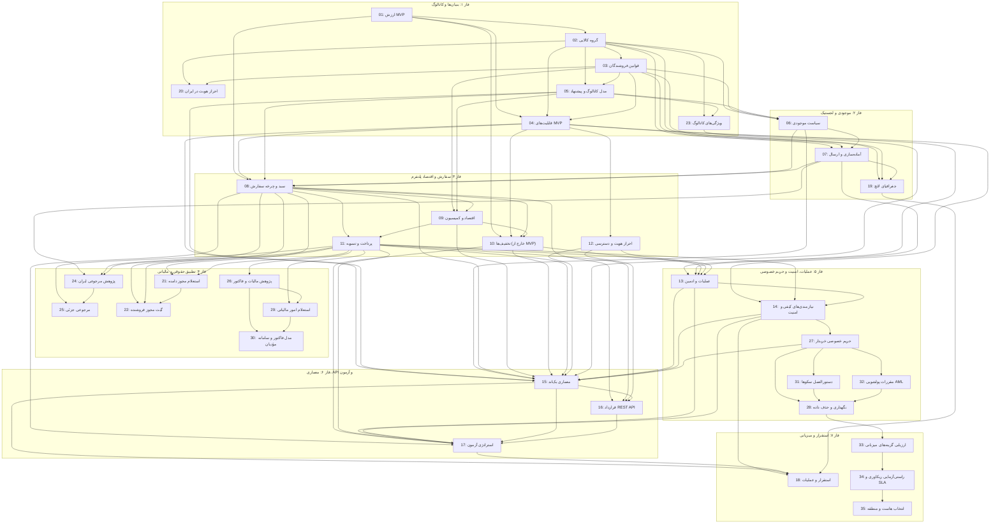

# نقشه راه آموزشی و ترتیب مهندسی تیکت‌های بک‌اند بازارگاه (Ecommerce Marketplace)

> **هدف این سند:** مرتب‌سازی دقیق و علمی ۳۵ تیکت معماری و نیازمندی‌های موجود در مسیر `.scratch/ecommerce-marketplace-backend/issues/` بر اساس پیش‌نیازها و روابط وابستگی (`Blocked by`). این سند ساختار و سرفصل‌های استاندارد جهت تولید **ویدئوهای آموزشی، پادکست‌های عمیق و درس‌نامه‌های فنی در ابزارهای هوش مصنوعی مانند Gemini Notebook و NotebookLM** را ارائه می‌دهد.

---

## ۱. چرا شماره‌گذاری فایل‌ها (01 تا 35) برای یادگیری و ضبط ویدئو مناسب نبود؟

تیکت‌های پوشه `issues` در طول فرایند تکامل پروژه و به مرور زمان نام‌گذاری شده‌اند:
1. **تیکت‌های 01 تا 19** تصمیم‌های کلان تجاری و اولیه بودند.
2. **تیکت‌های 20 تا 35** پژوهش‌های قانونی، مالیاتی و جزئیات تکمیلی کاتالوگ و حریم خصوصی بودند که بعداً ثبت شدند.
3. در نتیجه، در شماره‌گذاری ترتیبی فایل‌ها ناپیوستگی‌های جدی وجود دارد؛ به عنوان مثال:
   - **تیکت 15 (معماری بک‌اند)** صراحتاً به تیکت‌های **23 (ویژگی‌های کاتالوگ)** و **27 (پژوهش حریم خصوصی)** وابسته است. اگر کسی فایل 15 را پیش از 23 یا 27 بخواند یا تدریس کند، مفاهیم دیتابیس و مدل‌سازی داده‌ها هنوز کامل نشده است!
   - **تیکت 20 (احراز هویت فروشندگان در ایران)** دقیقاً پیش‌نیاز قوانین ورود فروشندگان (تیکت 03) است، اما شماره 20 به آن اختصاص داده شده بود.
   - **تیکت‌های 24، 25، 26، 29 و 30 (حقوق مرجوعی، مالیات بر ارزش افزوده و صورتحساب مؤدیان)** مستقیماً از تیکت‌های سفارش (08) و پرداخت (11) منشعب می‌شوند، در حالی که در انتهای فایل‌ها قرار دارند.
   - **تیکت‌های 29 و 30** در هدر خود لاین متنی `Blocked by` نداشتند، ولی در متن صورت مسئله تصریح شده که به تیکت‌های 11 و 26 (و 30 به 29) وابسته‌اند.

بنابراین، با اجرای **مرتب‌سازی توپولوژیک (Topological Sort / DAG Resolution)**، این ۳۵ تیکت در **۷ فاز منسجم و ۳۵ قسمت استاندارد** بازچینی شدند تا جریان یادگیری و تدریس به صورت کاملاً روان، بدون خلأ مفهومی و از پایه تا عمیق‌ترین لایه‌ها پیش برود.

---

## ۲. ساختار سطوح وابستگی (Topological Levels / DAG Depth)

نمودار جهت‌دار بدون دور (DAG) این ۳۵ تیکت دارای ۱۷ لایه تقدم و تأخر (عمق ۰ تا ۱۶) است:

```text
سطح ۰: [01]
سطح ۱: [02]
سطح ۲: [03]
سطح ۳: [04, 05, 20]
سطح ۴: [06, 12, 23]
سطح ۵: [07]
سطح ۶: [08, 19]
سطح ۷: [09]
سطح ۸: [10, 11]
سطح ۹: [13, 21, 24, 26]
سطح ۱۰: [14, 22, 25, 29]
سطح ۱۱: [27, 30]
سطح ۱۲: [15, 31, 32]
سطح ۱۳: [16, 28]
سطح ۱۴: [17, 33]
سطح ۱۵: [18, 34]
سطح ۱۶: [35]
```

---

## ۳. جدول جامع سرفصل ویدئوهای آموزشی (قسمت ۱ تا ۳۵)

| قسمت | تیکت اصلی | عنوان ویدئو و مبحث | نوع | پیش‌نیازها (Blocked by) | محور کلیدی جهت آموزش و پرامپت ویدئو |
| :---: | :---: | :--- | :---: | :--- | :--- |
| **01** | [`01-define-mvp-value.md`](.scratch/ecommerce-marketplace-backend/issues/01-define-mvp-value.md) | **تعریف ارزش پیشنهادی و مشتری هدف MVP** | `grilling` | ندارد (نقطه شروع) | نحوه تعریف دقیق مسئله و شاخص‌های موفقیت یک پلتفرم تجارت الکترونیک بدون افتادن در تله کاتالوگ عظیم یا جنگ قیمت. |
| **02** | [`02-define-initial-assortment.md`](.scratch/ecommerce-marketplace-backend/issues/02-define-initial-assortment.md) | **تعیین گروه‌های کالایی و دامنه کاتالوگ اولیه** | `grilling` | 01 | استراتژی انتخاب رسته کالایی آغازین (لوازم نظم‌دهی و نگهداری خانه) جهت تست فرضیه‌ها با کمترین پیچیدگی لجستیکی. |
| **03** | [`03-define-seller-participation.md`](.scratch/ecommerce-marketplace-backend/issues/03-define-seller-participation.md) | **تعیین شرایط ورود و مشارکت فروشندگان** | `grilling` | 02 | طراحی فرایند پذیرش دستی و دعوتی فروشندگان و تفکیک مفهوم "حساب کاربری" از "مجوز فروشندگی". |
| **04** | [`20-research-seller-verification-iran.md`](.scratch/ecommerce-marketplace-backend/issues/20-research-seller-verification-iran.md) | **الزامات قانونی احراز هویت و اهلیت فروشندگان ثالث در ایران** | `research` | 02, 03 | بررسی تخصصی قوانین تجارت الکترونیکی ایران پیرامون احراز هویت، شاهکار و مسئولیت قانونی فروشندگان ثالث. |
| **05** | [`04-define-mvp-capabilities.md`](.scratch/ecommerce-marketplace-backend/issues/04-define-mvp-capabilities.md) | **انتخاب جریان‌ها و قابلیت‌های داخل MVP** | `grilling` | 01, 02, 03 | هنر تعیین محدوده MVP (Scope Creep Prevention): حذف قابلیت‌های پرهزینه مثل نظرات و کد تخفیف در فاز اول. |
| **06** | [`05-define-catalog-offer-model.md`](.scratch/ecommerce-marketplace-backend/issues/05-define-catalog-offer-model.md) | **تعیین مرز کالا، کاتالوگ و پیشنهاد فروش** | `grilling` | 02, 03 | طراحی دامنه‌ای تمایز محصول کاتالوگی (Product Family & Variant) از پیشنهادهای فروشندگان (Offer). |
| **07** | [`23-define-catalog-attributes.md`](.scratch/ecommerce-marketplace-backend/issues/23-define-catalog-attributes.md) | **تعیین ویژگی‌های هویتی و گونه‌ساز کاتالوگ اولیه** | `grilling` | 02, 05 | مدل‌سازی ویژگی‌های فنی کالا (Attributes)، مقادیر نرمال‌شده و مشخصه‌های تفکیک‌کننده واریانت‌ها. |
| **08** | [`06-define-inventory-policy.md`](.scratch/ecommerce-marketplace-backend/issues/06-define-inventory-policy.md) | **تعیین مالکیت و چرخه موجودی** | `grilling` | 02, 03, 05 | معماری چرخه موجودی: رزرو اتمیک، زمان انقضای سبد خرید، جلوگیری از فروش بیش از موجودی (Overselling). |
| **09** | [`07-define-fulfillment-and-returns.md`](.scratch/ecommerce-marketplace-backend/issues/07-define-fulfillment-and-returns.md) | **تعیین مسئولیت آماده‌سازی، ارسال، تحویل و مرجوعی** | `grilling` | 02, 03, 06 | تقسیم کار در بازارگاه: چرا آماده‌سازی با فروشنده و حمل‌ونقل متمرکز با پلتفرم است؟ قوانین لغو سفارش. |
| **10** | [`19-define-launch-geography.md`](.scratch/ecommerce-marketplace-backend/issues/19-define-launch-geography.md) | **تعیین محدوده جغرافیایی عرضه اولیه** | `grilling` | 02, 03, 07 | تعیین جغرافیای لانچ آزمایشی بر اساس اعتبارسنجی کدپستی مناطق تحت پوشش در تهران و حومه. |
| **11** | [`08-define-cart-and-order-lifecycle.md`](.scratch/ecommerce-marketplace-backend/issues/08-define-cart-and-order-lifecycle.md) | **تعیین مرز سبد خرید و چرخه سفارش چندفروشنده‌ای** | `grilling` | 01, 04, 05, 06, 07 | هسته اصلی مارکت‌پلیس: تبدیل یک سبد خرید مشتری به چند Order و چند Sub-order مستقل برای فروشندگان مختلف. |
| **12** | [`09-define-marketplace-economics.md`](.scratch/ecommerce-marketplace-backend/issues/09-define-marketplace-economics.md) | **تعیین قیمت‌گذاری و اقتصاد Marketplace** | `grilling` | 03, 05, 08 | مدل درآمدی بازارگاه: محاسبه کمیسیون درصدی بر اساس رسته کالایی روی اقلام قطعی تحویل‌شده. |
| **13** | [`10-define-promotions.md`](.scratch/ecommerce-marketplace-backend/issues/10-define-promotions.md) | **تعیین دامنه و قواعد تخفیف و کدهای تبلیغاتی** | `grilling` | 01, 04, 08, 09 | تحلیل چرایی حذف کمپین‌های تبلیغاتی و تخفیف‌ها از فاز اول برای تمرکز بر هسته تراکنشی سیستم. |
| **14** | [`11-define-payment-and-settlement.md`](.scratch/ecommerce-marketplace-backend/issues/11-define-payment-and-settlement.md) | **تعیین چرخه پرداخت، بازپرداخت و تسویه فروشنده** | `grilling` | 08, 09 | معماری جریان مالی: درگاه پرداخت، مسیر مورد تایید شاپرک، حساب امانی و تسویه هفتگی با فروشندگان. |
| **15** | [`12-define-identity-and-access.md`](.scratch/ecommerce-marketplace-backend/issues/12-define-identity-and-access.md) | **تعیین چرخه حساب و دسترسی نقش‌ها** | `grilling` | 04 | طراحی سیستم ورود بدون کلمه عبور با OTP موبایل برای خریداران و تفکیک آن از پنل ادمین پلتفرم. |
| **16** | [`24-research-online-return-rights-iran.md`](.scratch/ecommerce-marketplace-backend/issues/24-research-online-return-rights-iran.md) | **پژوهش حقوق قانونی لغو و مرجوعی خرید اینترنتی در ایران** | `research` | 07, 08, 11 | بررسی حقوقی حق انصراف ۷ روزه، استثنائات قانونی کالاهای باز شده و مسئولیت هزینه‌های عودت در ایران. |
| **17** | [`25-define-partial-returns.md`](.scratch/ecommerce-marketplace-backend/issues/25-define-partial-returns.md) | **تعیین مرز مرجوعی جزئی در سفارش چندفروشنده‌ای** | `grilling` | 11, 24 | چالش‌های فنی مرجوعی جزئی: وقتی مشتری از یک سفارش ۳ آیتمی فقط ۱ آیتم یک فروشنده را مرجوع می‌کند چه رخ می‌دهد؟ |
| **18** | [`21-obtain-seller-license-guidance.md`](.scratch/ecommerce-marketplace-backend/issues/21-obtain-seller-license-guidance.md) | **گرفتن پاسخ رسمی درباره مجوز فروشندگان روی دامنه مشترک** | `task` | 08, 11 | پرسش حقوقی درباره پروانه کسب آنلاین و اینماد در دامنه‌های مشترک بازارگاه و سناریوهای قانونی. |
| **19** | [`22-decide-seller-license-activation-gate.md`](.scratch/ecommerce-marketplace-backend/issues/22-decide-seller-license-activation-gate.md) | **تعیین شرط مجوز فروشنده ثالث برای فعال‌سازی در بازارگاه** | `grilling` | 08, 11, 21 | تصمیم‌گیری ریسک‌پذیر: اعمال فرضیه کفایت اینماد پلتفرم برای راه‌اندازی سریع در محیط پایلوت. |
| **20** | [`26-research-invoicing-and-tax-iran.md`](.scratch/ecommerce-marketplace-backend/issues/26-research-invoicing-and-tax-iran.md) | **پژوهش مسئولیت صدور فاکتور و مالیات فروش در Marketplace ایران** | `research` | 11 | پژوهش تکالیف سامانه مؤدیان و قانون مالیات بر ارزش افزوده در مدل کارگزاری و کمیسیونی مارکت‌پلیس. |
| **21** | [`29-obtain-tax-authority-guidance.md`](.scratch/ecommerce-marketplace-backend/issues/29-obtain-tax-authority-guidance.md) | **گرفتن پاسخ کتبی مالیاتی درباره صورتحساب بازارگاه** | `task` | 11, 26 | فرایند دریافت استعلام کتبی از سازمان امور مالیاتی درباره صورتحساب چندفروشنده‌ای و فاکتور کمیسیون. |
| **22** | [`30-decide-marketplace-invoice-model.md`](.scratch/ecommerce-marketplace-backend/issues/30-decide-marketplace-invoice-model.md) | **تعیین مدل صورتحساب و ثبت مالیات بازارگاه** | `grilling` | 26, 29 | معماری صدور صورتحساب: ثبت اسناد مالیاتی، اسنپ‌شات نرخ مالیات بر ارزش افزوده در لحظه سفارش و فاکتور تفکیکی. |
| **23** | [`13-define-operations-and-support.md`](.scratch/ecommerce-marketplace-backend/issues/13-define-operations-and-support.md) | **تعیین عملیات ادمین و پشتیبانی** | `grilling` | 04, 07, 10, 11, 12 | طراحی میز کار عملیاتی ادمین، پشتیبانی مشتریان، لاگ تغییرات حساس و تایید دو مرحله‌ای تراکنش‌های مالی. |
| **24** | [`14-define-quality-and-security-requirements.md`](.scratch/ecommerce-marketplace-backend/issues/14-define-quality-and-security-requirements.md) | **تعیین نیازمندی‌های امنیت، حریم خصوصی و کیفیت خدمت** | `grilling` | 04, 11, 13 | تعیین اهداف کیفیت سرویس (QoS): دسترس‌پذیری ۹۹.۵٪، بیشینه زمان پاسخ و الزامات کمینه‌سازی داده‌ها. |
| **25** | [`27-research-buyer-data-privacy-iran.md`](.scratch/ecommerce-marketplace-backend/issues/27-research-buyer-data-privacy-iran.md) | **پژوهش الزامات حقوقی حریم خصوصی و نگهداری داده خریدار در ایران** | `research` | 14 | الزامات قانونی پلیس فتا و مصوبات شورای عالی فضای مجازی درباره داده‌های هویتی و رفتاری خریداران. |
| **26** | [`31-obtain-authoritative-platform-privacy-directive.md`](.scratch/ecommerce-marketplace-backend/issues/31-obtain-authoritative-platform-privacy-directive.md) | **دریافت نسخه رسمی و وضعیت لازم‌الاجرای دستورالعمل حریم خصوصی سکوها** | `task` | 27 | بررسی وضعیت حقوقی و الزامات ابلاغیه‌های حفظ حریم خصوصی کاربران در سکوهای بومی. |
| **27** | [`32-obtain-aml-marketplace-scope-guidance.md`](.scratch/ecommerce-marketplace-backend/issues/32-obtain-aml-marketplace-scope-guidance.md) | **دریافت تعیین تکلیف شمول بازارگاه بر مقررات مبارزه با پولشویی** | `task` | 27 | شناخت الزامات و حوزه‌های شمول قانون مبارزه با پولشویی (AML) در پلتفرم‌های پرداخت و واسطه‌گری. |
| **28** | [`28-decide-buyer-data-retention.md`](.scratch/ecommerce-marketplace-backend/issues/28-decide-buyer-data-retention.md) | **تعیین دوره نگهداری و حذف داده‌های خریدار** | `grilling` | 27, 31, 32 | سیاست چرخه عمر داده: دوره نگهداری اطلاعات هویتی خریداران، زمان‌بندی پاکسازی و الزامات پشتیبان‌ها. |
| **29** | [`15-choose-backend-architecture.md`](.scratch/ecommerce-marketplace-backend/issues/15-choose-backend-architecture.md) | **تعیین مرزهای معماری و نگهداری داده Backend** | `grilling` | 04, 05, 06, 08, 09, 10, 11, 12, 13, 14, 23, 27 | معماری Backend نهایی: چرایی انتخاب Modular Monolith به جای Microservices در بستر Node.js و PostgreSQL. |
| **30** | [`16-define-rest-api-contract.md`](.scratch/ecommerce-marketplace-backend/issues/16-define-rest-api-contract.md) | **تعیین منابع و قرارداد REST API** | `grilling` | 08, 11, 12, 15 | طراحی قرارداد RESTful API: استانداردهای طراحی اندپوینت‌ها، صفحه‌بندی با Cursor و هدایت با Idempotency Key. |
| **31** | [`17-define-test-and-acceptance-strategy.md`](.scratch/ecommerce-marketplace-backend/issues/17-define-test-and-acceptance-strategy.md) | **تعیین راهبرد آزمون و معیار پذیرش نسخه اول** | `grilling` | 08, 10, 11, 13, 14, 15, 16 | استراتژی جامع تست نرم‌افزار: تست‌های واحد دامنه، تست‌های ادغام تراکنشی و گیت‌های کنترل کیفی در CI/CD. |
| **32** | [`18-define-deployment-and-operations.md`](.scratch/ecommerce-marketplace-backend/issues/18-define-deployment-and-operations.md) | **تعیین استقرار و بهره‌برداری نسخه اول** | `grilling` | 14, 15, 17, 19 | معماری استقرار ۴ محیطی (Local, Staging, Pre-prod, Prod)، اتوماسیون انتشار و پایش لاگ‌ها و متریک‌ها. |
| **33** | [`33-research-hosting-provider-options.md`](.scratch/ecommerce-marketplace-backend/issues/33-research-hosting-provider-options.md) | **ارزیابی گزینه‌های ارائه‌دهنده و منطقهٔ میزبانی نسخه اول** | `research` | 28 | مقایسه ابر آروان و لیارا از نظر دیتابیس ابری، آبجکت استوریج، پایداری شبکه داخلی و ریکاوری PITR. |
| **34** | [`34-verify-hosting-recovery-and-serviceability.md`](.scratch/ecommerce-marketplace-backend/issues/34-verify-hosting-recovery-and-serviceability.md) | **تأیید عملی بازیابی و دسترس‌پذیری گزینه‌های میزبانی** | `task` | 33 | سناریوی شبیه‌سازی بحران و تمرین بازیابی داده‌ها (Disaster Recovery) با RPO زیر ۴ ساعت و RTO زیر ۸ ساعت. |
| **35** | [`35-select-hosting-provider-and-region.md`](.scratch/ecommerce-marketplace-backend/issues/35-select-hosting-provider-and-region.md) | **انتخاب ارائه‌دهنده و منطقهٔ میزبانی نسخه اول** | `grilling` | 34 | چک‌لیست نهایی و معیارهای انتخاب دیتاسنتر و منطقه عملیاتی قبل از لانچ عمومی سیستم. |

---

## ۴. تفکیک سرفصل‌های دوره به تفکیک ۷ فاز آموزشی (Syllabus Breakdown)

### فاز ۱: بنیان‌های کسب‌وکار، دامنه و مدل کاتالوگ (Foundations & Catalog Domain)

> شکل‌گیری ارزش محوری MVP، انتخاب گروه کالای آغازین، ضوابط پذیرش فروشندگان، الزامات قانونی احراز هویت در ایران، مرز کالا و پیشنهاد و ویژگی‌های تخصصی کاتالوگ.

| قسمت | فایل تیکت | عنوان فارسی | پیش‌نیاز مستقیم | خروجی اصلی این قسمت |
| :---: | :---: | :--- | :---: | :--- |
| قسمت 01 | [`01-define-mvp-value.md`](.scratch/ecommerce-marketplace-backend/issues/01-define-mvp-value.md) | تعریف ارزش پیشنهادی و مشتری هدف MVP | `ریشه (بدون پیش‌نیاز)` | نحوه تعریف دقیق مسئله و شاخص‌های موفقیت یک پلتفرم تجارت الکترونیک بدون افتادن در تله کاتالوگ عظیم یا جنگ قیمت. |
| قسمت 02 | [`02-define-initial-assortment.md`](.scratch/ecommerce-marketplace-backend/issues/02-define-initial-assortment.md) | تعیین گروه‌های کالایی و دامنه کاتالوگ اولیه | `01` | استراتژی انتخاب رسته کالایی آغازین (لوازم نظم‌دهی و نگهداری خانه) جهت تست فرضیه‌ها با کمترین پیچیدگی لجستیکی. |
| قسمت 03 | [`03-define-seller-participation.md`](.scratch/ecommerce-marketplace-backend/issues/03-define-seller-participation.md) | تعیین شرایط ورود و مشارکت فروشندگان | `02` | طراحی فرایند پذیرش دستی و دعوتی فروشندگان و تفکیک مفهوم "حساب کاربری" از "مجوز فروشندگی". |
| قسمت 04 | [`20-research-seller-verification-iran.md`](.scratch/ecommerce-marketplace-backend/issues/20-research-seller-verification-iran.md) | الزامات قانونی احراز هویت و اهلیت فروشندگان ثالث در ایران | `02, 03` | بررسی تخصصی قوانین تجارت الکترونیکی ایران پیرامون احراز هویت، شاهکار و مسئولیت قانونی فروشندگان ثالث. |
| قسمت 05 | [`04-define-mvp-capabilities.md`](.scratch/ecommerce-marketplace-backend/issues/04-define-mvp-capabilities.md) | انتخاب جریان‌ها و قابلیت‌های داخل MVP | `01, 02, 03` | هنر تعیین محدوده MVP (Scope Creep Prevention): حذف قابلیت‌های پرهزینه مثل نظرات و کد تخفیف در فاز اول. |
| قسمت 06 | [`05-define-catalog-offer-model.md`](.scratch/ecommerce-marketplace-backend/issues/05-define-catalog-offer-model.md) | تعیین مرز کالا، کاتالوگ و پیشنهاد فروش | `02, 03` | طراحی دامنه‌ای تمایز محصول کاتالوگی (Product Family & Variant) از پیشنهادهای فروشندگان (Offer). |
| قسمت 07 | [`23-define-catalog-attributes.md`](.scratch/ecommerce-marketplace-backend/issues/23-define-catalog-attributes.md) | تعیین ویژگی‌های هویتی و گونه‌ساز کاتالوگ اولیه | `02, 05` | مدل‌سازی ویژگی‌های فنی کالا (Attributes)، مقادیر نرمال‌شده و مشخصه‌های تفکیک‌کننده واریانت‌ها. |

---

### فاز ۲: سیاست‌های موجودی، لجستیک و محدوده جغرافیایی (Inventory, Fulfillment & Launch Geography)

> سیاست‌های رزرو و چرخه موجودی، نحوه انبارش، بسته‌بندی، ارسال و مرجوعی، و محدوده جغرافیایی لانچ پایلوت در تهران و حومه.

| قسمت | فایل تیکت | عنوان فارسی | پیش‌نیاز مستقیم | خروجی اصلی این قسمت |
| :---: | :---: | :--- | :---: | :--- |
| قسمت 08 | [`06-define-inventory-policy.md`](.scratch/ecommerce-marketplace-backend/issues/06-define-inventory-policy.md) | تعیین مالکیت و چرخه موجودی | `02, 03, 05` | معماری چرخه موجودی: رزرو اتمیک، زمان انقضای سبد خرید، جلوگیری از فروش بیش از موجودی (Overselling). |
| قسمت 09 | [`07-define-fulfillment-and-returns.md`](.scratch/ecommerce-marketplace-backend/issues/07-define-fulfillment-and-returns.md) | تعیین مسئولیت آماده‌سازی، ارسال، تحویل و مرجوعی | `02, 03, 06` | تقسیم کار در بازارگاه: چرا آماده‌سازی با فروشنده و حمل‌ونقل متمرکز با پلتفرم است؟ قوانین لغو سفارش. |
| قسمت 10 | [`19-define-launch-geography.md`](.scratch/ecommerce-marketplace-backend/issues/19-define-launch-geography.md) | تعیین محدوده جغرافیایی عرضه اولیه | `02, 03, 07` | تعیین جغرافیای لانچ آزمایشی بر اساس اعتبارسنجی کدپستی مناطق تحت پوشش در تهران و حومه. |

---

### فاز ۳: چرخه سبد خرید، سفارش چندفروشنده‌ای و مدل مالی (Cart, Multi-Seller Orders & Economics)

> تجربه خرید با یک سبد واحد چندفروشنده‌ای، تبدیل سفارش به زیرسفارش‌ها، مدل درآمدی و کمیسیون، مدیریت تخفیف‌ها، درگاه پرداخت و تسویه حساب و احراز هویت خریداران.

| قسمت | فایل تیکت | عنوان فارسی | پیش‌نیاز مستقیم | خروجی اصلی این قسمت |
| :---: | :---: | :--- | :---: | :--- |
| قسمت 11 | [`08-define-cart-and-order-lifecycle.md`](.scratch/ecommerce-marketplace-backend/issues/08-define-cart-and-order-lifecycle.md) | تعیین مرز سبد خرید و چرخه سفارش چندفروشنده‌ای | `01, 04, 05, 06, 07` | هسته اصلی مارکت‌پلیس: تبدیل یک سبد خرید مشتری به چند Order و چند Sub-order مستقل برای فروشندگان مختلف. |
| قسمت 12 | [`09-define-marketplace-economics.md`](.scratch/ecommerce-marketplace-backend/issues/09-define-marketplace-economics.md) | تعیین قیمت‌گذاری و اقتصاد Marketplace | `03, 05, 08` | مدل درآمدی بازارگاه: محاسبه کمیسیون درصدی بر اساس رسته کالایی روی اقلام قطعی تحویل‌شده. |
| قسمت 13 | [`10-define-promotions.md`](.scratch/ecommerce-marketplace-backend/issues/10-define-promotions.md) | تعیین دامنه و قواعد تخفیف و کدهای تبلیغاتی | `01, 04, 08, 09` | تحلیل چرایی حذف کمپین‌های تبلیغاتی و تخفیف‌ها از فاز اول برای تمرکز بر هسته تراکنشی سیستم. |
| قسمت 14 | [`11-define-payment-and-settlement.md`](.scratch/ecommerce-marketplace-backend/issues/11-define-payment-and-settlement.md) | تعیین چرخه پرداخت، بازپرداخت و تسویه فروشنده | `08, 09` | معماری جریان مالی: درگاه پرداخت، مسیر مورد تایید شاپرک، حساب امانی و تسویه هفتگی با فروشندگان. |
| قسمت 15 | [`12-define-identity-and-access.md`](.scratch/ecommerce-marketplace-backend/issues/12-define-identity-and-access.md) | تعیین چرخه حساب و دسترسی نقش‌ها | `04` | طراحی سیستم ورود بدون کلمه عبور با OTP موبایل برای خریداران و تفکیک آن از پنل ادمین پلتفرم. |

---

### فاز ۴: تطبیق حقوقی، مالیاتی و مرجوعی سفارشات در ایران (Legal Compliance, Tax & Returns in Iran)

> حقوق قانونی انصراف از خرید اینترنتی، مرجوعی جزئی اقلام، مجوزهای کسب‌وکار آنلاین و اینماد در دامنه مشترک، و قوانین مالیات و سامانه مؤدیان.

| قسمت | فایل تیکت | عنوان فارسی | پیش‌نیاز مستقیم | خروجی اصلی این قسمت |
| :---: | :---: | :--- | :---: | :--- |
| قسمت 16 | [`24-research-online-return-rights-iran.md`](.scratch/ecommerce-marketplace-backend/issues/24-research-online-return-rights-iran.md) | پژوهش حقوق قانونی لغو و مرجوعی خرید اینترنتی در ایران | `07, 08, 11` | بررسی حقوقی حق انصراف ۷ روزه، استثنائات قانونی کالاهای باز شده و مسئولیت هزینه‌های عودت در ایران. |
| قسمت 17 | [`25-define-partial-returns.md`](.scratch/ecommerce-marketplace-backend/issues/25-define-partial-returns.md) | تعیین مرز مرجوعی جزئی در سفارش چندفروشنده‌ای | `11, 24` | چالش‌های فنی مرجوعی جزئی: وقتی مشتری از یک سفارش ۳ آیتمی فقط ۱ آیتم یک فروشنده را مرجوع می‌کند چه رخ می‌دهد؟ |
| قسمت 18 | [`21-obtain-seller-license-guidance.md`](.scratch/ecommerce-marketplace-backend/issues/21-obtain-seller-license-guidance.md) | گرفتن پاسخ رسمی درباره مجوز فروشندگان روی دامنه مشترک | `08, 11` | پرسش حقوقی درباره پروانه کسب آنلاین و اینماد در دامنه‌های مشترک بازارگاه و سناریوهای قانونی. |
| قسمت 19 | [`22-decide-seller-license-activation-gate.md`](.scratch/ecommerce-marketplace-backend/issues/22-decide-seller-license-activation-gate.md) | تعیین شرط مجوز فروشنده ثالث برای فعال‌سازی در بازارگاه | `08, 11, 21` | تصمیم‌گیری ریسک‌پذیر: اعمال فرضیه کفایت اینماد پلتفرم برای راه‌اندازی سریع در محیط پایلوت. |
| قسمت 20 | [`26-research-invoicing-and-tax-iran.md`](.scratch/ecommerce-marketplace-backend/issues/26-research-invoicing-and-tax-iran.md) | پژوهش مسئولیت صدور فاکتور و مالیات فروش در Marketplace ایران | `11` | پژوهش تکالیف سامانه مؤدیان و قانون مالیات بر ارزش افزوده در مدل کارگزاری و کمیسیونی مارکت‌پلیس. |
| قسمت 21 | [`29-obtain-tax-authority-guidance.md`](.scratch/ecommerce-marketplace-backend/issues/29-obtain-tax-authority-guidance.md) | گرفتن پاسخ کتبی مالیاتی درباره صورتحساب بازارگاه | `11, 26` | فرایند دریافت استعلام کتبی از سازمان امور مالیاتی درباره صورتحساب چندفروشنده‌ای و فاکتور کمیسیون. |
| قسمت 22 | [`30-decide-marketplace-invoice-model.md`](.scratch/ecommerce-marketplace-backend/issues/30-decide-marketplace-invoice-model.md) | تعیین مدل صورتحساب و ثبت مالیات بازارگاه | `26, 29` | معماری صدور صورتحساب: ثبت اسناد مالیاتی، اسنپ‌شات نرخ مالیات بر ارزش افزوده در لحظه سفارش و فاکتور تفکیکی. |

---

### فاز ۵: عملیات اداری، امنیت، حریم خصوصی و چرخه داده (Operations, Security & Data Privacy)

> ابزارهای پشتیبانی و اپریشن ادمین، الزامات کیفیت سرویس و امنیت (NFR)، حریم خصوصی داده‌های کاربران، مقررات مبارزه با پولشویی و سیاست‌های نگهداری و حذف داده.

| قسمت | فایل تیکت | عنوان فارسی | پیش‌نیاز مستقیم | خروجی اصلی این قسمت |
| :---: | :---: | :--- | :---: | :--- |
| قسمت 23 | [`13-define-operations-and-support.md`](.scratch/ecommerce-marketplace-backend/issues/13-define-operations-and-support.md) | تعیین عملیات ادمین و پشتیبانی | `04, 07, 10, 11, 12` | طراحی میز کار عملیاتی ادمین، پشتیبانی مشتریان، لاگ تغییرات حساس و تایید دو مرحله‌ای تراکنش‌های مالی. |
| قسمت 24 | [`14-define-quality-and-security-requirements.md`](.scratch/ecommerce-marketplace-backend/issues/14-define-quality-and-security-requirements.md) | تعیین نیازمندی‌های امنیت، حریم خصوصی و کیفیت خدمت | `04, 11, 13` | تعیین اهداف کیفیت سرویس (QoS): دسترس‌پذیری ۹۹.۵٪، بیشینه زمان پاسخ و الزامات کمینه‌سازی داده‌ها. |
| قسمت 25 | [`27-research-buyer-data-privacy-iran.md`](.scratch/ecommerce-marketplace-backend/issues/27-research-buyer-data-privacy-iran.md) | پژوهش الزامات حقوقی حریم خصوصی و نگهداری داده خریدار در ایران | `14` | الزامات قانونی پلیس فتا و مصوبات شورای عالی فضای مجازی درباره داده‌های هویتی و رفتاری خریداران. |
| قسمت 26 | [`31-obtain-authoritative-platform-privacy-directive.md`](.scratch/ecommerce-marketplace-backend/issues/31-obtain-authoritative-platform-privacy-directive.md) | دریافت نسخه رسمی و وضعیت لازم‌الاجرای دستورالعمل حریم خصوصی سکوها | `27` | بررسی وضعیت حقوقی و الزامات ابلاغیه‌های حفظ حریم خصوصی کاربران در سکوهای بومی. |
| قسمت 27 | [`32-obtain-aml-marketplace-scope-guidance.md`](.scratch/ecommerce-marketplace-backend/issues/32-obtain-aml-marketplace-scope-guidance.md) | دریافت تعیین تکلیف شمول بازارگاه بر مقررات مبارزه با پولشویی | `27` | شناخت الزامات و حوزه‌های شمول قانون مبارزه با پولشویی (AML) در پلتفرم‌های پرداخت و واسطه‌گری. |
| قسمت 28 | [`28-decide-buyer-data-retention.md`](.scratch/ecommerce-marketplace-backend/issues/28-decide-buyer-data-retention.md) | تعیین دوره نگهداری و حذف داده‌های خریدار | `27, 31, 32` | سیاست چرخه عمر داده: دوره نگهداری اطلاعات هویتی خریداران، زمان‌بندی پاکسازی و الزامات پشتیبان‌ها. |

---

### فاز ۶: معماری فنی بک‌اند، قرارداد REST API و استراتژی آزمون (Backend Architecture, REST API & Testing)

> تبدیل کلیه الزامات و نیازمندی‌ها به معماری فنی Modular Monolith، مدل پایگاه داده PostgreSQL، طراحی کامل قرارداد REST API و تدوین استراتژی آزمون‌های چندلایه.

| قسمت | فایل تیکت | عنوان فارسی | پیش‌نیاز مستقیم | خروجی اصلی این قسمت |
| :---: | :---: | :--- | :---: | :--- |
| قسمت 29 | [`15-choose-backend-architecture.md`](.scratch/ecommerce-marketplace-backend/issues/15-choose-backend-architecture.md) | تعیین مرزهای معماری و نگهداری داده Backend | `04, 05, 06, 08, 09, 10, 11, 12, 13, 14, 23, 27` | معماری Backend نهایی: چرایی انتخاب Modular Monolith به جای Microservices در بستر Node.js و PostgreSQL. |
| قسمت 30 | [`16-define-rest-api-contract.md`](.scratch/ecommerce-marketplace-backend/issues/16-define-rest-api-contract.md) | تعیین منابع و قرارداد REST API | `08, 11, 12, 15` | طراحی قرارداد RESTful API: استانداردهای طراحی اندپوینت‌ها، صفحه‌بندی با Cursor و هدایت با Idempotency Key. |
| قسمت 31 | [`17-define-test-and-acceptance-strategy.md`](.scratch/ecommerce-marketplace-backend/issues/17-define-test-and-acceptance-strategy.md) | تعیین راهبرد آزمون و معیار پذیرش نسخه اول | `08, 10, 11, 13, 14, 15, 16` | استراتژی جامع تست نرم‌افزار: تست‌های واحد دامنه، تست‌های ادغام تراکنشی و گیت‌های کنترل کیفی در CI/CD. |

---

### فاز ۷: استقرار، مانیتورینگ و ارزیابی زیرساخت میزبانی (Deployment, Operations & Hosting)

> مدیریت محیط‌ها و پایپ‌لاین CI/CD، پایش و سیستم لاگین، سناریوهای آزمون ریکاوری و پشتیبان‌گیری، و ارزیابی ارائه‌دهندگان ابری داخلی برای میزبانی.

| قسمت | فایل تیکت | عنوان فارسی | پیش‌نیاز مستقیم | خروجی اصلی این قسمت |
| :---: | :---: | :--- | :---: | :--- |
| قسمت 32 | [`18-define-deployment-and-operations.md`](.scratch/ecommerce-marketplace-backend/issues/18-define-deployment-and-operations.md) | تعیین استقرار و بهره‌برداری نسخه اول | `14, 15, 17, 19` | معماری استقرار ۴ محیطی (Local, Staging, Pre-prod, Prod)، اتوماسیون انتشار و پایش لاگ‌ها و متریک‌ها. |
| قسمت 33 | [`33-research-hosting-provider-options.md`](.scratch/ecommerce-marketplace-backend/issues/33-research-hosting-provider-options.md) | ارزیابی گزینه‌های ارائه‌دهنده و منطقهٔ میزبانی نسخه اول | `28` | مقایسه ابر آروان و لیارا از نظر دیتابیس ابری، آبجکت استوریج، پایداری شبکه داخلی و ریکاوری PITR. |
| قسمت 34 | [`34-verify-hosting-recovery-and-serviceability.md`](.scratch/ecommerce-marketplace-backend/issues/34-verify-hosting-recovery-and-serviceability.md) | تأیید عملی بازیابی و دسترس‌پذیری گزینه‌های میزبانی | `33` | سناریوی شبیه‌سازی بحران و تمرین بازیابی داده‌ها (Disaster Recovery) با RPO زیر ۴ ساعت و RTO زیر ۸ ساعت. |
| قسمت 35 | [`35-select-hosting-provider-and-region.md`](.scratch/ecommerce-marketplace-backend/issues/35-select-hosting-provider-and-region.md) | انتخاب ارائه‌دهنده و منطقهٔ میزبانی نسخه اول | `34` | چک‌لیست نهایی و معیارهای انتخاب دیتاسنتر و منطقه عملیاتی قبل از لانچ عمومی سیستم. |

---

## ۵. راهنمای تفصیلی هر قسمت (ویژه فیلم‌نامه و طراحی اسلایدها در Gemini Notebook)

در این بخش، اطلاعات دقیق و خلاصه تصمیم هر قسمت برای تغذیه به Gemini Notebook آمده است:

### قسمت 01: تعریف ارزش پیشنهادی و مشتری هدف MVP

- **فایل سند:** [`01-define-mvp-value.md`](.scratch/ecommerce-marketplace-backend/issues/01-define-mvp-value.md)
- **شناسه تیکت:** `#01` | **نوع:** `grilling` | **وضعیت:** `resolved`
- **پیش‌نیازها:** `بدون پیش‌نیاز (نقطه ورود)`
- **مسئله و پرسش اصلی:** MVP برای کدام گروه مشتری و کدام نیاز خرید ساخته می‌شود، چه ارزشی باید نسبت به گزینه‌های فعلی ایجاد کند، و با چه نشانه‌های قابل مشاهده‌ای موفقیت عرضه محدود به مشتریان واقعی را می‌سنجیم؟ پاسخ باید مبنای انتخاب گروه کالایی و اولویت جریان‌های خرید باشد.
- **تصمیم و راه‌حل نهایی:** - مشتری هدف عرضه اول، خریداران حقیقیِ آنلاین‌پذیر هستند که برای خرید کالای فیزیکی به اطلاعات قابل‌اتکای محصول و پیشنهاد فروش نیاز دارند. انتخاب گروه کالا و محدوده جغرافیایی عرضه در تصمیم‌های بعدی انجام می‌شود. - ارزش اصلی MVP، خرید مطمئن‌تر و قابل‌پیش‌بینی‌تر از مجموعه‌ای کنترل‌شده از کالاهای منتخب است؛ این ارزش بر وعده ارزان‌ترین قیمت یا بزرگ‌ترین کاتالوگ اولویت دارد. جزئیات مسئولیت فروشنده، ارسا...
- **محور ویدئو و سناریوی تدریس:** نحوه تعریف دقیق مسئله و شاخص‌های موفقیت یک پلتفرم تجارت الکترونیک بدون افتادن در تله کاتالوگ عظیم یا جنگ قیمت.

---

### قسمت 02: تعیین گروه‌های کالایی و دامنه کاتالوگ اولیه

- **فایل سند:** [`02-define-initial-assortment.md`](.scratch/ecommerce-marketplace-backend/issues/02-define-initial-assortment.md)
- **شناسه تیکت:** `#02` | **نوع:** `grilling` | **وضعیت:** `resolved`
- **پیش‌نیازها:** `01`
- **مسئله و پرسش اصلی:** کدام گروه یا گروه‌های کالای فیزیکی در عرضه اول قرار می‌گیرند و کاتالوگ از ابتدا محدود به یک حوزه است یا چندحوزه‌ای؟ تصمیم باید تنوع لازم برای نسخه اول را روشن کند و مبنای کشف ویژگی‌ها، گونه‌های محصول و نیازهای نگهداری و ارسال باشد.
- **تصمیم و راه‌حل نهایی:** - عرضه اول به یک حوزه‌ی کاتالوگی منسجم محدود می‌شود؛ کاتالوگ چندحوزه‌ای در MVP هدف نیست. - حوزه‌ی آغازین «لوازم کوچک نظم‌دهی و نگهداری خانه» است؛ مانند نظم‌دهنده‌ها، تقسیم‌کننده‌های کشو و جعبه‌های نگهداری. تأمین پایدار این گروه پیش‌شرط عرضه‌ی آن است. - تنوع اولیه در همین حوزه انتخاب می‌شود تا ویژگی‌ها و گونه‌های رایج محصولات و نیازهای نگهداری و ارسال روشن شوند. تعداد دقیق کالاها و پیشنهادهای فروش ...
- **محور ویدئو و سناریوی تدریس:** استراتژی انتخاب رسته کالایی آغازین (لوازم نظم‌دهی و نگهداری خانه) جهت تست فرضیه‌ها با کمترین پیچیدگی لجستیکی.

---

### قسمت 03: تعیین شرایط ورود و مشارکت فروشندگان

- **فایل سند:** [`03-define-seller-participation.md`](.scratch/ecommerce-marketplace-backend/issues/03-define-seller-participation.md)
- **شناسه تیکت:** `#03` | **نوع:** `grilling` | **وضعیت:** `resolved`
- **پیش‌نیازها:** `02`
- **مسئله و پرسش اصلی:** چه نوع فروشندگانی می‌توانند در Marketplace فعالیت کنند و برای ثبت‌نام، بررسی، تأیید، تعلیق و بازگشت به فعالیت چه قواعدی لازم است؟ همچنین روشن کنیم فروشنده در نسخه اول چه مسئولیت‌ها و اختیارات عملیاتی دارد.
- **تصمیم و راه‌حل نهایی:** - در MVP، جذب فروشنده ثالث به فروشندگان دعوتی داخل ایران (حقیقی یا حقوقی) و بررسی دستی اولیه محدود است. - پیش از فعال‌سازی، هویت و اختیار فروش، اطلاعات تأمین، حساب تسویه قابل‌تأیید و پذیرش قرارداد بررسی می‌شود. بررسی‌های تکمیلی بر اساس ریسک انجام می‌شوند. الزامات رسمیِ دقیقِ احراز و اهلیت فروشنده به پژوهش جداگانه سپرده شده است. - وضعیت مشارکت فروشنده از وضعیت حساب کاربری جداست و چرخه آن شامل درخوا...
- **محور ویدئو و سناریوی تدریس:** طراحی فرایند پذیرش دستی و دعوتی فروشندگان و تفکیک مفهوم "حساب کاربری" از "مجوز فروشندگی".

---

### قسمت 04: الزامات قانونی احراز هویت و اهلیت فروشندگان ثالث در ایران

- **فایل سند:** [`20-research-seller-verification-iran.md`](.scratch/ecommerce-marketplace-backend/issues/20-research-seller-verification-iran.md)
- **شناسه تیکت:** `#20` | **نوع:** `research` | **وضعیت:** `resolved`
- **پیش‌نیازها:** `02, 03`
- **مسئله و پرسش اصلی:** با فرض MVP فروشندگان ثالث دعوتی داخل ایران، حقیقی یا حقوقی، برای عرضه کالاهای فیزیکی عادی در گروه لوازم کوچک نظم‌دهی و نگهداری خانه، کدام الزامات رسمی و جاری ایران را پلتفرم باید پیش از فعال‌سازی برای احراز هویت فروشنده، اختیار نماینده و اهلیت/مجوز فروش بررسی یا ثبت کند؟ موارد الزامی را از موارد وابسته به شکل کسب‌وکار یا نوع کالا جدا کنید و به منابع اولیه رسمی استناد دهید؛ ابهام‌ها یا نبود منبع رسمی را آشکارا مشخص کنید.
- **تصمیم و راه‌حل نهایی:** - قانون نظام صنفی، ماده ۸۷، مبنای الزام پروانه کسب برای فعالیت صنفی در فضای مجازی است؛ اگر فروشنده ثالث عرضه‌کننده یا طرف قراردادی فروش باشد، مجوز آنلاین او باید بررسی شود. کاربرگ جاریِ درگاه ملی مجوزها و اتحادیه صادرکننده باید برای رسته دقیق فروشنده تطبیق داده شوند. - مواد ۳۳ تا ۳۵ قانون تجارت الکترونیکی الزام افشای هویت عرضه‌کننده، نام تجاری، نشانی و راه تماس به خریدار پیش از معامله را پشتیبانی ...
- **محور ویدئو و سناریوی تدریس:** بررسی تخصصی قوانین تجارت الکترونیکی ایران پیرامون احراز هویت، شاهکار و مسئولیت قانونی فروشندگان ثالث.

---

### قسمت 05: انتخاب جریان‌ها و قابلیت‌های داخل MVP

- **فایل سند:** [`04-define-mvp-capabilities.md`](.scratch/ecommerce-marketplace-backend/issues/04-define-mvp-capabilities.md)
- **شناسه تیکت:** `#04` | **نوع:** `grilling` | **وضعیت:** `resolved`
- **پیش‌نیازها:** `01, 02, 03`
- **مسئله و پرسش اصلی:** برای مشتری، فروشنده و عملیات داخلی، کدام جریان‌های انتها‌به‌انتها باید در عرضه اول پشتیبانی شوند و چه چیزهایی صریحاً بیرون MVP بمانند؟ دامنه را بر اساس ارزش مشتری و امکان اجرای واقعی اولویت‌بندی کنیم؛ از جمله تصمیم درباره تخفیف‌ها، امتیاز و نظر، و امکانات عملیاتی پایه.
- **تصمیم و راه‌حل نهایی:** - MVP مسیر اصلی خریدار را از مرور و جست‌وجوی پایه کاتالوگ تا انتخاب پیشنهاد، سبد خرید، ثبت سفارش و پیگیری وضعیت پوشش می‌دهد. جزئیات پرداخت و چرخه سفارش در ticketهای مربوط تعیین می‌شوند. - فروشندگان ثالث در MVP پنل خودخدمت ندارند؛ تیم داخلی تغییرات پیشنهادهای آنان را مدیریت می‌کند. - MVP به ابزار داخلی حداقلی برای رسیدگی به فروشندگان و کاتالوگ، پایش سفارش‌ها و پاسخ‌گویی پایه به مسئله‌های خریدار نیا...
- **محور ویدئو و سناریوی تدریس:** هنر تعیین محدوده MVP (Scope Creep Prevention): حذف قابلیت‌های پرهزینه مثل نظرات و کد تخفیف در فاز اول.

---

### قسمت 06: تعیین مرز کالا، کاتالوگ و پیشنهاد فروش

- **فایل سند:** [`05-define-catalog-offer-model.md`](.scratch/ecommerce-marketplace-backend/issues/05-define-catalog-offer-model.md)
- **شناسه تیکت:** `#05` | **نوع:** `grilling` | **وضعیت:** `resolved`
- **پیش‌نیازها:** `02, 03`
- **مسئله و پرسش اصلی:** اطلاعات پایه هر کالا را چه کسی ایجاد و تأیید می‌کند و پیشنهاد قابل‌خرید هر فروشنده چگونه به آن متصل می‌شود؟ تصمیم باید روشن کند یک کالای مشترک می‌تواند چند پیشنهاد فروشنده و پیشنهاد خود پلتفرم داشته باشد یا نه، و مالکیت داده‌های محتوایی در این مدل با چه کسی است.
- **تصمیم و راه‌حل نهایی:** - کاتالوگ یک «خانوادهٔ کالا» مشترک دارد و هر پیکربندی قابل‌خرید، مانند اندازه یا رنگ معین، «گونهٔ کالا»ی جداگانه‌ای در آن است. کالاهای مشابه از نظر کارکرد، بدون تطبیق هویت دقیق، در یک خانواده ادغام نمی‌شوند. - تیم داخلی خانواده، گونه و محتوای مشترک کالا—عنوان، شرح و مشخصات استاندارد—را ایجاد، تأیید و نگهداری می‌کند. فروشنده می‌تواند اطلاعات و رسانه پیشنهاد کند یا اصلاح بخواهد، اما ویرایش مستقیم کا...
- **محور ویدئو و سناریوی تدریس:** طراحی دامنه‌ای تمایز محصول کاتالوگی (Product Family & Variant) از پیشنهادهای فروشندگان (Offer).

---

### قسمت 07: تعیین ویژگی‌های هویتی و گونه‌ساز کاتالوگ اولیه

- **فایل سند:** [`23-define-catalog-attributes.md`](.scratch/ecommerce-marketplace-backend/issues/23-define-catalog-attributes.md)
- **شناسه تیکت:** `#23` | **نوع:** `grilling` | **وضعیت:** `resolved`
- **پیش‌نیازها:** `02, 05`
- **مسئله و پرسش اصلی:** برای گروه آغازین لوازم کوچک نظم‌دهی و نگهداری خانه، کدام ویژگی‌ها هویت خانوادهٔ کالا را مشخص می‌کنند و کدام ویژگی‌ها یک گونهٔ قابل‌خرید را از گونه‌های دیگر جدا می‌کنند؟ تصمیم باید مشخص کند کدام مشخصات لازم‌اند، چگونه برای کالاهای برنددار و بی‌برند ثبت و نرمال می‌شوند، و کدام داده‌ها باید در همهٔ کالاها مشترک بمانند تا مدل کاتالوگ، ثبت پیشنهاد و نمایش/مقایسهٔ کالاها بر پایهٔ آن طراحی شود.
- **تصمیم و راه‌حل نهایی:** - مدل کاتالوگ سه لایهٔ داده دارد: محتوای پایه و محتوای مشترک کالا، ویژگی‌های هویتی خانواده و ویژگی‌های گونهٔ قابل‌خرید. قیمت و موجودی همچنان در پیشنهاد فروشنده قرار می‌گیرند. - برای هر خانواده، دسته و نوع کالا، عنوان، شرح کوتاه و تصویر تأییدشده لازم است. وضعیت برند یکی از «برنددار»، «بی‌برند» یا «نامشخص» است؛ برای کالای برنددار، برند و مدل/سری سازنده در صورت وجود ثبت می‌شود. «نامشخص» با «بی‌برند» ...
- **محور ویدئو و سناریوی تدریس:** مدل‌سازی ویژگی‌های فنی کالا (Attributes)، مقادیر نرمال‌شده و مشخصه‌های تفکیک‌کننده واریانت‌ها.

---

### قسمت 08: تعیین مالکیت و چرخه موجودی

- **فایل سند:** [`06-define-inventory-policy.md`](.scratch/ecommerce-marketplace-backend/issues/06-define-inventory-policy.md)
- **شناسه تیکت:** `#06` | **نوع:** `grilling` | **وضعیت:** `resolved`
- **پیش‌نیازها:** `02, 03, 05`
- **مسئله و پرسش اصلی:** موجودی هر پیشنهاد فروش از کجا تأمین و به‌روز می‌شود و در مسیر خرید چه زمانی رزرو، قطعی، آزاد یا اصلاح می‌شود؟ تصمیم باید مرز مسئولیت پلتفرم و فروشنده را مشخص کند و رفتار موجودی در شکست پرداخت، لغو و بازگشت کالا را در حد سیاست پایه تعیین کند.
- **تصمیم و راه‌حل نهایی:** - موجودی به‌صورت شمارش دقیق برای هر پیشنهاد فروشنده نگهداری می‌شود؛ در MVP یک عدد برای هر پیشنهاد داریم و آن را به انبارها یا محل‌های مختلف تفکیک نمی‌کنیم. موجودی قابل‌فروش برابر موجودی فیزیکی منهای واحدهای رزروشده است. - فروشندهٔ ثالث مسئول درستی موجودی پیشنهاد خود و گزارش تغییرات آن است. چون پنل خودخدمت فروشنده در MVP وجود ندارد، تیم داخلی گزارش را در ابزار مدیریتی ثبت می‌کند. موجودی پیشنهادهای ...
- **محور ویدئو و سناریوی تدریس:** معماری چرخه موجودی: رزرو اتمیک، زمان انقضای سبد خرید، جلوگیری از فروش بیش از موجودی (Overselling).

---

### قسمت 09: تعیین مسئولیت آماده‌سازی، ارسال، تحویل و مرجوعی

- **فایل سند:** [`07-define-fulfillment-and-returns.md`](.scratch/ecommerce-marketplace-backend/issues/07-define-fulfillment-and-returns.md)
- **شناسه تیکت:** `#07` | **نوع:** `grilling` | **وضعیت:** `resolved`
- **پیش‌نیازها:** `02, 03, 06`
- **مسئله و پرسش اصلی:** در عرضه اول چه مدل‌هایی برای آماده‌سازی و ارسال مجازند و مسئولیت هر مرحله بین پلتفرم و فروشنده چگونه تقسیم می‌شود؟ سیاست پایه تحویل، لغو پس از ثبت سفارش و مرجوعی را برای فروش مستقیم و فروش Marketplace مشخص کنیم.
- **تصمیم و راه‌حل نهایی:** - در فروش مستقیم، پلتفرم آماده‌سازی و بسته‌بندی سفارش را بر عهده دارد. در فروش Marketplace، فروشندهٔ ثالث کالا را آماده و بسته‌بندی می‌کند و مرسوله را به شرکت حمل‌ونقل رهگیری‌پذیری که پلتفرم هماهنگ کرده تحویل می‌دهد. پلتفرم پیگیری ارسال و پاسخ‌گویی اولیه به خریدار را مدیریت می‌کند. - لغو سفارش تا پیش از تحویل مرسوله به شرکت حمل‌ونقل ممکن است. پس از تحویل به شرکت حمل‌ونقل، درخواست خریدار از مسیر مر...
- **محور ویدئو و سناریوی تدریس:** تقسیم کار در بازارگاه: چرا آماده‌سازی با فروشنده و حمل‌ونقل متمرکز با پلتفرم است؟ قوانین لغو سفارش.

---

### قسمت 10: تعیین محدوده جغرافیایی عرضه اولیه

- **فایل سند:** [`19-define-launch-geography.md`](.scratch/ecommerce-marketplace-backend/issues/19-define-launch-geography.md)
- **شناسه تیکت:** `#19` | **نوع:** `grilling` | **وضعیت:** `resolved`
- **پیش‌نیازها:** `02, 03, 07`
- **مسئله و پرسش اصلی:** عرضه محدود MVP در کدام شهر یا محدوده جغرافیایی آغاز شود و چه معیارهایی برای انتخاب محدوده به کار رود؟ تصمیم باید با گروه کالایی، دسترسی به فروشندگان و امکان آماده‌سازی و ارسال هم‌خوان باشد و محدوده‌ای را روشن کند که تیم بتواند کیفیت وعده‌های خرید را در آن پشتیبانی کند.
- **تصمیم و راه‌حل نهایی:** - عرضه اولیه به تهران و حومهٔ متصل محدود می‌شود. محدوده بر اساس مقصد تحویل خریدار سنجیده می‌شود؛ محل فروشنده به‌تنهایی تعیین‌کنندهٔ عضویت در محدوده نیست، اگر شرکت حمل بتواند تعهدات ارسال و مرجوعی را پوشش دهد. - محدودهٔ عرضه به‌صورت فهرست قابل‌تنظیم کدپستی‌ها نگهداری می‌شود. در شروع، کدپستی‌های تهران و مقصدهای حومه‌ای که با ارسال رهگیری‌پذیر و مسیر مرجوعی پشتیبانی می‌شوند به فهرست افزوده می‌شوند. ن...
- **محور ویدئو و سناریوی تدریس:** تعیین جغرافیای لانچ آزمایشی بر اساس اعتبارسنجی کدپستی مناطق تحت پوشش در تهران و حومه.

---

### قسمت 11: تعیین مرز سبد خرید و چرخه سفارش چندفروشنده‌ای

- **فایل سند:** [`08-define-cart-and-order-lifecycle.md`](.scratch/ecommerce-marketplace-backend/issues/08-define-cart-and-order-lifecycle.md)
- **شناسه تیکت:** `#08` | **نوع:** `grilling` | **وضعیت:** `resolved`
- **پیش‌نیازها:** `01, 04, 05, 06, 07`
- **مسئله و پرسش اصلی:** آیا خریدار می‌تواند کالاهای چند فروشنده را در یک سبد خرید و checkout ترکیب کند؟ پس از ثبت، سفارش خریدار، پرداخت و ارسال در چه مرزی تفکیک می‌شوند و لغو یا تغییر یک ردیف چه اثری بر سایر ردیف‌های سفارش دارد؟ این ticket باید چرخه سفارش اصلی و تعهد خریدار را یکدست کند.
- **تصمیم و راه‌حل نهایی:** - یک سبد خرید می‌تواند پیشنهادهای چند فروشنده، از جمله فروش مستقیم پلتفرم و فروشندگان ثالث، را در خود داشته باشد. افزودن کالا به سبد موجودی را رزرو نمی‌کند. - قیمت جاری پیشنهاد هنگام checkout دوباره بررسی می‌شود. اگر قیمت تغییر کرده باشد، تغییر باید پیش از پذیرش سفارش به خریدار نشان داده شود و تأیید صریح بگیرد. - checkout همهٔ ردیف‌های سبد را با هم می‌پذیرد یا رد می‌کند. اگر موجودی کافی برای حتی ی...
- **محور ویدئو و سناریوی تدریس:** هسته اصلی مارکت‌پلیس: تبدیل یک سبد خرید مشتری به چند Order و چند Sub-order مستقل برای فروشندگان مختلف.

---

### قسمت 12: تعیین قیمت‌گذاری و اقتصاد Marketplace

- **فایل سند:** [`09-define-marketplace-economics.md`](.scratch/ecommerce-marketplace-backend/issues/09-define-marketplace-economics.md)
- **شناسه تیکت:** `#09` | **نوع:** `grilling` | **وضعیت:** `resolved`
- **پیش‌نیازها:** `03, 05, 08`
- **مسئله و پرسش اصلی:** قیمت فروش را چه کسی تعیین و تغییر می‌دهد، درآمد پلتفرم چگونه محاسبه می‌شود، و کارمزد فروشنده بر چه مبنایی اعمال می‌شود؟ سیاست پایه باید تفاوت فروش مستقیم پلتفرم و فروش فروشنده ثالث را پوشش دهد و روشن کند تخفیف‌ها چه اثری بر مبلغ دریافتی طرف‌ها دارند.
- **تصمیم و راه‌حل نهایی:** - کمیسیون فروشندهٔ ثالث درصدی از مبلغ خالص کالا است؛ هزینهٔ ارسال و مالیاتی که جداگانه مشخص شده باشد در پایهٔ محاسبه نمی‌آیند. در لغو یا مرجوعی جزئی، فقط مبلغ تعداد نگه‌داشته‌شده مبنای کمیسیون است. زمان کسر یا تسویهٔ آن تابع تصمیم چرخهٔ پرداخت می‌ماند. - نرخ کمیسیون برای گروه کالایی MVP یکسان و قابل‌تنظیم است؛ در نسخهٔ اول برای فروشندگان نرخ جداگانه یا مذاکره‌شده نداریم. مقدار عددی آغازین باید پیش...
- **محور ویدئو و سناریوی تدریس:** مدل درآمدی بازارگاه: محاسبه کمیسیون درصدی بر اساس رسته کالایی روی اقلام قطعی تحویل‌شده.

---

### قسمت 13: تعیین دامنه و قواعد تخفیف و کدهای تبلیغاتی

- **فایل سند:** [`10-define-promotions.md`](.scratch/ecommerce-marketplace-backend/issues/10-define-promotions.md)
- **شناسه تیکت:** `#10` | **نوع:** `grilling` | **وضعیت:** `resolved`
- **پیش‌نیازها:** `01, 04, 08, 09`
- **مسئله و پرسش اصلی:** آیا MVP به کمپین تخفیف، کد تخفیف یا اعتبار تبلیغاتی نیاز دارد؟ اگر بله، چه کسی آن‌ها را ایجاد و تأمین مالی می‌کند، روی چه کالاها و سفارش‌هایی اعمال می‌شوند، و آیا می‌توانند با هم یا با قیمت ویژه فروشنده ترکیب شوند؟
- **تصمیم و راه‌حل نهایی:** این تصمیم برای MVP لازم نیست: ticket «انتخاب جریان‌ها و قابلیت‌های داخل MVP» مشخص کرد که سامانه کمپین، کد تخفیف، اعتبار تبلیغاتی و امتیاز وفاداری بیرون از دامنه عرضه اول هستند. قیمت معمول پیشنهادها در دامنه می‌ماند.
- **محور ویدئو و سناریوی تدریس:** تحلیل چرایی حذف کمپین‌های تبلیغاتی و تخفیف‌ها از فاز اول برای تمرکز بر هسته تراکنشی سیستم.

---

### قسمت 14: تعیین چرخه پرداخت، بازپرداخت و تسویه فروشنده

- **فایل سند:** [`11-define-payment-and-settlement.md`](.scratch/ecommerce-marketplace-backend/issues/11-define-payment-and-settlement.md)
- **شناسه تیکت:** `#11` | **نوع:** `grilling` | **وضعیت:** `resolved`
- **پیش‌نیازها:** `08, 09`
- **مسئله و پرسش اصلی:** پرداخت خریدار در چه زمانی و برای کدام مرز سفارش دریافت یا تأیید می‌شود؟ چه مهلتی برای پرداخت معلق تعیین شود و شکست یا انقضای پرداخت چه وضعیتی برای سفارش و موجودی رزروشده داشته باشد؟ بازپرداخت در چه سناریوهایی و با چه مرجعی انجام می‌گیرد، و درآمد فروشندگان چه زمانی و بر اساس چه محاسبه‌ای تسویه می‌شود؟
- **تصمیم و راه‌حل نهایی:** کاربر هر پنج پیشنهاد را پذیرفت.  1. **طرف قرارداد و دریافت وجه:** فروشندهٔ هر زیرسفارش طرف قرارداد همان بخش است؛ پلتفرم برای زیرسفارش‌های فروش مستقیم، فروشنده و برای زیرسفارش‌های فروشندگان ثالث، واسطه است. هویت فروشنده پیش از پرداخت به خریدار نشان داده می‌شود. هر checkout یک مبلغ کل دارد؛ انتساب یا تقسیم وجه به فروشندگان باید از مسیر مورد تأیید ارائه‌دهندهٔ پرداخت انجام شود. تا فراهم‌شدن چنین مسیر...
- **محور ویدئو و سناریوی تدریس:** معماری جریان مالی: درگاه پرداخت، مسیر مورد تایید شاپرک، حساب امانی و تسویه هفتگی با فروشندگان.

---

### قسمت 15: تعیین چرخه حساب و دسترسی نقش‌ها

- **فایل سند:** [`12-define-identity-and-access.md`](.scratch/ecommerce-marketplace-backend/issues/12-define-identity-and-access.md)
- **شناسه تیکت:** `#12` | **نوع:** `grilling` | **وضعیت:** `resolved`
- **پیش‌نیازها:** `04`
- **مسئله و پرسش اصلی:** خریدار، فروشنده و کاربر عملیاتی چه نوع حساب و وضعیت‌هایی دارند و هر نقش به کدام داده‌ها و عملیات دسترسی دارد؟ سیاست پایه باید ثبت‌نام، احراز هویت لازم، بازیابی دسترسی و جداسازی اختیار نقش‌ها را در محدوده MVP مشخص کند.
- **تصمیم و راه‌حل نهایی:** - حساب کاربری هویت ورود یک فرد است و از نقش خریدار و از موجودیت فروشنده جدا می‌ماند. فرد می‌تواند نمایهٔ خریدار و نقش داخلی مجاز داشته باشد. وضعیت حساب نیز از وضعیت مشارکت فروشنده مستقل است. - مرور کاتالوگ بدون ورود آزاد است؛ ثبت سفارش نیازمند حساب خریدار با شمارهٔ تلفن تأییدشده است. ورود MVP با کد یک‌بارمصرف پیامکی انجام می‌شود و احراز هویت ملی برای خریدار به‌طور پیش‌فرض لازم نیست. - فروشندگان ثا...
- **محور ویدئو و سناریوی تدریس:** طراحی سیستم ورود بدون کلمه عبور با OTP موبایل برای خریداران و تفکیک آن از پنل ادمین پلتفرم.

---

### قسمت 16: پژوهش حقوق قانونی لغو و مرجوعی خرید اینترنتی در ایران

- **فایل سند:** [`24-research-online-return-rights-iran.md`](.scratch/ecommerce-marketplace-backend/issues/24-research-online-return-rights-iran.md)
- **شناسه تیکت:** `#24` | **نوع:** `research` | **وضعیت:** `resolved`
- **پیش‌نیازها:** `07, 08, 11`
- **مسئله و پرسش اصلی:** با توجه به مرز سفارش و طرف قرارداد با خریدار که در تصمیم چرخهٔ سفارش مشخص می‌شود و نقش پذیرنده و تسویه که در تصمیم پرداخت تعیین می‌شود، برای کالای فیزیکی عادی MVP در ایران حداقل حقوق و تکالیف قانونی دربارهٔ انصراف از خرید، کالای معیوب یا مغایر، مهلت‌ها، استثناهای کالایی، هزینهٔ بازگشت و بازپرداخت چیست؟ الزامات فروش مستقیم پلتفرم و فروش فروشندگان ثالث را جدا کنید، قواعد آمره را از سیاست اختیاری پلتفرم تفکیک کنید و برای هر ادعای حقوقی به منبع اولیهٔ رسمی و جاری استناد دهید؛ ابهام یا نبود پاسخ رسمی را آشکارا ثبت کنید.
- **تصمیم و راه‌حل نهایی:** - در خرید از راه دور، حداقل مهلت انصراف هفت روز کاری است؛ برای کالا از تاریخ تحویل محاسبه می‌شود و اعمال آن پس از افشای اطلاعات مقرر در مواد ۳۳–۳۴ آغاز می‌شود. تأمین‌کننده وجه را در اسرع وقت پس می‌دهد؛ قانون در مواد بررسی‌شده مهلت عددی ۱۵روزه تعیین نکرده است. - در انصراف عادی، هزینهٔ بازپس‌فرستادن تنها هزینه‌ای است که از خریدار قابل مطالبه است. اگر کالای دیگری به‌جای موضوع معامله ارسال شده باشد، ه...
- **محور ویدئو و سناریوی تدریس:** بررسی حقوقی حق انصراف ۷ روزه، استثنائات قانونی کالاهای باز شده و مسئولیت هزینه‌های عودت در ایران.

---

### قسمت 17: تعیین مرز مرجوعی جزئی در سفارش چندفروشنده‌ای

- **فایل سند:** [`25-define-partial-returns.md`](.scratch/ecommerce-marketplace-backend/issues/25-define-partial-returns.md)
- **شناسه تیکت:** `#25` | **نوع:** `grilling` | **وضعیت:** `resolved`
- **پیش‌نیازها:** `11, 24`
- **مسئله و پرسش اصلی:** پس از تحویل یک مرسوله، خریدار در چه شرایطی می‌تواند یک ردیف یا بخشی از تعداد آن را مرجوع کند، و این مرجوعی چه اثری بر واحدهای باقی‌ماندهٔ همان ردیف، زیرسفارش فروشنده و سفارش خریدار دارد؟ تصمیم باید با حقوق قانونیِ بررسی‌شده در ticket پژوهشی و سیاست بازپرداخت ticket پرداخت سازگار باشد.
- **تصمیم و راه‌حل نهایی:** کاربر چهار تصمیم پیشنهادی را تأیید کرد.  1. **شرایط انصراف و ادعای عیب:** برای کالاهای فیزیکیِ مشمول حق انصراف، MVP دست‌کم مهلت قانونی هفت روز کاری را بدون نیاز به ذکر دلیل یا جریمه رعایت می‌کند. این حق پس از تحویل کالا و ارائهٔ اطلاعات الزامی قابل اعمال است؛ برای پیاده‌سازی، مهلت تا فراهم‌شدن هر دو شرط باز می‌ماند و محاسبه از تاریخ دیرتر آغاز می‌شود. این شیوهٔ محاسبه محافظه‌کارانه است و چون پژوهش...
- **محور ویدئو و سناریوی تدریس:** چالش‌های فنی مرجوعی جزئی: وقتی مشتری از یک سفارش ۳ آیتمی فقط ۱ آیتم یک فروشنده را مرجوع می‌کند چه رخ می‌دهد؟

---

### قسمت 18: گرفتن پاسخ رسمی درباره مجوز فروشندگان روی دامنه مشترک

- **فایل سند:** [`21-obtain-seller-license-guidance.md`](.scratch/ecommerce-marketplace-backend/issues/21-obtain-seller-license-guidance.md)
- **شناسه تیکت:** `#21` | **نوع:** `task` | **وضعیت:** `resolved`
- **پیش‌نیازها:** `08, 11`
- **مسئله و پرسش اصلی:** پس از روشن‌شدن اینکه در چرخه سفارش چه کسی طرف قرارداد خریدار است و در چرخه پرداخت چه کسی پذیرنده وجه است، از مرجع رسمی صدور مجوز یا اتحادیه مربوط پاسخ کتبی بگیرید: آیا هر فروشنده ثالث روی دامنه مشترک باید پروانه کسب آنلاین مستقل داشته باشد، یا پروانه پلتفرم پوشش کافی است؟ آیا هر فروشنده به نماد اعتماد مستقل نیاز دارد یا نماد پلتفرم کفایت می‌کند؟ شرح دقیق مدل قرارداد و مسیر پرداخت را همراه پرسش ارائه دهید و مرجع، تاریخ، پاسخ، شرایط و دامنه شمول آن را در یک فایل قابل ارجاع ثبت کنید.
- **تصمیم و راه‌حل نهایی:** ### بسته‌شدن به دستور کاربر برای پیشبرد برنامه‌ریزی  به دستور صریح کاربر در 2026-11-16، این ticket برای پیشبرد مشخصات بسته شد و تحلیل ثبت‌شده در [پیش‌نویس درخواست راهنمایی مجوز](../seller-license-guidance-request.md) فقط به‌عنوان فرضیهٔ برنامه‌ریزی پذیرفته می‌شود: فعلاً فرض می‌شود مجوز و اینماد پلتفرم برای عرضه روی دامنهٔ مشترک کفایت می‌کند و تخصیص وجه از مسیر مورد تأیید ارائه‌دهندهٔ پرداخت انجام ...
- **محور ویدئو و سناریوی تدریس:** پرسش حقوقی درباره پروانه کسب آنلاین و اینماد در دامنه‌های مشترک بازارگاه و سناریوهای قانونی.

---

### قسمت 19: تعیین شرط مجوز فروشنده ثالث برای فعال‌سازی در بازارگاه

- **فایل سند:** [`22-decide-seller-license-activation-gate.md`](.scratch/ecommerce-marketplace-backend/issues/22-decide-seller-license-activation-gate.md)
- **شناسه تیکت:** `#22` | **نوع:** `grilling` | **وضعیت:** `resolved`
- **پیش‌نیازها:** `08, 11, 21`
- **مسئله و پرسش اصلی:** با توجه به تصمیم‌های چرخه سفارش و پرداخت و پاسخ رسمی درباره بازارگاه چندفروشنده‌ای با دامنه مشترک، پیش از فعال‌سازی هر فروشنده ثالث چه مدرک کسب‌وکار آنلاین و چه وضعیت اینمادی باید شرط باشد؟ قاعده MVP را برای فروشنده‌ای که طرف قرارداد/عرضه‌کننده است، فروشنده‌ای که پذیرنده پرداخت است، و فروشنده دارای مجوز فیزیکی مشخص کنیم؛ مجوزهای محصول‌محور را فقط برای رسته یا کالای مشمول در نظر بگیریم و الزامات صریح قانون را از شرط احتیاطی پلتفرم جدا نگه داریم.
- **تصمیم و راه‌حل نهایی:** ### فرضیهٔ برنامه‌ریزی، نه تعیین تکلیف حقوقی  به‌دستور کاربر، تحلیل داخلی ثبت‌شده در [پیش‌نویس درخواست راهنمایی مجوز](../seller-license-guidance-request.md) به‌عنوان فرضیهٔ کاری پذیرفته شد تا طراحی جلو برود. این تصمیم ادعای قانون یا پاسخ مرجع نیست.  - برای فروشندهٔ ثالثی که فقط از طریق دامنهٔ مشترک بازارگاه عرضه می‌کند، در MVP فرض می‌کنیم مجوز کسب‌وکار آنلاین و اینماد پلتفرم کفایت می‌کند و اخذ مجو...
- **محور ویدئو و سناریوی تدریس:** تصمیم‌گیری ریسک‌پذیر: اعمال فرضیه کفایت اینماد پلتفرم برای راه‌اندازی سریع در محیط پایلوت.

---

### قسمت 20: پژوهش مسئولیت صدور فاکتور و مالیات فروش در Marketplace ایران

- **فایل سند:** [`26-research-invoicing-and-tax-iran.md`](.scratch/ecommerce-marketplace-backend/issues/26-research-invoicing-and-tax-iran.md)
- **شناسه تیکت:** `#26` | **نوع:** `research` | **وضعیت:** `resolved`
- **پیش‌نیازها:** `11`
- **مسئله و پرسش اصلی:** برای فروش مستقیم پلتفرم و فروش فروشندگان ثالث در MVP ایران، با قرارداد در سطح زیرسفارش و تخصیص وجه از مسیر مورد تأیید ارائه‌دهندهٔ پرداخت، هر یک از طرف‌ها چه مسئولیت قانونی برای صدور و تحویل فاکتور به خریدار، ثبت یا ارسال صورتحساب الکترونیکی، ثبت‌نام و پرداخت مالیات فروش دارند؟ مسئولیت مالیاتی کمیسیون پلتفرم و سهم‌های تسویه را نیز مشخص کنید. الزامات قطعی را از موارد وابسته به وضعیت مالیاتی، نوع کالا یا سازوکار ارائه‌دهنده جدا کنید؛ برای ادعاهای حقوقی به منابع اولیهٔ رسمی و جاری ارجاع دهید و ابهام یا نیاز به پاسخ رسمی را ثبت کنید.
- **تصمیم و راه‌حل نهایی:** - صورتحساب فروش قابل ارائه به مشتری و صورتحساب الکترونیکی سامانه مؤدیان دو تکلیف جدا هستند. قانون نظام صنفی برای فرد صنفی در برابر دریافت بها، صورتحساب فروش مقرر می‌کند؛ قانون حمایت از حقوق مصرف‌کنندگان نیز تکلیف صورتحساب/ضمانت‌نامه را برای کالاها و سقف‌هایی که فهرست اجرایی تعیین می‌کند مطرح می‌سازد. فهرست رسمی جاریِ مرتبط با کالاهای این MVP پیدا نشد. - بر پایه مدل قراردادی مصوب، فروشنده ثالث فروش...
- **محور ویدئو و سناریوی تدریس:** پژوهش تکالیف سامانه مؤدیان و قانون مالیات بر ارزش افزوده در مدل کارگزاری و کمیسیونی مارکت‌پلیس.

---

### قسمت 21: گرفتن پاسخ کتبی مالیاتی درباره صورتحساب بازارگاه

- **فایل سند:** [`29-obtain-tax-authority-guidance.md`](.scratch/ecommerce-marketplace-backend/issues/29-obtain-tax-authority-guidance.md)
- **شناسه تیکت:** `#29` | **نوع:** `task` | **وضعیت:** `resolved`
- **پیش‌نیازها:** `11, 26`
- **مسئله و پرسش اصلی:** از سازمان امور مالیاتی، ترجیحاً مرکز تنظیم مقررات نظام پایانه‌های فروشگاهی و سامانه مؤدیان یا اداره‌کل ذی‌ربط، پاسخ کتبی درباره صورتحساب و گزارش مالیاتی بازارگاه چندفروشنده‌ای بگیرید. شرح مدل باید بر تصمیم [تعیین چرخه پرداخت، بازپرداخت و تسویه فروشنده](11-define-payment-and-settlement.md) و پژوهش [مسئولیت صدور فاکتور و مالیات فروش در Marketplace ایران](26-research-invoicing-and-tax-iran.md) منطبق باشد: فروشنده طرف قرارداد هر زیرسفارش ثالث است؛ یک checkout همه زیرسفارش‌ها را می‌پردازد؛ تخصیص وجه با مسیر مورد تأیید ارائه‌دهنده انجام می‌شود؛ و پلتفرم کمیسیون را کسر و مانده فروشنده را هفتگی تسویه می‌کند.  درخواست را از مجرای رسمی ثبت کنید و پاسخ/عدم پاسخ را با تاریخ، شماره پیگیری، مرجع، متن دقیق سؤال و مدارک پیوست در یک یادداشت قابل ارجاع ثبت کنید. از مرجع بخواهید مشخص کند:  1. صادرکننده و شناسه مؤدی صورتحساب مالیاتی هر کالای زیرسفارش ثالث کیست؟ آیا برای یک checkout چندفروشنده‌ای صورتحساب تفکیک‌شده با چند فروشنده مجاز است یا هر فروشنده باید سند جداگانه صادر کند؟ 2. آیا پلتفرم می‌تواند صورتحساب فروشنده را فنیّاً از طریق کارپوشه یا شرکت معتمد ارسال کند، و در این حالت کدام طرف/شناسه باید فروشنده صورتحساب بماند؟ 3. آیا فروشنده همچنان فروش ناخالص کالا را گزارش می‌کند و پلتفرم صرفاً درآمد و صورتحساب خدمت کمیسیون را ثبت می‌کند، وقتی درگاه وجه را دریافت و به فروشندگان تخصیص می‌دهد؟ نحوه ثبت وجوه دریافتی به نمایندگی، مرجوعی و برگشت جزئی چیست؟ 4. در فروش ثالث، مسئول تسلیم صورتحساب فروش قابل ارائه به مشتری و تعیین فهرست/سقف کالاهای مشمول ماده ۳ قانون حمایت از حقوق مصرف‌کنندگان کیست؟  پاسخ رسمی و مستندات آن را در فایل پژوهشی همین effort ذخیره و به این ticket پیوند دهید. تا دریافت پاسخ، مفاد پیش‌نویس/درخواست را به‌عنوان موضع رسمی سازمان ثبت نکنید.
- **تصمیم و راه‌حل نهایی:** ### بسته‌شدن به دستور کاربر برای پیشبرد برنامه‌ریزی  به دستور صریح کاربر در 2026-11-16، این ticket برای پیشبرد مشخصات بسته شد و تحلیل ثبت‌شده در [پیش‌نویس درخواست راهنمایی مالیاتی](../tax-authority-guidance-request.md) فقط فرضیهٔ برنامه‌ریزی است. مدل فرضیِ انتخاب‌شده در [تعیین مدل صورتحساب و ثبت مالیات بازارگاه](30-decide-marketplace-invoice-model.md) مبنای ادامهٔ طراحی باقی می‌ماند.  درخواست هنوز...
- **محور ویدئو و سناریوی تدریس:** فرایند دریافت استعلام کتبی از سازمان امور مالیاتی درباره صورتحساب چندفروشنده‌ای و فاکتور کمیسیون.

---

### قسمت 22: تعیین مدل صورتحساب و ثبت مالیات بازارگاه

- **فایل سند:** [`30-decide-marketplace-invoice-model.md`](.scratch/ecommerce-marketplace-backend/issues/30-decide-marketplace-invoice-model.md)
- **شناسه تیکت:** `#30` | **نوع:** `grilling` | **وضعیت:** `resolved`
- **پیش‌نیازها:** `26, 29`
- **مسئله و پرسش اصلی:** با تکیه بر پاسخ کتبی سازمان امور مالیاتی در [گرفتن پاسخ کتبی مالیاتی درباره صورتحساب بازارگاه](29-obtain-tax-authority-guidance.md) و پژوهش [مسئولیت صدور فاکتور و مالیات فروش در Marketplace ایران](26-research-invoicing-and-tax-iran.md)، مدل نسخه اول را تعیین کنید: هر طرف برای فروش مستقیم/ثالث چه رسیدی به مشتری می‌دهد؛ صورتحساب الکترونیکی فروش به نام کدام مؤدی و با چه مرزی صادر و ثبت می‌شود؛ درآمد ناخالص فروش، کمیسیون، VAT، تسویه خالص و اصلاحات برگشت جزئی چگونه به هم تطبیق داده می‌شوند؛ و کدام اطلاعات در قرارداد، سفارش و اسناد مالی ذخیره می‌شوند.  قاعده را برای فروش مستقیم پلتفرم، زیرسفارش ثالث، معافیت یا حدنصاب معتبر هر پرونده مالیاتی، کمیسیون پلتفرم، مرجوعی/لغو و گزارش ارائه‌دهنده پرداخت مشخص کنید. نرخ و وضعیت معافیت کالا/خدمت را به‌صورت مقدار ثابت مدل نکنید؛ تصمیم باید تعیین کند این داده‌ها چگونه بر اساس شناسه کالا/خدمت و تاریخ مؤثر اعمال می‌شوند.
- **تصمیم و راه‌حل نهایی:** ### فرضیهٔ برنامه‌ریزی، نه موضع سازمان امور مالیاتی  به دستور صریح کاربر، تحلیل داخلی ثبت‌شده در [پیش‌نویس درخواست راهنمایی مالیاتی](../tax-authority-guidance-request.md) مبنای فرضی این تصمیم است. در نتیجه، مدل زیر برای پیشبرد مشخصات MVP پذیرفته می‌شود؛ پاسخ رسمی مالیاتی یا نظر قطعی حقوقی/حسابداری محسوب نمی‌شود.  - **صورتحساب مشتری:** برای checkout چندفروشنده‌ای یک خلاصهٔ پرداخت و سفارش ارائه شود،...
- **محور ویدئو و سناریوی تدریس:** معماری صدور صورتحساب: ثبت اسناد مالیاتی، اسنپ‌شات نرخ مالیات بر ارزش افزوده در لحظه سفارش و فاکتور تفکیکی.

---

### قسمت 23: تعیین عملیات ادمین و پشتیبانی

- **فایل سند:** [`13-define-operations-and-support.md`](.scratch/ecommerce-marketplace-backend/issues/13-define-operations-and-support.md)
- **شناسه تیکت:** `#13` | **نوع:** `grilling` | **وضعیت:** `resolved`
- **پیش‌نیازها:** `04, 07, 10, 11, 12`
- **مسئله و پرسش اصلی:** برای مدیریت کاتالوگ، فروشنده‌ها، سفارش‌ها، پرداخت‌ها، مرجوعی‌ها و درخواست مشتری چه کارهایی باید در اختیار تیم داخلی باشد؟ تصمیم مشخص کند کدام کارها خودکارند، کدام به مداخله ادمین نیاز دارند و تغییرات حساس چگونه قابل پیگیری می‌شوند.
- **تصمیم و راه‌حل نهایی:** - ابزار داخلی MVP جریان‌های عملیات فروشنده، کاتالوگ و پیشنهادها، سفارش و ارسال، پرداخت و تسویه، مرجوعی و پشتیبانی خریدار را پوشش می‌دهد. فروشندهٔ ثالث پنل ورود ندارد. - گذارها و محاسبات قطعی بر پایهٔ قواعد و رویداد معتبر پرداخت یا حمل خودکارند: وضعیت سفارش و پرداخت، مبلغ بازپرداخت، کمیسیون و ماندهٔ تسویه. هنگام انقضای پرداخت، وضعیت با ارائه‌دهنده تطبیق داده می‌شود و سپس در صورت تأیید‌نشدن پرداخت، ...
- **محور ویدئو و سناریوی تدریس:** طراحی میز کار عملیاتی ادمین، پشتیبانی مشتریان، لاگ تغییرات حساس و تایید دو مرحله‌ای تراکنش‌های مالی.

---

### قسمت 24: تعیین نیازمندی‌های امنیت، حریم خصوصی و کیفیت خدمت

- **فایل سند:** [`14-define-quality-and-security-requirements.md`](.scratch/ecommerce-marketplace-backend/issues/14-define-quality-and-security-requirements.md)
- **شناسه تیکت:** `#14` | **نوع:** `grilling` | **وضعیت:** `resolved`
- **پیش‌نیازها:** `04, 11, 13`
- **مسئله و پرسش اصلی:** نسخه اول چه تعهدهای قابل‌اندازه‌گیری برای امنیت، حفاظت از داده، دسترس‌پذیری، زمان پاسخ و حجم اولیه درخواست دارد؟ تصمیم باید با عرضه محدود و منابع تیم کوچک تناسب داشته باشد و مواردی را که باید در طراحی، آزمون و عملیات کنترل شوند مشخص کند.
- **تصمیم و راه‌حل نهایی:** کاربر هر پنج پیشنهاد را پذیرفت.  1. **امنیت و حریم خصوصی:** فقط داده‌های لازم برای تحویل، سفارش و پشتیبانی جمع‌آوری شود. کد یک‌بارمصرف کوتاه‌عمر باشد؛ اطلاعات کارت و رمز پرداخت ذخیره نشود و پردازش پرداخت به ارائه‌دهنده سپرده شود. ارتباط و نسخه‌های پشتیبان رمزگذاری شوند، دسترسی کارکنان حداقلی باشد، تغییرات حساس ردپای حسابرسی داشته باشند و کدها، توکن‌ها و نشانی کامل در گزارش‌ها ثبت نشوند. دوره‌های د...
- **محور ویدئو و سناریوی تدریس:** تعیین اهداف کیفیت سرویس (QoS): دسترس‌پذیری ۹۹.۵٪، بیشینه زمان پاسخ و الزامات کمینه‌سازی داده‌ها.

---

### قسمت 25: پژوهش الزامات حقوقی حریم خصوصی و نگهداری داده خریدار در ایران

- **فایل سند:** [`27-research-buyer-data-privacy-iran.md`](.scratch/ecommerce-marketplace-backend/issues/27-research-buyer-data-privacy-iran.md)
- **شناسه تیکت:** `#27` | **نوع:** `research` | **وضعیت:** `resolved`
- **پیش‌نیازها:** `14`
- **مسئله و پرسش اصلی:** برای MVP بازارگاه ایران، با توجه به داده‌های خریدار و تحویل‌گیرنده (شماره تماس، نام و نشانی تحویل)، سوابق سفارش و پرداخت، پرونده‌های پشتیبانی و داده‌های احراز هویت و امنیت، کدام الزامات رسمی و جاری درباره جمع‌آوری، استفاده، حفاظت، دسترسی، افشا، حذف و مدت نگهداری وجود دارد؟ قواعد لازم‌الاجرا را از توصیه‌های احتیاطی پلتفرم جدا کنید؛ تفاوت مسئولیت پلتفرم در فروش مستقیم و نقش واسطه‌ای آن برای فروشنده ثالث را مشخص کنید و برای هر ادعای حقوقی به منبع اولیه رسمی استناد دهید. نبود منبع رسمی یا ابهام در تفسیر را آشکارا ثبت کنید.
- **تصمیم و راه‌حل نهایی:** پژوهش نشان داد قانون تجارت الکترونیکی هدف‌مندی، ضرورت و تناسب، صحت و روزآمدبودن، دسترسی/اصلاح و امکان درخواست حذف داده‌های شخصی را مقرر می‌کند؛ برای داده‌های حساس مادهٔ ۵۸ رضایت صریح لازم است. برای داده‌های عادی مشتری دورهٔ عددی عمومی در این مواد نیافتیم. مادهٔ ۸۱ پشتیبان امن و مستقل می‌خواهد.  مدت ده‌سالهٔ مادهٔ ۱۳ قانون تجارت به دفاتر و ثبت‌های تجاری تاجر مربوط است، نه کل پروفایل، نشانی تحویل یا...
- **محور ویدئو و سناریوی تدریس:** الزامات قانونی پلیس فتا و مصوبات شورای عالی فضای مجازی درباره داده‌های هویتی و رفتاری خریداران.

---

### قسمت 26: دریافت نسخه رسمی و وضعیت لازم‌الاجرای دستورالعمل حریم خصوصی سکوها

- **فایل سند:** [`31-obtain-authoritative-platform-privacy-directive.md`](.scratch/ecommerce-marketplace-backend/issues/31-obtain-authoritative-platform-privacy-directive.md)
- **شناسه تیکت:** `#31` | **نوع:** `task` | **وضعیت:** `resolved`
- **پیش‌نیازها:** `27`
- **مسئله و پرسش اصلی:** نسخهٔ رسمی نهایی و اصلاحات بعدی «دستورالعمل اجرایی بهبود حفاظت از حریم خصوصی کاربران و شیوهٔ جمع‌آوری، پردازش و نگهداری اطلاعات کاربران در سامانه‌ها و سکوهای فضای مجازی» چیست، و آیا این مقرره در تاریخ تصمیم‌گیری بر بازارگاه خصوصی کالاهای فیزیکی شمول و اثر دارد؟ برای بستن این کار، متن/رکورد ابلاغ رسمی یا پاسخ کتبی مرجع مربوط را تهیه کنید و تاریخ اجرا، الزام رضایت، رمزنگاری، حذف و استثنای نگهداری قانونی را مشخص کنید. این کار HITL است: نسخهٔ رسمی یا پاسخ معتبر باید از مرکز ملی فضای مجازی/تنظیم‌گر مربوط یا مشاور حقوقی محلی دریافت و به این issue پیوست شود.
- **تصمیم و راه‌حل نهایی:** ### بسته‌شدن به دستور کاربر برای پیشبرد برنامه‌ریزی  به دستور صریح کاربر در 2026-11-16، این ticket برای پیشبرد مشخصات بسته شد. بررسی موجود در [پژوهش حریم خصوصی و نگهداری دادهٔ خریدار](../research/buyer-data-privacy-iran.md) تنها مبنای فرضیِ برنامه‌ریزی است: تا روشن‌شدن وضعیت سند، کنترل‌های احتیاطیِ شفافیت هدف پردازش، تفکیک دادهٔ ضروری و اختیاری، حفاظت از دادهٔ هویتی و حذف در نبود الزام نگهداری می‌...
- **محور ویدئو و سناریوی تدریس:** بررسی وضعیت حقوقی و الزامات ابلاغیه‌های حفظ حریم خصوصی کاربران در سکوهای بومی.

---

### قسمت 27: دریافت تعیین تکلیف شمول بازارگاه بر مقررات مبارزه با پولشویی

- **فایل سند:** [`32-obtain-aml-marketplace-scope-guidance.md`](.scratch/ecommerce-marketplace-backend/issues/32-obtain-aml-marketplace-scope-guidance.md)
- **شناسه تیکت:** `#32` | **نوع:** `task` | **وضعیت:** `resolved`
- **پیش‌نیازها:** `27`
- **مسئله و پرسش اصلی:** آیا مدل MVP این بازارگاه—با فروش مستقیم پلتفرم، فروشندهٔ ثالث، checkout و تخصیص وجه از مسیر ارائه‌دهندهٔ پرداخت—در تعریف «شخص مشمول» یا حرفهٔ غیرمالیِ مشمول قانون/آیین‌نامهٔ فعلی مبارزه با پولشویی قرار می‌گیرد؟ اگر بله، کدام شخصیت حقوقی و کدام سوابق شناسایی، حساب، معامله و تعامل کاری باید برای چه مدتی نگهداری شود؟ این کار HITL است: تعیین شمول و مدت را با پاسخ کتبی مرجع اطلاعات مالی/تنظیم‌گر مربوط یا نظر مکتوب مشاور حقوقی دارای صلاحیت و ارجاع به مواد رسمی مستند کنید.
- **تصمیم و راه‌حل نهایی:** ### بسته‌شدن به دستور کاربر برای پیشبرد برنامه‌ریزی  به دستور صریح کاربر در 2026-11-16، این ticket برای پیشبرد مشخصات بسته شد. [پژوهش AML بازارگاه](../research/aml-marketplace-primary-sources-iran.md) و تحلیل ثبت‌شده در [پیش‌نویس درخواست تعیین شمول](../aml-scope-guidance-request.md) فقط برای فرضیه‌سازی برنامه‌ریزی به‌کار می‌روند: شمول پلتفرم، فروشندگان و مسیر پرداخت، و دسته‌ها و دوره‌های نگهداری ب...
- **محور ویدئو و سناریوی تدریس:** شناخت الزامات و حوزه‌های شمول قانون مبارزه با پولشویی (AML) در پلتفرم‌های پرداخت و واسطه‌گری.

---

### قسمت 28: تعیین دوره نگهداری و حذف داده‌های خریدار

- **فایل سند:** [`28-decide-buyer-data-retention.md`](.scratch/ecommerce-marketplace-backend/issues/28-decide-buyer-data-retention.md)
- **شناسه تیکت:** `#28` | **نوع:** `grilling` | **وضعیت:** `resolved`
- **پیش‌نیازها:** `27, 31, 32`
- **مسئله و پرسش اصلی:** با توجه به نتیجه پژوهش الزامات حقوقی داده خریدار، برای داده‌های تماس و حساب، نشانی تحویل، سوابق سفارش و پرداخت، پرونده‌های پشتیبانی و رخدادهای احراز هویت و امنیت چه دوره نگهداری و قاعده حذف یا ناشناس‌سازی تعیین شود؟ تصمیم باید نگهداری الزامی سوابق را از داده‌های قابل‌حذف جدا کند و اثر درخواست بستن حساب یا حذف داده و انقضای نسخه‌های پشتیبان را روشن سازد.
- **تصمیم و راه‌حل نهایی:** کاربر هر شش پیشنهاد را پذیرفت. دوره‌های زیر سیاست برنامه‌ریزی MVP هستند؛ دورهٔ ده‌ساله فقط برای حداقل سوابق تجاری/مالیِ لازم در نظر گرفته می‌شود و به معنی نگهداری ده‌سالهٔ همهٔ داده‌های سفارش نیست. شمول قانونی بازارگاه بر مقررات نگهداریِ میزبانی یا مبارزه با پولشویی و الزامات قطعی مالیاتی هنوز تأیید رسمی/حقوقی نشده است؛ پیش از عرضهٔ واقعی باید این موارد بازبینی شوند و دوره‌ها قابل‌تنظیم بمانند.  1...
- **محور ویدئو و سناریوی تدریس:** سیاست چرخه عمر داده: دوره نگهداری اطلاعات هویتی خریداران، زمان‌بندی پاکسازی و الزامات پشتیبان‌ها.

---

### قسمت 29: تعیین مرزهای معماری و نگهداری داده Backend

- **فایل سند:** [`15-choose-backend-architecture.md`](.scratch/ecommerce-marketplace-backend/issues/15-choose-backend-architecture.md)
- **شناسه تیکت:** `#15` | **نوع:** `grilling` | **وضعیت:** `resolved`
- **پیش‌نیازها:** `04, 05, 06, 08, 09, 10, 11, 12, 13, 14, 23, 27`
- **مسئله و پرسش اصلی:** با توجه به جریان‌ها، قواعد دامنه، نیازهای کیفی و ظرفیت تیم، Backend چگونه به ماژول‌ها و مرزهای داده تقسیم شود و چه نوع ذخیره‌سازی و پردازش پس‌زمینه‌ای لازم است؟ باید گزینه‌ها را در برابر سادگی شروع، صحت تراکنش‌ها، قابلیت تغییر و بهره‌برداری بسنجیم؛ هیچ پایگاه داده یا سبک معماری از پیش قطعی نیست.
- **تصمیم و راه‌حل نهایی:** کاربر همهٔ پیشنهادهای معماری را تأیید کرد.  - Backend نسخهٔ MVP به‌شکل modular monolith در یک کدبیس ساخته می‌شود؛ مرزهای ماژولی روشن می‌مانند و فعلاً سرویس‌های مستقل نداریم. - ماژول‌های دامنه عبارت‌اند از هویت و دسترسی، مشارکت فروشنده، کاتالوگ، پیشنهاد و موجودی، سبد و checkout، سفارش و انجام، پرداخت و تسویه، مرجوعی، و عملیات و پشتیبانی. هر ماژول مالک تغییرات دادهٔ خود است؛ ارتباط میان ماژول‌ها از ...
- **محور ویدئو و سناریوی تدریس:** معماری Backend نهایی: چرایی انتخاب Modular Monolith به جای Microservices در بستر Node.js و PostgreSQL.

---

### قسمت 30: تعیین منابع و قرارداد REST API

- **فایل سند:** [`16-define-rest-api-contract.md`](.scratch/ecommerce-marketplace-backend/issues/16-define-rest-api-contract.md)
- **شناسه تیکت:** `#16` | **نوع:** `grilling` | **وضعیت:** `resolved`
- **پیش‌نیازها:** `08, 11, 12, 15`
- **مسئله و پرسش اصلی:** APIهای نسخه اول چه مرزهای منبع و عملیاتی دارند و قراردادهای مشترک برای نسخه‌بندی، خطاها، صفحه‌بندی، اعتبارسنجی، idempotency و دسترسی چگونه تعریف می‌شود؟ قرارداد باید جریان‌های مشتری، فروشنده و ادمین را پوشش دهد و با مدل معماری و قواعد کسب‌وکار سازگار باشد.
- **تصمیم و راه‌حل نهایی:** کاربر هر شش پیشنهاد را تأیید کرد. قرارداد نسخهٔ اول بر این مبنا شکل می‌گیرد:  1. **مرز API و منابع:** API زیر `/api/v1` عرضه می‌شود و مسیرهای عملیات داخلی زیر `/api/v1/admin` قرار می‌گیرند. خواندن کاتالوگ و خانواده/گونهٔ کالا و پیشنهادهای منتشرشده عمومی است. منابع خریدار شامل حساب و نشانی‌های خودش، سبد، checkout، سفارش‌های خودش، لغو، مرجوعی و پرونده‌های پشتیبانی است: خریدار سبد را می‌خواند و تغییر...
- **محور ویدئو و سناریوی تدریس:** طراحی قرارداد RESTful API: استانداردهای طراحی اندپوینت‌ها، صفحه‌بندی با Cursor و هدایت با Idempotency Key.

---

### قسمت 31: تعیین راهبرد آزمون و معیار پذیرش نسخه اول

- **فایل سند:** [`17-define-test-and-acceptance-strategy.md`](.scratch/ecommerce-marketplace-backend/issues/17-define-test-and-acceptance-strategy.md)
- **شناسه تیکت:** `#17` | **نوع:** `grilling` | **وضعیت:** `resolved`
- **پیش‌نیازها:** `08, 10, 11, 13, 14, 15, 16`
- **مسئله و پرسش اصلی:** برای اثبات قواعد دامنه، مرزهای API، دسترسی‌ها و جریان‌های مالی چه سطح‌هایی از آزمون و چه داده‌های آزمایشی لازم است؟ معیارهای پذیرش باید مشخص کنند چه شواهدی پیش از عرضه محدود لازم است و چه کنترل‌هایی در خط توسعه اجرا شوند.
- **تصمیم و راه‌حل نهایی:** کاربر هر پنج پیشنهاد را پذیرفت. راهبرد آزمون نسخهٔ اول چنین است:  1. **سطح‌های آزمون:** آزمون واحد برای قواعد و محاسبات دامنه؛ آزمون یکپارچگی با PostgreSQL واقعی برای تراکنش‌ها، رقابت موجودی و کارهای پایدار؛ آزمون قرارداد API و مجوزها؛ و آزمون سرتاسری محدود برای مسیرهای اصلی خریدار و عملیات. اتصال‌های بیرونی در اجرای معمول شبیه‌سازی می‌شوند و پیش از عرضهٔ محدود در sandbox ارائه‌دهندگان بررسی خواهن...
- **محور ویدئو و سناریوی تدریس:** استراتژی جامع تست نرم‌افزار: تست‌های واحد دامنه، تست‌های ادغام تراکنشی و گیت‌های کنترل کیفی در CI/CD.

---

### قسمت 32: تعیین استقرار و بهره‌برداری نسخه اول

- **فایل سند:** [`18-define-deployment-and-operations.md`](.scratch/ecommerce-marketplace-backend/issues/18-define-deployment-and-operations.md)
- **شناسه تیکت:** `#18` | **نوع:** `grilling` | **وضعیت:** `resolved`
- **پیش‌نیازها:** `14, 15, 17, 19`
- **مسئله و پرسش اصلی:** نسخه اول در چه محیط‌هایی و روی چه نوع زیرساختی اجرا می‌شود و برای انتشار، بازگشت نسخه، پیکربندی اسرار، پایش، ثبت رخداد، پشتیبان‌گیری و بازیابی چه رویه‌هایی لازم است؟ راهکار باید با کیفیت خدمت و محدودیت هزینه و نیروی عملیاتی تعیین‌شده هماهنگ باشد.
- **تصمیم و راه‌حل نهایی:** کاربر همهٔ شش پیشنهاد را پذیرفت.  1. **محیط‌ها:** محیط توسعهٔ محلی، CI، staging و production داریم. staging تا حد ممکن شبیه production است و فقط از دادهٔ ساختگی و sandbox ارائه‌دهندگان استفاده می‌کند؛ محیط QA مستقل لازم نیست. 2. **زیرساخت:** نسخهٔ اول در یک منطقه اجرا می‌شود؛ API و worker فرایندهای جدا از همان کدبیس‌اند و PostgreSQL و object storage استفاده می‌شوند. در MVP cache، broker یا استقرار...
- **محور ویدئو و سناریوی تدریس:** معماری استقرار ۴ محیطی (Local, Staging, Pre-prod, Prod)، اتوماسیون انتشار و پایش لاگ‌ها و متریک‌ها.

---

### قسمت 33: ارزیابی گزینه‌های ارائه‌دهنده و منطقهٔ میزبانی نسخه اول

- **فایل سند:** [`33-research-hosting-provider-options.md`](.scratch/ecommerce-marketplace-backend/issues/33-research-hosting-provider-options.md)
- **شناسه تیکت:** `#33` | **نوع:** `research` | **وضعیت:** `resolved`
- **پیش‌نیازها:** `28`
- **مسئله و پرسش اصلی:** پس از تعیین محدودیت‌های قانونی نگهداری و پردازش دادهٔ خریدار، کدام گزینه‌های میزبانیِ در دسترس برای نسخهٔ اول با یک منطقهٔ استقرار، فرایندهای جداگانهٔ API و worker، PostgreSQL و object storage سازگارند؟ گزینه‌ها را از نظر محل و دسترس‌پذیری سرویس‌ها، تعهدهای دسترس‌پذیری، پشتیبان‌گیری و بازیابی متناسب با RPO چهار ساعت و RTO هشت ساعت، شبکهٔ قابل‌دسترسی از ایران، هزینه و بار عملیاتی مقایسه کنید و shortlist مستند برای تصمیم انتخاب ارائه‌دهنده و منطقه آماده کنید.
- **تصمیم و راه‌حل نهایی:** یادداشت پژوهش [گزینه‌های میزبانی نسخهٔ اول](../research/hosting-provider-options.md) دو نامزد داخلیِ قابل پیگیری را مستند می‌کند: ArvanCloud از نظر سرویس‌های لازم و مسیر بازیابی، و Liara از نظر سادگی/هزینهٔ شروع. مستندات رسمی ArvanCloud دربارهٔ بازیابی PITR ناسازگارند؛ Liara پشتیبان PostgreSQL روزانه را نشان می‌دهد. منابع عمومیِ بررسی‌شده برای هیچ‌کدام تعهد قابل‌استناد هم‌زمان به RPO حداکثر ۴ ساعت...
- **محور ویدئو و سناریوی تدریس:** مقایسه ابر آروان و لیارا از نظر دیتابیس ابری، آبجکت استوریج، پایداری شبکه داخلی و ریکاوری PITR.

---

### قسمت 34: تأیید عملی بازیابی و دسترس‌پذیری گزینه‌های میزبانی

- **فایل سند:** [`34-verify-hosting-recovery-and-serviceability.md`](.scratch/ecommerce-marketplace-backend/issues/34-verify-hosting-recovery-and-serviceability.md)
- **شناسه تیکت:** `#34` | **نوع:** `task` | **وضعیت:** `resolved`
- **پیش‌نیازها:** `33`
- **مسئله و پرسش اصلی:** پیش از انتخاب میزبان، چه شواهد کتبی و نتیجهٔ پیش‌پایلوتی باید از نامزدهای [ارزیابی گزینه‌های ارائه‌دهنده و منطقهٔ میزبانی نسخه اول](33-research-hosting-provider-options.md) ثبت شود؟ این کار HITL است و به حساب/تعامل انسانی با ارائه‌دهنده نیاز دارد:  - از هر نامزد، محل و منطقهٔ واقعی برنامه، PostgreSQL، object storage، پشتیبان‌ها و سامانهٔ build/control plane؛ تناوب و مدت نگهداری پشتیبان؛ در دسترس و قابل‌اجرا بودن PITR؛ روش بازیابی؛ SLA جداگانهٔ PaaS، DB و ذخیره‌سازی؛ و قیمت ظرفیت MVP به‌همراه پشتیبان و ترافیک را کتبی بپرسید. - در محیط staging با دادهٔ ساختگی و حجمی نمایندهٔ MVP، بازیابی از پشتیبان زمان‌بندی‌شده را تمرین کنید. آخرین نقطهٔ قابل‌بازیابی و زمان تا بازگشت سرویس را اندازه بگیرید و نتیجه را با اهداف RPO حداکثر ۴ ساعت و RTO حداکثر ۸ ساعت بسنجید. - اتصال API، worker، PostgreSQL و object storage را از دست‌کم یک ISP ثابت و یک اپراتور همراه در محدودهٔ پایلوت بررسی کنید. تاریخ، شبکه و نتیجهٔ درخواست‌های اصلی را ثبت کنید. - پاسخ‌ها، عدم پاسخ/امتناع، تعرفهٔ واقعیِ ظرفیت آزموده‌شده و شواهد تمرین را به یک یادداشت قابل ارجاع پیوست کنید. دادهٔ production وارد آزمون نشود.  برای ثبت پاسخ‌ها و اندازه‌گیری‌ها از [برگهٔ شواهد پیش‌پایلوت میزبانی](../hosting-preflight-evidence.md) استفاده کنید. این تیکت تا تکمیل استعلام‌ها و تمرین انسانی باز می‌ماند.
- **تصمیم و راه‌حل نهایی:** به تصمیم کاربر دربارهٔ محدودهٔ مقصد، این تیکت از مسیر تکمیل مشخصات توسعه خارج شد. استعلام کتبی و آزمون restore در staging هنوز انجام نشده‌اند؛ آن‌ها به‌عنوان شرط آماده‌سازی production باقی می‌مانند و این بسته‌شدن به معنی تأیید نتیجه یا تکمیل کار نیست.
- **محور ویدئو و سناریوی تدریس:** سناریوی شبیه‌سازی بحران و تمرین بازیابی داده‌ها (Disaster Recovery) با RPO زیر ۴ ساعت و RTO زیر ۸ ساعت.

---

### قسمت 35: انتخاب ارائه‌دهنده و منطقهٔ میزبانی نسخه اول

- **فایل سند:** [`35-select-hosting-provider-and-region.md`](.scratch/ecommerce-marketplace-backend/issues/35-select-hosting-provider-and-region.md)
- **شناسه تیکت:** `#35` | **نوع:** `grilling` | **وضعیت:** `resolved`
- **پیش‌نیازها:** `34`
- **مسئله و پرسش اصلی:** با تکیه بر [ارزیابی گزینه‌های ارائه‌دهنده و منطقهٔ میزبانی نسخه اول](33-research-hosting-provider-options.md) و نتیجهٔ [تأیید عملی بازیابی و دسترس‌پذیری گزینه‌های میزبانی](34-verify-hosting-recovery-and-serviceability.md)، کدام ارائه‌دهنده و منطقه برای اجرای production انتخاب شوند؟ تصمیم باید اجرای API و worker، PostgreSQL و object storage، محل پشتیبان، دسترس‌پذیری واقعی از شبکه‌های پایلوت، بار عملیات، هزینه، محدودیت‌های قانونی داده، و تعهد/شواهد RPO حداکثر ۴ ساعت و RTO حداکثر ۸ ساعت را یکجا بسنجد. اگر هیچ گزینه‌ای این معیارها را برآورده نکند، آیا گزینهٔ تازه‌ای باید ارزیابی شود یا هدف کیفی با یک تصمیم صریح بازنگری شود؟
- **تصمیم و راه‌حل نهایی:** به تصمیم کاربر دربارهٔ محدودهٔ مقصد، انتخاب ارائه‌دهنده و منطقهٔ production از این نقشه خارج شد. این انتخاب پس از تکمیل شواهد پیش‌پایلوت و پیش از production انجام می‌شود؛ در این نقشه هیچ میزبانی به‌عنوان گزینهٔ تأییدشده انتخاب نشده است.
- **محور ویدئو و سناریوی تدریس:** چک‌لیست نهایی و معیارهای انتخاب دیتاسنتر و منطقه عملیاتی قبل از لانچ عمومی سیستم.

---

## ۶. نمودار جریان وابستگی تیکت‌ها (Mermaid Dependency Graph)



---

## ۷. راهنمای استفاده در Gemini Notebook و NotebookLM

برای ساخت ویدئو، پادکست (Audio Overview) یا اسلایدهای آموزشی به کمک جمینای نوت‌بوک، از روش زیر استفاده کنید:

### گام اول: دسته‌بندی منابع (Source Collections)
به جای آپلود هم‌زمان ۳۵ تیکت در یک نوت‌بوک شلوغ، بهتر است برای هر یک از **۷ فاز بالا** یک Notebook اختصاصی باز کنید و تیکت‌های مربوط به همان فاز را در آن قرار دهید.

### گام دوم: پرامپت پیشنهادی برای ساخت فیلم‌نامه هر قسمت (Video Script Prompt)
هنگام انتخاب تیکت هر قسمت در جمینای، این پرامپت را اجرا کنید:

```text
بر اساس تیکت [شماره تیکت] و تیکت‌های پیش‌نیاز آن که در منابع قرار دارند:
یک سناریوی ویدئوی آموزشی ۱۰ دقیقه‌ای برای مهندسان نرم‌افزار و معماران سیستم تولید کن.
ساختار ویدئو باید شامل بخش‌های زیر باشد:
۱. هوک اولیه و صورت مسئله در دنیای واقعی تجارت الکترونیک ایران
۲. چالش‌ها و خطرات تصمیم‌گیری اشتباه در معماری
۳. شرح تصمیم مهندسی اتخاذ شده و جزئیات مدل دامنه
۴. اثر این تصمیم بر پایگاه داده، API و فرایندهای مالی/عملیاتی
۵. جمع‌بندی و پیش‌نمایش قسمت بعدی بر اساس نقشه راه
لحن کلام فنی، روان و مبتنی بر تجربیات ارشد مهندسی نرم‌افزار باشد.
```

### گام سوم: پرامپت ساخت اسلاید و محتوای بصری
```text
برای موضوع [عنوان قسمت]، ساختار ۵ اسلاید کلیدی با نمودار متنی (ASCII/Mermaid) و نکات بولت‌پوینت جهت ارائه تصویری طراحی کن که تفاوت وضعیت پیش از تصمیم و پس از تصمیم را نشان دهد.
```

---
*تهیه شده به صورت خودکار و اعتبارسنجی شده توسط الگوریتم مرتب‌سازی توپولوژیک.*
